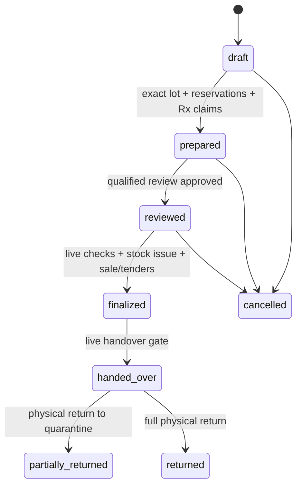

# Pharmacy runtime contract

Source đối chiếu **22/10/2026**, `pharmacy 0.1.0-dev.1`. Đọc [trạng thái triển khai](../architecture/pharmacy-implementation-status.md) trước khi công bố capability hoặc mở pilot. Tài liệu này mô tả source; không xác nhận module đã cài vào database nghiệp vụ.

## 1. Installation và ownership

- Cài/upgrade/bật bằng Core Module Manager; cài/bật Merchandise và Inventory trước. Không chạy migration thô để bỏ qua lifecycle/security/capability.
- Source Inventory `0.5.0` có `inventory.managed_stock.v1`; Purchasing optional `0.2.2` có `purchasing.managed_returns.v1`. Kiểm tra **installed capabilities**, không chỉ đọc version manifest trên đĩa.
- Package chỉ công bố `pharmacy.workspace.v1`. Bootstrap trả readiness/runtime và các cờ bảo thủ. Có source optional adapter không có nghĩa provider production đã được nghiệm thu.
- Không có uninstall dữ liệu nghiệp vụ. Disable cần hết hồ sơ cấp thuốc đang mở và integration processing/uncertain; xử lý recovery và đối soát trước khi tắt.
- Pharmacy sở hữu `ph_*`; Inventory là stock/cost ledger duy nhất; Purchasing là purchasing ledger; Merchandise sở hữu SKU/unit/packaging/barcode. Không viết tay `inv_*`/`pur_*` để sửa sai nghiệp vụ.

Kho nhà thuốc được tag owner. Mọi mutation/replay đi qua `InventoryManagedStockService::withinOwner` với module, pharmacy UUID, actor và action hợp lệ. Policy kiểm tra đúng kho/phạm vi/quyền và trạng thái module; shared generic API và sửa trực tiếp Eloquent warehouse/location/batch không được vượt policy. Inventory generic expiry không tự giải phóng reservation Pharmacy; recovery của Pharmacy giữ liên kết đơn/lô nhất quán.

## 2. Native auth/context

Entry **`/admin/pharmacy/login`**; shell **`/admin/modules/pharmacy/{workspace}`**. Dùng Core admin session, CSRF, login throttle, active/auth-version, bắt buộc đổi mật khẩu và TOTP/recovery hiện hữu. Pharmacy entry hoạt động khi các website đều inactive. Password/logout/2FA đi qua native aliases trong group Pharmacy.

API prefix **`/admin/api/pharmacy`**, middleware `auth:admin`, `admin.active`, `module.enabled:pharmacy`. Không yêu cầu hoặc tin `X-Website-Key` để quyết định native quyền. Phần lớn read cần `pharmacy_id` UUID; tài nguyên được resolve lại theo chain/pharmacy. Nhánh chain cần grant chain, không suy từ quyền một cơ sở.

Quyền hiệu lực là giao giữa Core `pharmacy.*` và native membership active trong chain/pharmacy active. Professional credential còn hiệu lực và phạm vi phù hợp là điều kiện riêng cho review/handover/quality; System Owner không tự có qualification. Chứng cứ qualification hiện là **manual attestation mã hóa**, không tuyên bố đã kiểm tra registry ngoài. Revocation được kiểm tra lại trước write/replay/in/download và tác vụ worker có actor.

Customers mapping kiểm thêm quyền website/book; Accounting mapping kiểm thêm organization. Không dùng membership Pharmacy để cấp quyền ở app khác.

## 3. HTTP/read/command

Response JSON thành công bọc `{ "data": ... }`, `Cache-Control: private, no-store`, `nosniff`. Lỗi validation dùng 422; mất quyền 403; tài nguyên ngoài phạm vi 404; stale version/key/snapshot hoặc trạng thái xung đột 409. Client phải hiển thị lỗi server và đọc lại tài nguyên trước hành động mới.

| API | Contract |
| --- | --- |
| `GET bootstrap?pharmacy_id=UUID` | Identity, chain/pharmacy được phép, cơ sở hiện tại, counters, effective/navigation permissions, readiness và runtime. Khi phải đổi mật khẩu chỉ trả identity tối thiểu. |
| `GET {kind}/{id?}?pharmacy_id=UUID` | Scoped reader; `page>=1`, `per_page=1..100`, `q<=255` nếu reader hỗ trợ; `status/from/to` được áp vào query tương ứng. Ngày `YYYY-MM-DD` theo timezone cơ sở rồi đổi UTC. |
| `POST commands/{operation}` | Body nghiệp vụ, header `Idempotency-Key`; alias `POST commands` nhận thêm `action`. Có thể dùng `data` object, controller flatten trước dispatch. |
| `GET commands/{key}` | Chỉ command của actor hiện tại, kiểm lại quyền scope; trả `unknown` hoặc `committed` cùng resource references. Không trả payload/PHI của command cũ. |
| `POST documents` | Multipart private upload, scope/source/kind theo validator; tối đa 10 MiB, PDF/JPEG/PNG, auth tại nguồn. |
| `GET documents/{id}` | Download private, kiểm lại actor/scope/nguồn/TTL/checksum; không public URL. |
| `GET print-jobs/{id}` | Render private đã kiểm lại quyền và source fingerprint; nguồn đổi thì từ chối bản cũ. |

`kind` có: `products`, `prices`, `units`, `scan`, `patients`, `customers`, `prescriptions`, `dispensings`, `work`, `sales`, `shifts`, `inventory`, `lots`, `trace`, `receipts`, `transfers`, `stocktakes`, `suppliers`, `purchasing`, `quality`, `recalls`, `reports`, `operations`, `settings`, `pharmacies`, `chains`, `counters`, `integrations`, `imports`, `filters`, `price-publications`, `tasks`, `replenishment`, `cash-movements`, `recovery`, `customer-books`, `accounting-organizations`, `accounting-items`. Không phải kind nào cũng có detail/keyword search; validator domain là nguồn contract cuối.

`products/prices` là danh mục active theo chain, giá theo cơ sở, `packagings[]` chứa active revision/factor và giá từng quy cách. `inventory/lots` là balances theo disposition/lô; available loại reserved/quarantine/expired/holds. Người thiếu `pharmacy.cost.view` không nhận giá vốn. `scan` bắt buộc `code`, chỉ ghép các biến thể GTIN tương đương do padding số 0, chỉ trả gợi ý; luôn `allocation_confirmed:false`. Quét hộp giữ `packaging_id`, tên/factor/revision/giá hộp, không thay thành giá một viên. Thiếu giá quy cách thì không đoán giá base.

`reports/operations` trả số cơ sở hiện tại và `sites[]` cùng chain, chỉ những nơi actor có `pharmacy.report.view`. `recalls/{UUID}` cần quyền chain recall, chỉ operational refs/lượng và không trả bệnh nhân/giá vốn. `customer-books` tối đa 100 book active có quyền manager theo website; `accounting-items` cần `organization_id` và quyền tạo/sync chứng từ của organization.

Lệnh `customer.lookup` là read-only: kiểm quyền hiện hành, không ghi command journal, không replay qua key; các mutation dùng contract idempotency dưới đây.

Idempotency key dài 8–120 ký tự `[A-Za-z0-9:_.-]`; cùng actor/key phải cùng operation/payload/scope. Fingerprint canonical và unique actor/key nằm trong transaction. Kiểm quyền/runtime **trước replay**. Effect, journal commit, audit và outbox cùng commit; retry không tạo lần thu/issue/claim thứ hai. Replay chỉ trả references/totals/status/version hạn chế; UI đọc lại scoped resource thay vì trông đợi nguyên response đầu.

`expected_version` là version tài nguyên command nêu; version mới trả trong response. Không tự retry với version mới trên thay đổi nghiệp vụ của người dùng khác. Browser journal chỉ giữ key/operation/resource refs, không lưu patient/Rx/clinical body vào localStorage; chuyển cơ sở hủy dữ liệu màn hình và xử lý giỏ chưa lưu.

## 4. Command families và invariant

| Miền | Operations |
| --- | --- |
| Setup/master | `setup`, `pharmacy.create`, `product.save`, `unit.save`, `price.save`, `membership.save`, `credential.save`, `counter.save`, `settings.save` |
| Patient/Rx | `patient.save`, `patient.lookup`, `prescription.save`, `prescription.verify`, `prescription.transfer`, `prescription.transfer-revoke` |
| Dispensing | `dispensing.create`, `dispensing.update`/`dispensing.lines`, `dispensing.prepare`, `dispensing.review`, `dispensing.cancel`, `dispensing.finalize`, `dispensing.handover`, `dispensing.return`, `dispensing.refund` |
| Workflow/cash | `dispensing.assign`, `dispensing.parties`, `dispensing.counsel`, `dispensing.handover-failed`, `shift.open`, `shift.close`, `shift.cash-movement`, `replenishment.propose` |
| Stock/quality | `receipt.create`, `receipt.inspect`, `quality.hold`, `quality.release`, `quality.disposition`, `quality.destroy`, `quality.supplier-return`, `recall.create`, `recall.confirm`, `recall.reconcile`, `recall.close`, `temperature.record` |
| Network stock | `transfer.create`, `transfer.approve`, `transfer.dispatch`, `transfer.receive`, `stocktake.create`, `stocktake.post` |
| Purchasing | `supplier.save`, `purchasing.create`, `purchasing.approve`, `purchasing.receive`, `purchasing.return` |
| Admin/documents | `import.preview`, `import.commit`, `price.publish`, `filter.save`, `print.create`, `export.create` |
| Adapters/recovery | `connection.save`, `integration.queue`, `integration.reconcile`, `customer.mapping.save`, `customer.save`, `customer.lookup`, `customer.link`, `accounting.mapping.save`, `accounting.draft`, `recovery.resolve` |

Validators nằm tại service operation; không suy API được hỗ trợ chỉ từ menu hoặc permission. Thiếu mapping/capability phải từ chối, không fallback sang app khác.

Luồng cấp thuốc:

Sửa dòng trước thu tiền giải phóng allocations/claims và quay draft; phải chuẩn bị/duyệt lại. Cùng canonical Rx line dùng claim authoritative xuyên chi nhánh, nên hai cơ sở không thể cấp quá lượng. Chuyển quyền đọc đơn cần consent riêng, thời hạn/phạm vi và có thể revoke; không tạo bản sao đơn có hạn mức mới.

Prepare phải đủ lượng theo dòng, chọn exact batch, check expiry/active/increment/holds và Rx remaining. Review/finalize recheck product/price/pack revision, patient/Rx verification và credential; quy cách generic Merchandise vừa đổi khiến finalize 409. Giá/pack/clinical facts ở review và sale được snapshot; thay đổi danh mục sau trả tiền không làm đổi lịch sử. Không tự chia lô theo barcode/FEFO gợi ý mà không xác nhận allocations.

Finalize atomic: đúng ca đang mở của người thu tại cơ sở, tiền đủ, consume đúng reservations, stock/cost issue và sale/tenders, claim `committed_pending_handover`. `finalized` là đã chốt tiền/kho **chưa giao**. Handover chuyển claim `dispensed`. Giao thất bại tạo recovery/evidence, không tự hoàn tiền, nhập lại hoặc khôi phục hạn mức đơn. Physical return và cash refund là hai lệnh có cap, trả hàng luôn cách ly; trả/hoàn không tự cấp lại quyền dùng đơn.

PosNumbers dùng decimal 6 chữ số cho quantity, money nguyên minor có giới hạn, half-up line amount, phân bổ phần dư deterministic; không dùng float để post tiền/tồn. Đơn vị tài chính bản này là VND. Tiền chuyển khoản là ghi nhận có kiểm soát của người dùng, chưa phải bank/provider settlement tự động.

Nhập trực tiếp/Purchasing/điều chuyển/trả khách vào **quarantine**. `receipt.inspect` release chỉ khi không còn receipt chưa được chấp nhận cho batch đó và không có reservation trái điều kiện. Quality disposition không được vượt kiểm nhận/hold. Supplier return nguồn Purchasing phải đi `purchasing.return` để giữ đúng source quantity/cost cap; lệnh quality trả NCC không thay thế ledger Purchasing.

Transfer cùng legal entity, draft trước duyệt bởi actor khác, live approver authority khi xuất; nhận từng phần bởi người khác vào cách ly, sau đó kiểm nhận riêng. Stocktake khóa toàn kho, có count lines/maker-checker, posting có professional gate. Không có tự động điều chuyển liên pháp nhân.

Recall tạo authoritative holds cho batch toàn chain, kể cả zero balance/new sites; confirm là chứng cứ cách ly, chưa phải kết thúc case. `recall.reconcile` cần `pharmacy_id/task_id/expected_version/physical_quantity/reason`, lưu snapshot/chênh lệch. `recall.close` cần case version, lý do và chứng cứ follow-up thủ công được xác nhận; chặn nếu tồn vật lý/ledger, transit, reservation hoặc chờ giao chưa giải quyết, reviewer không còn đủ quyền, snapshot cũ hay integrity issues. **Đóng không release hold**; cơ sở mở sau có `permanent_hold`, lô vẫn bị chặn.

## 5. PHI, documents và retention

Thông tin người bệnh/đơn/tư vấn/parties/chứng cứ chuyên môn được mã hóa tại miền Pharmacy. Tra phone dùng HMAC index có current/previous keys, chuẩn hóa +84/0; không quét giải mã cả bảng, không ghi phone vào URL/journal, không tự merge. Dữ liệu cũ chưa có index cần resave/reindex có kiểm soát trước khi dùng lookup; quản lý rotation với backup keys.

Disk **`pharmacy_private`** tách khỏi `public/files`; bảo đảm path không được web server phục vụ trực tiếp. Không đưa file gốc/PHI vào audit/outbox generic; command journal giữ refs. Upload là private originals; export/print là artifacts có TTL. Prune chỉ xóa export/print hết hạn, **không tự xóa hồ sơ gốc lâm sàng**. Cần chính sách lưu/ủy quyền/key rotation được chủ dữ liệu duyệt trước dữ liệu thật.

`print.create` tạo receipt/dispensing-label/handover từ nguồn được phép; nhãn cần credential/clinical quyền, receipt tài chính chỉ whitelist dòng tiền/sản phẩm. Download/print kiểm lại quyền và hash rendering hiện tại, từ chối job lỗi thời. `export.create` hỗ trợ products/inventory/sales/reports, tối đa 100 dòng, chống CSV formula, TTL mặc định 24h; download cần đúng requester và còn quyền export cùng resource/cost permissions. Đây không phải công cụ export toàn bộ hồ sơ bệnh nhân.

Parser GS1 chỉ hỗ trợ AI 01/10/17/21, HRI/FNC1 và symbology prefix đã kiểm; checksum, duplicate/unknown AI và ngày không hợp lệ bị từ chối. Không hỗ trợ ngày 00 trong AI17 ở luồng này; đối chiếu [GS1 guideline 2D retail, phần healthcare expiry](https://ref.gs1.org/guidelines/2d-in-retail/) trước khi mở rộng. Serial/batch trong mã là gợi ý, không chứng minh nguồn gốc hoặc tự map stock.

## 6. Integrations và background work

Customers mapping chain → website/book là explicit, authority hai miền và consent chia sẻ thương mại riêng. Lookup adapter read-only không ghi payload lookup vào journal. Chỉ danh sách trường thương mại được whitelist; không sao chép dị ứng, bệnh, đơn, hướng dẫn dùng thuốc sang Customers. Patient link không tự gộp profile khác theo số điện thoại.

Accounting mapping theo pháp nhân và product→item, kiểm quyền organization hiện tại; `accounting.draft` tạo **draft** nội bộ từ nguồn sale/return/refund hợp lệ, không auto approve/post hay phát hành Minvoice. Báo cáo nháp không phải chứng từ thuế đã phát hành. Provider thanh toán/hóa đơn, CSDL dược và eRx chưa có transport thực đăng ký mặc định.

`config/pharmacy.php`: `network_enabled=false`, `production_enabled=false`, `transports=[]`, allowlist hosts rỗng. Lưu endpoint/credentials không làm connection sẵn sàng. Registration phải định nghĩa class thực hiện `PharmacyTransport`, loại provider/environment/capability và timeout được xác minh; HTTPS/host policy, không redirects, timeout 1–15s. CSDL dược và đơn thuốc điện tử là hai loại kết nối độc lập, không thay thế nhau.

`DispatchPharmacyWork` được scheduler gọi mỗi phút khi module enabled: outbox/inbox audit thực, recovery claims và dispatch integration. Dispatcher timeout **60s**, budget nội bộ **40s**; provider job timeout **30s**, transport budget **1–15s**, nhỏ hơn queue `retry_after` mặc định **90s**. Nếu đổi queue runtime, vẫn phải giữ timeout nhỏ hơn retry_after và kiểm lease/recovery; không chạy provider transport bằng sync queue trên production. Scheduler phải chạy thật, worker chỉ nhận code/version đã deploy.

Network I/O sau commit, event ID là idempotency key bên ngoài. Crash/timeout sau send thành `uncertain`; dùng reconcile/lookup cùng event, không blind resend hoặc giả success. Worker recheck module/runtime, connection version, actor/scope/nguồn và credentials. Không thử provider production để kiểm tra giao diện. Human evidence dùng để phân loại/đối soát; không tạo remote acknowledgment giả.

`pharmacy:prune-documents --limit=100` chạy hàng giờ. Backup/restore phải bao gồm DB, private originals, keys và integration checkpoints nhất quán; còn cần rehearsal RPO/RTO và alert backlog/uncertain trước go-live.

## 7. Release gates

`controlled`, `cold_chain`, `ecommerce`, `clinical_knowledge` trong bootstrap hiện false; thuốc kiểm soát/chuỗi lạnh không được release sang saleable/cấp/xuất. Ghi nhiệt độ thủ công không có nghĩa IoT/cold-chain đạt chuẩn. `advanced_release` là placeholder bảo thủ, không phải công tắc bỏ qua server guard.

Trước pilot: nghiệm thu nghiệp vụ/pháp lý và qualification, dữ liệu nguồn/tồn đầu, thiết bị/quyền, privacy/retention, provider sandbox nếu cần, backup/restore/worker, đo workload thực rồi rollout 2–3 cơ sở. Trước mở rộng: hot SKU/warehouse concurrency, HTTP/WAN/report/Rx mix, soak/outage/recovery và SLO. Evidence service benchmark 10/50/100 không thay các gate này; full AIO baseline còn lỗi đã phân loại.
