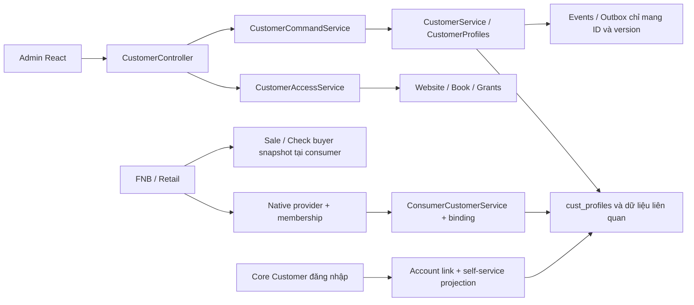

# Customers — kiến trúc và phạm vi đã triển khai

Đây là điểm bắt đầu cho AI/người bảo trì app **Quản lý khách hàng**: hồ sơ dùng chung cho FNB, Retail và tài khoản website trong hệ sinh thái AIO. Đối chiếu source, menu và giao diện ngày **20/10/2026**; manifest Customers `0.1.0`, FNB `0.2.0-dev.3`, Retail `0.1.0-dev.2`. Version trong manifest không chứng minh module đã được cài/nâng trên một database cụ thể.

Hợp đồng HTTP nằm tại [runtime contract](../api/customers-runtime-contract.md). Quy tắc nền tảng nằm tại [bootstrap AIO](../ai-session-bootstrap-prompt.md) và [phân quyền Core](admin-access-control.md). Khi có mâu thuẫn, kiểm source + migration/schema + test tương ứng; snapshot local và kết quả kiểm thử dưới đây chỉ là checkpoint có ngày.

**Việc còn mở ưu tiên cao:** Customers xuất file qua disk `local`, nhưng [cấu hình filesystem](../../config/filesystems.php) hiện đặt disk này trong `public/files`. API download có authorize không bảo vệ một URL tĩnh nếu web server public thư mục đó. Chưa được coi storage export là private hoặc production-ready; xem [giới hạn](#8-giới-hạn-phải-biết). Lượt cập nhật tài liệu này không sửa runtime/storage hay chạy lại rollout.

## 0. Đọc trong 60 giây

1. **Customers giữ master, consumer giữ nghiệp vụ.** App quản lý danh tính/hồ sơ, không sở hữu sale, tiền, công nợ, hóa đơn thuế, điểm thưởng hay chiến dịch.
2. **Book là vùng chia sẻ dữ liệu trong website.** Chi nhánh/outlet do app nguồn quản lý; không thêm branch/tenant scope vào Core.
3. **Ba lớp quyền khác nhau.** App quản trị dùng Core permission + book grant; consumer dùng native permission/membership + binding ability; tài khoản website chỉ xem profile đã link. Menu và UUID không cấp quyền.
4. **Chuyển nguồn là thao tác tường minh.** Binding mới vẫn `legacy`; phải preview → nhập theo đợt → cutover. Đã shared mà Customers không sẵn sàng thì chặn phần cần khách hàng, không fallback local. Giao dịch khách lẻ vẫn được phép theo consumer.
5. **Retry không tạo ý định mới.** Giữ cùng command key/body, kiểm quyền lại và dùng expected version; không lưu payload PII trong browser journal.
6. **Snapshot quá khứ không đổi theo master.** Merge tạo alias, giữ nguồn và chứng từ; không tự hợp nhất consent, credentials hay Accounting party.
7. **UI đã có bốn page và drawer/form riêng.** Menu chính thay tab cấp app; trang Tổng quan chất lượng dữ liệu và phân nhóm động mới là đề xuất, chưa triển khai.

Trình tự đọc theo việc cần làm:

| Công việc | Đọc tiếp |
| --- | --- |
| Hiểu phạm vi, ownership, quyền | Mục 1–6 tài liệu này |
| Tìm file cần sửa, bảo trì React | [Bản đồ source](#9-bản-đồ-source-cho-ai-bảo-trì), [giao diện và state](#10-giao-diện-hiện-hành-và-quy-tắc-bảo-trì) |
| Gọi API/thêm consumer | [Runtime contract](../api/customers-runtime-contract.md), mục 4 và 11 tài liệu này |
| Cài/nâng, chạy worker, xác minh release | Mục 7–8; phân biệt lệnh đọc trạng thái và lệnh có tác động |



## 1. Trách nhiệm và định danh

Customers sở hữu hồ sơ khách dùng chung theo **nhóm dữ liệu khách hàng** (`book`), liên hệ, địa chỉ, nhãn, quan hệ, consent, định nghĩa/giá trị trường mở rộng, source mappings và liên kết tới tài khoản website. Có app quản trị riêng tại `/admin/modules/customers` và thành phần chọn/tạo nhanh có thể nhúng vào consumer.

Điều hướng quản trị sử dụng menu chính của app, không lặp lại bằng tab trong nội dung. Các trang có URL riêng, hỗ trợ tải lại và lịch sử trình duyệt:

| Menu | URL | Quyền menu |
| --- | --- | --- |
| Danh bạ | `/admin/modules/customers` | `customers.view` |
| Hồ sơ trùng | `/admin/modules/customers/duplicates` | `customers.view` và `customers.merge` |
| Nhập & xuất | `/admin/modules/customers/data` | `customers.view` và ít nhất một trong `customers.import`, `customers.export` |
| Thiết lập | `/admin/modules/customers/settings` | `customers.view` và `customers.settings` |

Manifest dùng `permission` kết hợp AND với nhóm OR `permissions_any`; navigation và liên kết nhanh Dashboard áp dụng cùng quy tắc. Quyền menu không thay thế kiểm tra book grant và quyền API. Trong danh bạ không có quyền tương ứng, trang hiển thị thông báo giới hạn quyền; riêng Nhập & xuất chỉ hiển thị thao tác được cấp.

| Đối tượng | Chủ sở hữu và ý nghĩa |
| --- | --- |
| `App\Models\Customer`, bảng `customers` | Core giữ tài khoản đăng nhập website, password, session và email unique hiện hữu. Không đổi thành bảng master B2B/B2C; khách tại quầy không bắt buộc tạo account. |
| `cust_profiles` | Customers giữ master `person\|company`, UUID public ổn định, mã trong book, trạng thái và version. Phone/email không unique giữa các hồ sơ. |
| `cust_books` và grants | Partition nội bộ module gắn website; không phải core tenant hoặc pháp nhân kế toán. Hai consumer chỉ dùng chung khi binding tường minh tới cùng book. |
| Local customer FNB/Retail | Giữ ID nguồn và lịch sử đã có; adapter/mapping điều phối chuyển sang master. Không gộp bằng phone/email. |
| `AcctParty`, `AcctPartySource` | Accounting giữ đối tác và quan hệ `customer\|supplier\|both` theo organization, thông tin kế toán và chứng từ. Công ty khách hàng không đồng nghĩa `AcctOrganization` vận hành AIO. |
| Giao dịch, tài chính, chương trình khách hàng | Sale/return/payment tại consumer; AP tại Purchasing/Accounting. Loyalty, ví, voucher, campaign, lead/opportunity và ticket/SLA tiếp tục thuộc app nghiệp vụ riêng. |

Nguồn: [manifest Customers](../../modules/Customers/module.json), [schema](../../modules/Customers/database/migrations/2026_10_20_300000_create_customer_master_tables.php), [tài khoản Core](../../app/Models/Customer.php), [AcctParty](../../app/Models/AcctParty.php), [source Accounting](../../app/Models/AcctPartySource.php).

## 2. Phân quyền nhiều lớp

Admin API dùng Core identity/session, `admin.active`, website context và permission module. Customers kết hợp **core permission + book grant** (`reader|editor|manager`). Global `customers.settings` bỏ qua yêu cầu book grant trong website hiện hành nhưng vẫn cần permission của thao tác; role thường phải có grant book. Không thêm scope branch vào Core, không mở rộng whitelist organization scope Accounting cho Customers.

- Trong Admin Customers API, quyền đọc danh bạ khác quyền thông tin nhạy cảm. Không có `customers.sensitive` thì phone/email được che; ghi chú, ngày sinh, địa chỉ và field nhạy cảm được giới hạn theo projection. Gateway ủy quyền cho consumer có contract projection riêng; consumer chịu trách nhiệm che dữ liệu khi trả response theo quyền native, không mặc định cần role Customers trung tâm cho thu ngân.
- Quyền cấu hình/import/export/merge/account-link/consent là các quyền riêng. Grant book không gán role Core hoặc quyền native cho consumer.
- `CustomerAccessService` kiểm actor active, trạng thái yêu cầu đổi mật khẩu, auth version và quyền website. Mutation/replay kiểm lại quyền hiện hành ở service, không chỉ tại middleware.
- Consumer được ủy quyền qua binding đã cấu hình, vẫn phải kiểm permission/membership native; không tự có quyền toàn book vì biết một UUID.
- Retail cấu hình binding toàn chain cần `retail.setup.manage` global và membership HQ còn hiệu lực; xem khách tại một branch không đủ quyền chuyển nguồn toàn chain.
- Runtime barrier bền vững phối hợp mutation và lifecycle. Shared mode phải fail closed khi Customers/book không sẵn sàng, không đọc/ghi lại local customer để tiếp tục ngầm.

Nguồn: [CustomerAccessService](../../modules/Customers/Services/CustomerAccessService.php), [command journal](../../modules/Customers/Services/CustomerCommandService.php), [consumer gateway](../../modules/Customers/Services/ConsumerCustomerService.php), [Retail provider](../../modules/RetailPos/Services/RetailCustomersProvider.php), [config consumer](../../config/customers.php).

## 3. Mô hình dữ liệu và khả năng hiện có

| Nhóm | Hành vi trong source |
| --- | --- |
| Hồ sơ | Danh sách phân trang/lọc/tìm; bộ lọc riêng theo Admin/book lưu trên server; person/company; mã unique trong book; create/update có expected version; archive/restore; alias sau merge. |
| Liên hệ | Nhiều phone/email, giữ giá trị gốc và normalized; chuẩn hóa VN về dạng `+84…`, email chữ thường; số nước ngoài cần dấu `+`. Không xác minh quyền sở hữu phone/email bằng normalization. |
| Địa chỉ/nhãn/quan hệ | Địa chỉ shipping/billing/both, nhãn, quan hệ giữa hồ sơ cùng book có vai trò và ngày hiệu lực. Không phải workflow pháp lý xác nhận quyền đại diện công ty. |
| Consent | Append-only theo purpose/channel/brand/state/policy_version/source/time; trạng thái unknown/granted/denied/withdrawn; grant yêu cầu policy_version. Evidence lưu mã hóa, không đưa vào payload sự kiện. |
| Trường mở rộng | Namespace/key, text/number/date/boolean/select, required/sensitive/searchable/status/version. Giá trị mã hóa; field searchable không nhạy cảm có search_value trong phạm vi book và index tìm prefix. Required kiểm tại `CustomerProfiles::save` (create/update, import, consumer, migration), kể cả khi request không gửi custom_fields; không phải mọi mutation như archive/consent. Không cho đổi type khi đã có dữ liệu. |
| Nhập dữ liệu | JSON rows, preview và commit tạo mới; lỗi theo dòng; duplicate contact được xử lý theo contract hiện hành, không tự merge. Không phải công cụ cập nhật hàng loạt theo phone. |
| Xuất | CSV qua queue, lease worker, artifact từng lượt, checksum, expiry và reauthorization tại API/worker. Lấy toàn book, gồm active/archived/merged, không áp filter UI. Sáu cột code/type/name/phone/email/status. Storage hiện dùng disk local có vấn đề public root nêu tại mục 8. |
| Hợp nhất | Hai hồ sơ active cùng book/cùng loại, kiểm version cả hai; nguồn thành alias, mappings chuyển về survivor. Có field_choices tường minh; consent về unknown hoặc withdrawn để không nới quyền. Giữ provenance nguồn; không tự gộp credentials hay tài khoản. |
| Tài khoản website | Admin có quyền tạo invitation ràng buộc account đích; khách đăng nhập đúng account, nhập token và mật khẩu hiện tại để chấp nhận. Tự xem/sửa projection cho phép và consent trong website hiện hành. |

`CustomerProfiles` là persistence/projection nội bộ; entry point công khai phải đi qua `CustomerService`, consumer gateway hoặc account-link service đã authorize. Không dùng thẳng `CustomerProfiles` trong route mới để bỏ qua book grants. Nguồn: [profiles](../../modules/Customers/Services/CustomerProfiles.php), [service](../../modules/Customers/Services/CustomerService.php), [bộ lọc riêng](../../modules/Customers/Services/CustomerSavedFilterService.php), [import](../../modules/Customers/Services/CustomerImportService.php), [export](../../modules/Customers/Services/CustomerExportService.php), [account links](../../modules/Customers/Services/CustomerAccountLinkService.php).

## 4. Tích hợp consumer và chuyển đổi

`CustomerConsumerProvider` đăng ký tại `config/customers.php`; provider phải authorize ngoài HTTP bằng actor/context hiện hành. `bindingScope` xác định partition của consumer, `legacyProfiles` cung cấp dữ liệu nguồn. Gateway hỗ trợ status, lookup, create/update, profile/snapshot, resolveLegacy, legacyIds và profileIds cho alias history.

Đây chưa phải cơ chế cắm consumer bất kỳ chỉ bằng config. `CustomerIntegrationService::consumerScope` hiện xử lý riêng `fnb-pos/website` và `retail-pos/chain`; validator binding chỉ nhận website/chain, settings options cũng chỉ liệt kê hai app này. Muốn thêm app phải mở rộng/refactor cả đường cấu hình, resolve native scope và kiểm thử, không chỉ implement interface.

| Consumer | Binding bền vững | Context thao tác | Lịch sử |
| --- | --- | --- | --- |
| Retail | `scope_type=chain`, `scope_key=chain public UUID` | Branch public UUID; permission + membership chain/branch + website | Sale giữ legacy customer_id, thêm shared_customer_id và buyer_snapshot. History union source mappings và alias IDs, chỉ branch được phép. |
| FNB | `scope_type=website`, `scope_key=website_key` | Outlet native context; quyền consumer và staff/outlet membership | FNB 0.2.0-dev.3 giữ local profile và buyer snapshot cũ; thêm shared ID trên session/check, nối history qua numeric source IDs và alias UUID. Notes/ngày sinh/consent riêng FNB không được tự nâng thành consent toàn book. |

Trạng thái mặc định là **legacy**. Tạo binding chưa chuyển nguồn. Luồng vận hành: cấu hình book/grants → bind consumer → preview migration → xử lý dữ liệu/cảnh báo → commit theo lô tối đa 500 hồ sơ mới → cutover tường minh khi `has_more=false`. Nguồn đã mapping nhưng đổi hash trong thời gian còn legacy chặn cutover để đối soát. Không đổi mode bằng sửa DB tay. Shared mode đã bật phải dùng Customers; disable/thiếu capability/book archived trả trạng thái không ready, không fallback local. Retail/FNB vẫn cho giao dịch khách lẻ không gắn hồ sơ; quote đã gắn shared customer phải kiểm readiness trước thanh toán.

Retail customer master cũ thuộc chain; nhiều branch cùng chain dùng cùng binding. FNB profile cũ thuộc website, có unique phone/core_customer_id theo website. Vì vậy không áp cấu trúc nhiều book theo từng outlet lên schema FNB cũ mà không qua adapter/migration. Không suy identity từ tên, phone hoặc email; source ID mới là lineage di trú.

Nguồn: [integration service](../../modules/Customers/Services/CustomerIntegrationService.php), [interface](../../modules/Customers/Contracts/CustomerConsumerProvider.php), [Retail sale service](../../modules/RetailPos/Services/RetailService.php), [FNB provider](../../modules/FnbPos/Services/FnbCustomersProvider.php).

## 5. Snapshot và Accounting

Retail chụp buyer snapshot khi tạo quote và không lấy tên/liên hệ master mới để viết lại sale khi complete. Sale shared kiểm lại readiness/identity trước tác động tồn/thu tiền. Thiếu quyền Retail customer.view thì response sale che phone/email trong snapshot. History sau merge theo cả UUID canonical và aliases, không sửa shared_customer_id lịch sử.

Adapter Accounting là thao tác **explicit source link**: đúng branch/book, mapping pháp nhân Retail → Accounting organization, quyền native `accounting.party.manage` và `accounting.integration.sync`, module/org active. Nó tạo một `AcctParty` cùng `AcctPartySource` cho profile nguồn; key retry không tạo lần hai và không ghi đè master Accounting đã chỉnh sửa. Audit chỉ có ID/thông tin kết quả, không copy PII vào audit payload.

Đây không phải đồng bộ hai chiều, không tự hợp nhất các đối tác kế toán sau merge Customers và không tạo payment/chứng từ thuế. Bridge sale nội bộ Retail giữ source buyer snapshot trong metadata; quy trình kế toán và phân loại thuế tiếp tục thuộc Accounting. Nguồn: [adapter](../../modules/RetailPos/Services/RetailCustomerAccountingAdapter.php), [Retail forward migration](../../modules/RetailPos/database/migrations/2026_10_20_200003_add_shared_customer_sale_snapshots.php), [Accounting bridge](../../modules/RetailPos/Services/RetailAccountingBridge.php).

## 6. Sự kiện và phần mở rộng

Mutation tạo `cust_events`; các destination module có shared binding nhận `cust_outbox_deliveries`. Dispatcher phát event nội bộ `CustomerChanged` với eventId, destination, website, profile UUID, type, aggregate version và changedFields; **không broadcast contact data**.

- Delivery có retry; extension phải deduplicate bằng eventId + destination và xử lý version cũ. Không có bảo đảm exactly-once cho side effect ngoài DB.
- Module đích disabled hoặc listener lỗi giữ failed/retry theo giới hạn trong source; đây không phải webhook công khai hay cơ chế gọi mạng đã xác minh.
- Listener cần đọc qua service có grant/context phù hợp. Event không cấp quyền đọc hồ sơ, không dùng Admin #1 làm quyền mặc định.
- `delivered` xác nhận dispatch/listener nội bộ không ném lỗi; không chứng minh một hệ thống bên ngoài đã nhận hoặc tồn tại listener nghiệp vụ ở mọi app.

Nguồn: [CustomerChanged](../../modules/Customers/Events/CustomerChanged.php), [outbox](../../modules/Customers/Services/CustomerOutboxService.php), [scheduler](../../routes/console.php).

## 7. Cài đặt, rollout và kiểm chứng

### 7.1. Thứ tự schema và chuyển đổi

1. Sao lưu DB/storage/config theo quy trình AIO, lưu revision/module versions; rehearsal trên DB clone trước rollout sang môi trường khác.
2. Chạy migration **Core** trước. Cài/bật/nâng Customers và consumer qua App Store/`ModuleManager`, không tự aggregate toàn bộ migration module. [AppServiceProvider](../../app/Providers/AppServiceProvider.php) chỉ nạp migration module hàng loạt khi `runningUnitTests()`.
3. Customers không hard-depend FNB/Retail/Accounting; credentials Core giữ riêng. Nâng consumer qua lifecycle để nhận schema/version mới trước khi tạo shared binding.
4. Cấp Core role và book grant tối thiểu; thử reader/editor/manager riêng. Kiểm native permission và HQ membership trước bind/migrate.
5. Preview → xử lý mã/contact conflict → commit theo lô → preview lại → cutover khi hết dữ liệu và nguồn nhất quán. Đối chiếu row count/mappings, legacy IDs và giao dịch trước/sau. Không sửa `mode`/version/lineage trực tiếp để vượt chặn.
6. Kiểm storage export và worker/scheduler theo 7.2 và mục 8 trước khi cho phép xuất dữ liệu thực hoặc gọi deployment là sẵn sàng.

| Migration Customers | Vai trò |
| --- | --- |
| `2026_10_20_300000_create_customer_master_tables.php` | Master, grants, mapping, consent, journal/outbox/export và cài runtime barrier |
| `2026_10_20_300001_add_customer_account_link_recipient.php` | Ràng buộc invitation với Core account đích |
| `2026_10_20_300002_add_customer_command_authorization.php` | Metadata để authorize khi đọc/replay command |
| `2026_10_20_300003_add_customer_export_leases.php` | Lease token/expiry chống hai worker publish cùng export |
| `2026_10_20_300004_add_customer_filters_and_field_search.php` | Saved filters mã hóa và index search value |

Migrations nằm trong [thư mục module](../../modules/Customers/database/migrations). Consumer cần [FNB 000016](../../modules/FnbPos/database/migrations/000016_add_fnb_shared_customers.php) và [Retail 200003](../../modules/RetailPos/database/migrations/2026_10_20_200003_add_shared_customer_sale_snapshots.php). Không sửa migration đã chạy; thay đổi schema tiếp theo cần forward migration. Hook chặn uninstall không bảo vệ dữ liệu nếu vận hành viên gọi raw `down()`/`migrate:refresh` ngoài lifecycle.

### 7.2. Đọc trạng thái và chạy nền

Các lệnh chỉ đọc để hiểu môi trường, không tự thực hiện recovery:

```sh
php artisan migrate:status
php artisan modules:lifecycle customers --json
php artisan schedule:list
```

`modules:lifecycle` chỉ đọc khi **không truyền `--resume`**. Endpoint `GET /admin/api/modules` với Admin có `store.module.view` cho installed/latest version và status; manifest mới không đồng nghĩa installation đã nâng. Đối chiếu `module_installations`, `cust_runtime_states` và `module_lifecycle_operations` khi có operation dở dang. Không chỉnh các bảng này để tự mở barrier.

Các lệnh dưới đây **có tác động** lên job/sự kiện/file, chỉ chạy khi đang thực hiện nhiệm vụ vận hành đúng môi trường:

```sh
php artisan queue:work
php artisan schedule:run
php artisan customers:dispatch-events --limit=100
php artisan customers:prune-exports
```

- Export được dispatch after-commit; job `tries=3`, `timeout=180` giây, lease năm phút, nhường lại sau 30 giây khi worker khác đang giữ lease. Kiểm timeout của worker và `retry_after` của queue trong deployment; [config queue](../../config/queue.php) hiện mặc định database `retry_after=90`, không mặc nhiên phù hợp với timeout job 180 giây.
- Scheduler dispatch outbox mỗi phút; limit được clamp 1–500, tối đa tám attempts, lỗi chờ năm phút. Chưa có UI/API phục hồi riêng cho delivery đã hết attempts; không gọi `delivered` là xác nhận webhook bên ngoài.
- Prune chạy mỗi giờ, tối đa 500 exports/lượt. Retention mặc định 24 giờ từ [config Customers](../../config/customers.php); expiry của API không đồng nghĩa file đã được xóa vật lý đúng giây đó. Không dùng prune để giải quyết vấn đề storage nằm trong public root.
- Giữ app key và policy sao lưu phù hợp vì custom values, consent evidence, saved filters phụ thuộc mã hóa. Không suy rằng mọi PII/contacts/snapshot trong hệ sinh thái đều mã hóa chỉ vì có các cột mã hóa này.

### 7.3. Kiểm thử theo phần thay đổi

| Nhóm | File/ý nghĩa |
| --- | --- |
| Master, contacts, merge, consent | [CustomersModuleTest](../../tests/Feature/CustomersModuleTest.php) |
| Access, command replay, recipient/self-service | [CustomersAccessAndPortalTest](../../tests/Feature/CustomersAccessAndPortalTest.php) |
| Fields/search, saved filters, leases, merge choices, outbox | [CustomersAdvancedTest](../../tests/Feature/CustomersAdvancedTest.php) |
| Preview/batches/hash/cutover/native configure | [CustomersMigrationTest](../../tests/Feature/CustomersMigrationTest.php) |
| FNB adapter và snapshot/history/disable | [FnbCustomersIntegrationTest](../../tests/Feature/FnbCustomersIntegrationTest.php), các regression FNB liên quan |
| Retail shared identity, branch, snapshot, Accounting | [RetailSharedCustomersTest](../../tests/Feature/RetailSharedCustomersTest.php), các regression Retail liên quan |
| Menu AND/OR, Dashboard links, API không được cấp quyền từ menu | [ModuleNavigationPermissionsTest](../../tests/Feature/ModuleNavigationPermissionsTest.php) |
| Portal login Core vẫn hoạt động | [CustomerPortalTest](../../tests/Feature/CustomerPortalTest.php), [AuthSplitTest](../../tests/Feature/AuthSplitTest.php) |
| CSV/serializer/merge choices/retry/filter và binding JSX | [customers-domain-unit.test.js](../../tests/UnitJavaScript/customers-domain-unit.test.js), [customers-component-bindings.test.js](../../tests/UnitJavaScript/customers-component-bindings.test.js) |

Chạy từ repository root, ép database test riêng để không kế thừa cấu hình DB nghiệp vụ từ shell. Các feature tests có `RefreshDatabase`; không đổi các biến sau thành database có dữ liệu cần giữ:

```sh
APP_ENV=testing DB_CONNECTION=sqlite DB_DATABASE=:memory: DB_URL='' \
CACHE_STORE=array SESSION_DRIVER=array QUEUE_CONNECTION=sync \
php -d memory_limit=256M vendor/bin/phpunit --do-not-cache-result \
  tests/Feature/CustomersModuleTest.php \
  tests/Feature/CustomersAccessAndPortalTest.php \
  tests/Feature/CustomersAdvancedTest.php \
  tests/Feature/CustomersMigrationTest.php \
  tests/Feature/FnbCustomersIntegrationTest.php \
  tests/Feature/RetailSharedCustomersTest.php \
  tests/Feature/ModuleNavigationPermissionsTest.php \
  tests/Feature/CustomerPortalTest.php

node --test tests/UnitJavaScript/customers-component-bindings.test.js tests/UnitJavaScript/customers-domain-unit.test.js
npm run build
```

MySQL lifecycle smoke là lệnh riêng, không thay bằng cách trỏ PHPUnit aggregate migrations vào MySQL:

```sh
php tests/Support/customers-mysql-gates.php --allow-isolated-mysql
```

Đọc [script](../../tests/Support/customers-mysql-gates.php) và connection trước chạy. Script yêu cầu local MySQL không read/write routing cùng quyền CREATE/DROP **scratch database**; tạo tên ngẫu nhiên `aio_customers_gate_<hex>`, marker nonce, boot worker riêng, Core migrate rồi module lifecycle, dọn trong `finally`. Nó kiểm integration/lifecycle và export trên root tạm; không chứng minh storage hiện hành là private, khả năng chịu tải hay tranh chấp nhiều process ở mọi nghiệp vụ.

Checkpoint kiểm chứng đã ghi nhận ngày 20/10/2026:

| Checkpoint | Kết quả và giới hạn |
| --- | --- |
| Release Customers + consumer + Core liên quan | 22 file, 206 tests / 2.623 assertions pass; không phải toàn AIO suite |
| MySQL standalone | 6 gates / 42 assertions pass; scratch DB/export được dọn; root storage test đã override |
| JavaScript trước chỉnh giao diện | 54/54 pass trên nhóm JS đã chạy khi triển khai ban đầu |
| Menu Customers | 3 feature tests / 35 assertions pass |
| Sau redesign UI | 15 tests JS Customers pass, production build pass; build có warning chunk lớn hiện hữu |
| Trình duyệt | Ban đầu có workflow trên SQLite cô lập; sau redesign đã xem đủ bốn page, search/reset/empty, form validation và đổi tab liên hệ/hủy. Không đồng nghĩa kiểm thử mọi thiết bị, commit import/merge hay tải lớn |

Đợt cập nhật tài liệu này chỉ đối chiếu source và liên kết tài liệu; **không chạy lại các suite hoặc xác minh lại database**. Kết quả lịch sử không thay cho chạy kiểm thử phù hợp trên revision kế tiếp.

### 7.4. Snapshot local đã ghi nhận, không phải mặc định của mọi installation

Trong đợt triển khai ngày 20/10/2026, local DB `aio` đã cài/bật Customers `0.1.0`, nâng FNB `0.2.0-dev.3` và Retail `0.1.0-dev.2`. Ba profile FNB đã mapping/cutover sau dry-run; hash legacy profiles/check snapshots và số tài khoản login không đổi. Retail lúc đó chưa có chain nên chưa cutover. Không seed lại ba profile này, không mặc định book ID/tên/chain count và không áp snapshot local cho môi trường khác. Luôn đọc runtime hiện hành theo 7.2.

## 8. Giới hạn phải biết

- **Storage export chưa được chứng minh private:** [BuildCustomerExport](../../modules/Customers/Jobs/BuildCustomerExport.php), [CustomerExportService](../../modules/Customers/Services/CustomerExportService.php) và prune đều dùng disk `local`; [config/filesystems.php](../../config/filesystems.php) hiện đặt root tại `public_path('files')`. Nếu web server phục vụ tĩnh thư mục đó, API authorize/expiry không chặn đường truy cập file tĩnh. Cần sửa theo disk riêng ngoài web root và kiểm chứng server/legacy artifacts trong một thay đổi triển khai phù hợp trước production. Không đổi global disk `local` một cách mù quáng vì các app khác cũng dùng; không mở/xuất dữ liệu thực chỉ để thử. Lượt audit tài liệu chưa gọi URL tĩnh hoặc kiểm chứng truy cập ẩn danh, nên đây là sai lệch cấu hình đã xác nhận và rủi ro cần xử lý, không phải kết luận đã có bên ngoài đọc dữ liệu.
- **Có lệch giới hạn cấu hình/UI:** `config('customers.import_limit')` có mặc định 1.000 nhưng validator import hiện hardcode 1.000; đổi config một mình chưa thay contract. Tên saved filter API tối đa 80 ký tự, UI đang cho nhập 100 nên 81–100 có thể trả 422. Đợt tài liệu không sửa các behavior này.
- Không có self-service xóa toàn bộ dữ liệu/anonymization/retention hold đầy đủ. Archive không phải erasure; snapshot và journal consumer có chính sách lưu riêng.
- CSV là danh sách sáu cột của toàn book, không theo filter trên UI; không phải bản xuất toàn bộ dữ liệu cá nhân gồm consent/địa chỉ/custom fields. Worker đọc chunk 200 lúc chạy; chưa phải snapshot nhất quán toàn book giữa nhiều transaction đồng thời.
- Namespace trường hiện là cấu hình của manager; không phải marketplace extension có publisher signing/namespace ownership enforcement. Searchable chỉ lập index prefix cho giá trị không nhạy cảm, không phải full-text/filter engine cho mọi field.
- Chuyển field từ optional sang required chưa phải backfill/revalidate toàn bộ giá trị lịch sử. Khi request omit key, kiểm tra required hiện dựa vào row value đã tồn tại; không suy rằng mọi giá trị cũ đều đã được kiểm lại theo định nghĩa mới.
- Quick-create tại POS nhận tập field tối thiểu. Nếu book có custom field bắt buộc mà consumer không cung cấp, tạo nhanh/di trú trả lỗi để bổ sung qua app Customers; cần rà cấu hình book trước cutover.
- Merge chỉ thay các field được chọn; combine áp dụng contacts/addresses/tags, không có unmerge hoàn chỉnh. Liên kết tài khoản và mapping kế toán cần xử lý riêng.
- Không tự gửi invitation qua email/SMS; token hiển thị một lần, admin chuyển qua kênh được phép. Không dùng email/phone trùng để xác minh account.
- Chưa kiểm capacity lớn, thiết bị/production pilot, khôi phục thảm họa hay đầy đủ yêu cầu pháp lý theo từng môi trường. Cần kiểm thử/đánh giá riêng trước rollout.

## 9. Bản đồ source cho AI bảo trì

### 9.1. Backend và ownership dữ liệu

| Cần hiểu/sửa | Entry point và trách nhiệm |
| --- | --- |
| Đăng ký app, version, capability, menu, quyền | [module.json](../../modules/Customers/module.json); [CustomerLifecycleHook](../../modules/Customers/Hooks/CustomerLifecycleHook.php) tạo roles `customers.reader/editor/manager`, không tự gán role cho mọi Admin |
| Admin HTTP | [routes module](../../modules/Customers/routes.php), [CustomerController](../../modules/Customers/Http/CustomerController.php), được ghép trong [routes/admin.php](../../routes/admin.php) |
| Actor/website/book grant/runtime | [CustomerAccessService](../../modules/Customers/Services/CustomerAccessService.php), [CustomerRuntimeState](../../modules/Customers/Services/CustomerRuntimeState.php) |
| Command retry và authorize trước replay/status | [CustomerCommandService](../../modules/Customers/Services/CustomerCommandService.php); journal references và fingerprint, không phải bản sao hồ sơ |
| Use case quản trị | [CustomerService](../../modules/Customers/Services/CustomerService.php): book/profile/timeline/consent/relationships/fields/grants/duplicates/merge |
| Persistence/projection/normalize/search | [CustomerProfiles](../../modules/Customers/Services/CustomerProfiles.php); service nội bộ, không phải entry point được phép bỏ qua authorization |
| Consumer API nội bộ | [ConsumerCustomerService](../../modules/Customers/Services/ConsumerCustomerService.php): native authorization + binding + projection/snapshot |
| Binding và di trú | [CustomerIntegrationService](../../modules/Customers/Services/CustomerIntegrationService.php), [provider interface](../../modules/Customers/Contracts/CustomerConsumerProvider.php), [registry config](../../config/customers.php) |
| CSV vào/ra | [CustomerImportService](../../modules/Customers/Services/CustomerImportService.php), [CustomerExportService](../../modules/Customers/Services/CustomerExportService.php), [BuildCustomerExport](../../modules/Customers/Jobs/BuildCustomerExport.php); kiểm cả filesystem config trước khi gọi artifact private |
| Bộ lọc riêng | [CustomerSavedFilterService](../../modules/Customers/Services/CustomerSavedFilterService.php): mã hóa bộ lọc, scope actor/book, không public segment |
| Tài khoản website | [CustomerAccountLinkService](../../modules/Customers/Services/CustomerAccountLinkService.php), [CustomerPortalController](../../modules/Customers/Http/CustomerPortalController.php), [routes/web.php](../../routes/web.php) |
| Event và retention | [CustomerChanged](../../modules/Customers/Events/CustomerChanged.php), [CustomerOutboxService](../../modules/Customers/Services/CustomerOutboxService.php), [routes/console.php](../../routes/console.php) |

Các nhóm bảng để định vị schema, không thay thế validation/service:

| Nhóm | Bảng |
| --- | --- |
| Vùng dữ liệu và quyền | `cust_books`, `cust_book_grants` |
| Master và projection | `cust_profiles`, `cust_contacts`, `cust_addresses`, `cust_profile_tags`, `cust_relationships` |
| Chia sẻ và lineage | `cust_bindings`, `cust_sources` |
| Consent và mở rộng | `cust_consents`, `cust_field_definitions`, `cust_field_values` |
| Core account linkage | `cust_account_links`, `cust_account_link_requests`; FK tới bảng Core `customers`, không đổi credentials |
| Journal/async/runtime | `cust_commands`, `cust_events`, `cust_outbox_deliveries`, `cust_exports`, `cust_runtime_states` |
| Bộ lọc cá nhân | `cust_saved_filters` |

`public_id` là định danh giao tiếp khi contract yêu cầu UUID; các FK integer giữ nội bộ. `cust_sources` nhận identity từ module/scope/source ID; phone/email không phải identity nguồn. Không tạo cross-module FK từ shared UUID sang bảng optional để ép cài app khác.

### 9.2. Consumer và UI

| Phần | File bắt đầu |
| --- | --- |
| FNB adapter/native authority | [FnbCustomerDirectory](../../modules/FnbPos/Services/FnbCustomerDirectory.php), [FnbCustomersProvider](../../modules/FnbPos/Services/FnbCustomersProvider.php), [FnbCustomerService](../../modules/FnbPos/Services/FnbCustomerService.php) |
| Retail adapter/native authority | [RetailCustomersProvider](../../modules/RetailPos/Services/RetailCustomersProvider.php), [RetailService](../../modules/RetailPos/Services/RetailService.php) |
| Accounting explicit link | [RetailCustomerAccountingAdapter](../../modules/RetailPos/Services/RetailCustomerAccountingAdapter.php); command journal thuộc Retail, không khôi phục qua Customers command-status API |
| Chọn module page trong Admin | [ModuleRoutePage](../../resources/admin/src/pages/modules/ModuleRoutePage.jsx), [AdminLayout](../../resources/admin/src/layouts/AdminLayout.jsx), [ModuleRegistry](../../app/Core/Modules/ModuleRegistry.php) |
| Page shell, book context, directory | [CustomersManagerPage](../../resources/admin/src/modules/customers/pages/CustomersManagerPage.jsx) |
| Form/drawer/links/merge | [CustomerProfileEditor](../../resources/admin/src/modules/customers/components/CustomerProfileEditor.jsx), [CustomerProfileDrawer](../../resources/admin/src/modules/customers/components/CustomerProfileDrawer.jsx), [CustomerLinksPanel](../../resources/admin/src/modules/customers/components/CustomerLinksPanel.jsx), [CustomerDuplicates](../../resources/admin/src/modules/customers/components/CustomerDuplicates.jsx) |
| Nhập/xuất và thiết lập | [CustomerDataTools](../../resources/admin/src/modules/customers/components/CustomerDataTools.jsx), [CustomerBookSettings](../../resources/admin/src/modules/customers/components/CustomerBookSettings.jsx) |
| HTTP/retry/serializer UI | [customersApi.js](../../resources/admin/src/modules/customers/api/customersApi.js), [customerData.js](../../resources/admin/src/modules/customers/utils/customerData.js) |
| Picker nhúng ở POS | [CustomerPicker](../../resources/admin/src/modules/customers/components/CustomerPicker.jsx); nhận callback adapter, không query mọi book trực tiếp |
| Self-service website | [SharedCustomerProfiles](../../resources/customer/src/components/SharedCustomerProfiles.jsx), [CustomerLayout](../../resources/customer/src/layouts/CustomerLayout.jsx), [AccountOverviewController](../../app/Http/Controllers/Customer/Api/AccountOverviewController.php) |

## 10. Giao diện hiện hành và quy tắc bảo trì

Redesign ngày 20/10/2026 đã có trong source, không phải mockup: hero xanh ngọc đậm, bộ chọn danh bạ, context quyền, các card nội dung và typography đồng bộ. Không thêm số liệu mẫu để lấp bố cục.

| Page/view | Hành vi đã có |
| --- | --- |
| Danh bạ | Ba chỉ số dữ liệu thật; search, trạng thái/loại/nhãn, bộ lọc riêng, đặt lại; bảng responsive với liên hệ, trạng thái, mở hồ sơ/chỉnh sửa/lưu trữ/khôi phục theo quyền |
| Hồ sơ trùng | Danh sách cặp ứng viên, loading/lỗi/empty; so sánh, chọn hồ sơ chính và field choices; không auto merge |
| Nhập & xuất | Layout nhập + rail xuất/hướng dẫn; chọn file qua native input, không có drag/drop handler; CSV tối đa 5 MiB phía UI, 1.000 dòng; mapping, preview năm dòng, kiểm tra rồi xác nhận; file xuất và trạng thái theo phiên trang |
| Thiết lập | Sidebar ba nhóm `fields`, `bindings`, `grants`; bảng/empty state, drawer cấu hình, modal preview/commit/cutover. Nhóm chọn bằng local state, mặc định fields; chưa có URL riêng cho từng nhóm |
| Chi tiết hồ sơ | Drawer: Hồ sơ, Liên hệ & địa chỉ, Đồng ý liên hệ, Hoạt động, Quan hệ, Ứng dụng liên kết, Tài khoản & kế toán. Timeline lỗi có thông báo riêng |
| Thêm/sửa hồ sơ | Ba tab Thông tin chung, Liên hệ & địa chỉ, Trường mở rộng; `forceRender` giữ fields để validate/submit; lỗi chuyển về tab tương ứng; footer lưu/hủy |
| Tài khoản & kế toán | Invitation gắn account đích, token hiện một lần trong state; Accounting explicit source link theo native permissions. Hiển thị nút không thay cho API guard |

Các quy tắc cần giữ khi sửa React:

- **Menu là entry point cấp app.** `moduleMenu.key` chọn section trong `CustomersManagerPage`, không chỉ dựa pathname. Thêm/đổi menu cần sửa manifest và map section, truyền đúng `moduleMenu`, kiểm route reload/back/forward và permission AND/OR. Không thêm lại bốn tab cấp app trong nội dung.
- **Context phải sống cùng dữ liệu.** Identity là website + Admin; đổi website/actor/book dọn state liên quan. Request generation chống response cũ ghi vào scope mới. Book ID chưa persist trình duyệt; tải lại chọn book đầu tiên còn quyền. URL riêng giữ page, không cam kết giữ book/filter qua reload.
- **Số liệu có scope khác nhau.** `resource.total` là kết quả sau filter; `stats.active/archived` của toàn book. Không suy cả ba là cùng một tập lọc.
- **Quyền phía UI chỉ điều khiển trình bày.** `can()` ưu tiên `book.permissions` từ server. Fallback Admin ID 1 trong UI không được sao chép vào backend; grant thu hồi phải bị service từ chối dù page đang giữ state cũ.
- **Không gửi lại masked PII.** Dùng `serializeCustomerProfile`, `visibleFields` và sensitive guard; không submit nguyên object response. Merge dùng serializer lựa chọn và version cả hai profile.
- **Không lưu PII trong browser journal.** `customersApi.command` giữ key/hash/scope và tái dùng khi kết quả chưa rõ; đổi ý định cùng path/method/book bị chặn để tránh ghi lặp. `preview` không vào pending write journal. Không đổi preview thành command chỉ để dùng chung spinner.
- **Bộ lọc là riêng của actor/book, lưu server.** Bỏ chọn Select saved-filter không tự xóa các điều kiện đã áp dụng; nút Đặt lại mới reset về active. Không coi saved filter là nhóm khách hàng động dùng chung.
- **Export không phải danh sách đang lọc.** Nút chuẩn bị file hiện gửi toàn book, không truyền search/status/filter. Poll tối đa 15 lần × 1,5 giây; sau đó người dùng bấm Kiểm tra. Danh sách lượt xuất chỉ ở state của phiên component, chưa có API history list; file trên server vẫn theo expiry/quyền/storage hiện hành.
- **Picker dùng chung phải reset đúng context.** FNB/Retail remount picker theo outlet/branch/book/mode; giữ callback native authorization, debounce/generation. Không sửa picker theo giả định chỉ phục vụ app Customers.

CSS được tách tại [styles](../../resources/admin/src/modules/customers/styles): `customers.css` (shell/directory), `customers-data.css`, `customers-settings.css`, `customers-profiles.css`. Scope selector trong workspace; Drawer/Modal render ở portal phải dùng class riêng như `customers-profile-drawer`, `customers-profile-modal`, `customers-duplicates-modal`, `customers-settings-drawer`, `customers-settings-migration-modal`. Không ghi đè `.ant-card/.ant-tabs/.ant-btn` toàn Admin để sửa riêng Customers.

Source đã có breakpoint cho grid/sidebar, padding drawer/merge cards và table scroll. Điều này chưa phải nghiệm thu mọi thiết bị. Khi sửa layout, kiểm page có/không dữ liệu, tên/email dài, loading/lỗi, từng quyền và viewport hẹp; form vẫn phải validate được tab ẩn và có đường hủy khi chưa lưu. Các chi tiết API cần đọc runtime contract, không suy API từ placeholder UI.

## 11. Tiếp tục phát triển và chẩn đoán

### 11.1. Thêm consumer mới

1. Đọc [CustomerConsumerProvider](../../modules/Customers/Contracts/CustomerConsumerProvider.php), gateway và hai provider hiện có. Implement native permission/membership theo actor **hiện hành** trong `authorize`, gồm quyền cấu hình riêng; không mặc định dùng Admin #1 hoặc quyền của người tạo binding cũ.
2. `bindingScope` phải resolve runtime scope hợp lệ về phạm vi chia sẻ bền vững; `legacyProfiles` trả ID nguồn ổn định và profile đúng website/scope. Không suy source ID từ phone/email hoặc mở membership bằng book grant.
3. Đăng ký class vào `config/customers.php`; đồng thời mở rộng/refactor `CustomerIntegrationService::consumerScope`, validator scope của binding và `CustomerController::options` vì hiện chỉ biết FNB/website và Retail/chain. Kiểm tra UI settings options/fallback cùng regression cấu hình/migration/native configure. Khai báo optional capability/dependency đúng convention và gắn adapter vào consumer. Chọn book/binding/abilities tường minh; không tự install/cutover trong một lệnh đọc.
4. Ghi shared UUID cạnh legacy ID nếu cần, giữ snapshot tại thời điểm nghiệp vụ. Đường đọc history xử lý mappings/aliases nhưng không sửa chứng từ cũ. Snapshot nội bộ có thể chứa contact đầy đủ; response consumer phải áp chính quyền PII của consumer.
5. Kiểm retry/replay, revoke native/HQ/book permission, đổi context, disabled module, guest transaction, snapshot, duplicate source và migration nhiều lô. Shared thiếu readiness phải chặn chức năng phụ thuộc; không lùi local ngầm.

Muốn thêm trường nghiệp vụ, trước tiên quyết định ownership: trường master dùng chung có thể là custom field; điểm thưởng/công nợ/trạng thái hóa đơn/ghi chú riêng một app thuộc consumer. Quick-create gateway hiện chỉ nhận tập field tối thiểu, không phải đường ghi arbitrary custom fields; xem giới hạn required field trước khi áp một cấu hình book mới cho POS.

### 11.2. Sửa lỗi theo đúng lớp

| Triệu chứng | Đọc/kiểm trước khi sửa |
| --- | --- |
| Menu thiếu hoặc vào nhầm nội dung | Manifest, `ModuleRegistry::menuMatchesPermissions`, navigation trong `/admin/api/me`, map `moduleMenu.key`; API vẫn phải authorize độc lập |
| API 403/404 dù thấy menu | Website/actor/auth version, permission Core, book active/grant, native membership và binding ability; không đổi ID/book để vượt lỗi |
| 409 khi lưu/retry | Expected version hoặc command fingerprint; đọc lại hồ sơ/kết quả ý định cũ, không tạo key mới để thử ghi trùng |
| POS không tìm/tạo/gắn khách | Consumer status/mode/readiness; Customers runtime barrier, book/binding/native permission; required custom field có thể chặn quick-create |
| CSV chờ lâu/failed | Queue worker/lease/error, quyền requester còn hiệu lực, module/book, filesystem root và timeout/retry_after; không mở public URL để bỏ qua download authorization |
| Migration đang legacy nhưng đã có mappings | Bình thường sau commit chưa cutover; preview lại source hash/has_more và các lỗi, không sửa mode bằng DB |
| Sau merge vẫn có ID/tên khách cũ trên bill | Snapshot lịch sử giữ nguyên theo thiết kế; history phải resolve lineage/aliases, không rewrite bill |
| Mất book/lượt xuất khi reload | UI chưa persist book và chưa có export-history endpoint; đừng coi đây là bằng chứng mất master/file server |

Hạng mục **chưa triển khai** gồm Tổng quan chất lượng dữ liệu, phân nhóm khách hàng động/segment engine, CRM pipeline và Loyalty/campaign engine. Đây là đề xuất mở rộng, không phải phần còn lại được tự động cho phép triển khai trong một nhiệm vụ bảo trì tài liệu. Ưu tiên kỹ thuật đã nhận diện là storage export, queue timing và các lệch giới hạn ở mục 8; sửa code cần cập nhật contract/test cùng thay đổi đó.
