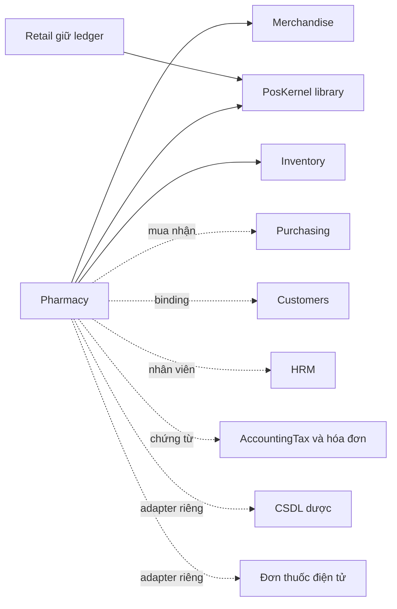
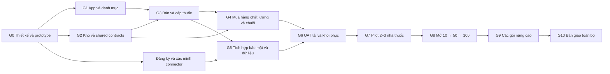

# Kế hoạch triển khai app Nhà thuốc

> Phiên bản kế hoạch: `0.1.0` · Ngày: **2026-10-22**.
> Phạm vi đã chốt với chủ sản phẩm: **nhà thuốc bán lẻ và chuỗi nhà thuốc tại Việt Nam; 10–100 điểm bán, có đường mở rộng**.
> Trạng thái: **kế hoạch mục tiêu**. Source `pharmacy 0.1.0-dev.1` đã có bản nội bộ đầu đến cuối ngày 22/10/2026; đọc [trạng thái triển khai](pharmacy-implementation-status.md) và [runtime contract](../api/pharmacy-runtime-contract.md) để biết phần đã chạy và phần còn thiếu. Checklist/gate bên dưới vẫn là tiêu chí nghiệm thu, không tự chuyển thành hoàn tất từ việc có source. Chưa cài vào DB nghiệp vụ hoặc nghiệm thu production.

Tài liệu xác định phạm vi toàn app, quyết định kiến trúc, thứ tự phụ thuộc, công việc backend/frontend, kiểm thử, di chuyển dữ liệu và rollout. Các gói nâng cao có kế hoạch và gate riêng; khi chưa nghiệm thu, giao dịch thuộc gói phải bị chặn ở server. Giao diện hiển thị được không thay thế bằng chứng nghiệp vụ, liên thông hoặc vận hành.

## 1. Phạm vi và định nghĩa hoàn thành

### 1.1. Yêu cầu đã chốt

- App `pharmacy` trong AIO, phục vụ một cửa hàng và nhiều chuỗi/nhà thuốc trong cùng installation; giữ single-tenant theo codebase.
- Mục tiêu vận hành online 10–100 điểm bán; nghiệp vụ, phân quyền và dữ liệu không dựa vào website đang mở.
- Tích hợp linh hoạt Merchandise, Inventory, Purchasing, Customers, HRM, AccountingTax, hóa đơn, thanh toán và các hệ thống chuyên ngành.
- Tối ưu riêng cho dược sĩ, dược sĩ phụ trách/chất lượng, thu ngân, kho, mua hàng, quản lý cửa hàng, HQ và kế toán.
- Cửa hàng nhỏ cho phép kiêm nhiệm; chuỗi lớn hỗ trợ hàng đợi và bàn giao công việc. Hai chế độ dùng chung các chốt nghiệp vụ.

### 1.2. Các mức bàn giao

| Mức | Phạm vi | Điều kiện công nhận |
| --- | --- | --- |
| R0 — thiết kế có thể triển khai | ADR, contract, schema draft, statecharts, prototype, fixture và ma trận nghiệm thu | G0; các quyết định ảnh hưởng correctness đã có owner và kết luận |
| R1 — bản nội bộ chạy đầu đến cuối | Danh mục, cơ sở/quyền, kho thuốc, mua/nhận, OTC/Rx thông thường, ca/thu tiền/giao, đổi trả/thu hồi | G1–G4; chỉ dữ liệu tổng hợp hoặc sandbox, chưa được coi là production |
| R2 — pilot production | R1 + tích hợp cần thiết, bảo mật, migration, thiết bị, vận hành và khôi phục | G5–G7; 2–3 nhà thuốc, có chủ sở hữu nghiệm thu nghiệp vụ |
| R3 — phạm vi chính hoàn chỉnh | Mua tập trung, kho trung tâm, điều chuyển, giá/chính sách, báo cáo HQ và 10–100 điểm | G8; tải 10/50/100 và rollout từng wave có bằng chứng |
| R4 — toàn bộ danh mục mở rộng | Thuốc kiểm soát đặc biệt; kênh online hợp lệ; chuỗi lạnh/IoT; kiến thức chuyên môn; chăm sóc khách theo consent | G9A–G9D riêng từng gói, sau đó G10 bàn giao đầy đủ |

App hoàn chỉnh không có nghĩa mọi deployment phải bật mọi gói. Một gói được bàn giao phải có implementation, migration, permission, UX, test, tài liệu vận hành và bằng chứng gate; thiếu quyền truy cập hệ thống ngoài hoặc điều kiện cơ sở phải ghi là chưa nghiệm thu, không đánh dấu hoàn tất.

### 1.3. Phạm vi chưa cam kết trong lần triển khai này

Khám bệnh/kê đơn; AI tự chẩn đoán hoặc tự đổi thuốc; quản lý bệnh viện/BHYT; sản xuất/pha chế thuốc; phân phối bán buôn; vận hành bán thuốc offline đầy đủ; giao dịch điều chuyển liên pháp nhân tự động. Những phần này cần đặc tả và gate bổ sung. Riêng khi một tình huống bắt buộc cho cơ sở pilot thì phải bổ sung scope trước go-live, hoặc loại nhóm giao dịch đó khỏi phạm vi được mở.

### 1.4. Quyết định cần chốt tại G0

| ID | Quyết định | Owner | Gate chịu ảnh hưởng |
| --- | --- | --- | --- |
| DEC-01 | Loại hình/phạm vi từng cơ sở, nhóm thuốc được bán, người phụ trách chuyên môn | Chủ sản phẩm + dược sĩ nghiệp vụ | Mọi go-live |
| DEC-02 | 2–3 nhà thuốc pilot, kho trung tâm, pháp nhân, người dùng/quầy và thiết bị | Operations + chủ sản phẩm | UX, tải, G7 |
| DEC-03 | Danh mục nguồn, quyền sử dụng, dữ liệu cũ, khả năng xác minh lô/đơn và người bệnh | Dược sĩ + data lead | Import, G2–G5 |
| DEC-04 | Contract và tài khoản riêng của CSDL dược, đơn thuốc điện tử, thanh toán, hóa đơn | Integration lead | G5, G7 |
| DEC-05 | Chính sách đơn hợp lệ, cấp một phần, thay thế, review, hoàn/giao thất bại | Dược sĩ + finance + product | G3–G4 |
| DEC-06 | RPO/RTO cho DB, file/bằng chứng private, keys và integration checkpoints; manifest phục hồi nhất quán; hạ tầng tham chiếu, SLO, budget và nhân lực | Tech lead + Operations + chủ sản phẩm | G6–G8 |
| DEC-07 | Thời hạn lưu, căn cứ xử lý, consent và phạm vi dữ liệu chia sẻ từng loại hồ sơ | Privacy owner + dược sĩ | G5–G10 |
| DEC-08 | Thứ tự ưu tiên và cơ sở đủ điều kiện cho từng gói G9 | Chủ sản phẩm + domain owner | R4 |

Quyết định mở chỉ chặn hạng mục phụ thuộc trực tiếp; không chặn các luồng phát triển độc lập. Người duyệt là trách nhiệm cần bố trí, không phải nhân sự đã được phân công.

## 2. Baseline source và khoảng trống

Baseline **trước triển khai** đọc ngày 22/10/2026, commit `f4a9333b`. Khi đó source có 15 module manifest, 90 theme; chưa có package Pharmacy hoặc PosKernel. Bảng dưới giữ baseline để đối chiếu công việc; phiên bản sau triển khai và giới hạn nằm trong [trạng thái triển khai](pharmacy-implementation-status.md). Versions là manifest source, không phải xác nhận trạng thái cài của mọi deployment.

| Thành phần | Source hiện tại | Phần tái sử dụng | Công việc cho Pharmacy |
| --- | --- | --- | --- |
| Core | Laravel 13, React 19; auth/RBAC/audit/lifecycle/capability | Admin identity, scoped permission, audit, durable recovery | Native Pharmacy workspace, security policy và professional gates |
| Merchandise | `0.2.2` | SKU, unit/packaging, conversion/barcode, import | Drug presentation links, increment/pack price, GS1 parser và search projection |
| Inventory | `0.4.0` | Decimal, batch/expiry, FEFO, FIFO costing, reservation, transfer, stocktake | Managed Pharmacy policy, multi-reason hold, exact-lot trace, generic disposition/withdrawal, contention |
| Purchasing | `0.2.1` | Supplier, PO, maker-checker, partial receipts/returns | Delegated Pharmacy authorization, inspection/quarantine, returns ngoài saleable, replenishment |
| Retail | `0.1.0-dev.2` | Patterns quote/tender/cash/idempotency và calculators | PosKernel nhỏ, không dùng cart/ledger Retail làm Pharmacy |
| FNB | `0.2.0-dev.3` | Pattern approval/conflict/pending/print | Reuse thành phần có contract; không phụ thuộc FNB |
| Customers | `0.1.0` | Book, profiles, contacts/consent, gateway | Native Pharmacy binding; gateway hiện còn website/FNB/Retail-specific |
| HRM/Payroll | `1.0.0` | Employee/admin và khóa tài khoản | Mapping nhân viên; không thay qualification chuyên môn |
| AccountingTax/Minvoice | `0.2.0` | Chứng từ, mapping pháp nhân, provider safety | Adapter Pharmacy sale/return/refund, phân loại và đối soát |

Các file neo phải đọc trước khi sửa:

- [Module lifecycle](../../app/Core/Modules/ModuleManager.php), [runtime barrier](../../app/Core/Modules/Support/ModuleRuntimeBarrier.php), [capabilities](../../app/Core/Modules/ModuleCapabilityChecker.php).
- [Merchandise](../../modules/Merchandise/Services/MerchandiseService.php), [Inventory v2](../../modules/Inventory/Services/InventoryV2Service.php), [Inventory production](../../modules/Inventory/Services/InventoryProductionService.php).
- [Purchasing](../../modules/Purchasing/Services/PurchasingService.php), [production adapter](../../modules/Purchasing/Services/PurchasingProductionService.php).
- [Retail transactions](../../modules/RetailPos/Services/RetailService.php), [numbers](../../modules/RetailPos/Domain/RetailNumbers.php), [POS UI](../../resources/admin/src/modules/retail-pos/components/RetailSalePanel.jsx).
- [Customer bindings](../../modules/Customers/Services/CustomerIntegrationService.php), [consumer contract](../../modules/Customers/Contracts/CustomerConsumerProvider.php).
- [Native access sample](../../modules/Manufacturing/Services/Access/ManufacturingAccessService.php), [command sample](../../modules/Manufacturing/Services/Commands/ManufacturingCommandService.php).

Khoảng trống ảnh hưởng critical path:

1. Retail cart gộp theo SKU; Pharmacy cần dòng cấp thuốc riêng, một dòng có nhiều allocations lô và hướng dẫn riêng.
2. Inventory reserve nhận `batchId`, nhưng Retail complete chưa truyền lô thực chọn. UI chọn lô phải đi cùng authoritative reservation/commit contract.
3. Inventory có quality/trace capabilities cho production roll; không suy chúng đã là contract thuốc tổng quát hoặc dùng roll giả cho thuốc.
4. Inventory mutation khóa exclusive row kho và row item; cần đo, sau đó giảm phạm vi serialize mà vẫn bảo vệ ownership, first insert, stocktake và lifecycle.
5. Purchasing generic nhận mặc định saleable và supplier return reserve từ sellable. Không phù hợp mọi tình huống cách ly/thu hồi/hết hạn.
6. Customers binding chưa nhận app native tùy ý; không tạo SiteContext giả để vượt authorization.
7. Retail product lookup lặp ensureItem/barcode/availability cho từng SKU; cần reader không ghi dữ liệu và truy vấn bulk.
8. Disk `local` hiện trỏ `public/files`; tài liệu/exports Pharmacy phải dùng disk private riêng. Nếu dùng Customers export, phải xử lý boundary lưu trữ đó trước khi mở tính năng cho dữ liệu thật.
9. Không có bằng chứng toàn AIO suite hiện xanh trong đợt lập kế hoạch. G0 phải xác lập baseline, phân loại lỗi và không hợp thức hóa regression mới bằng lỗi cũ.

## 3. Quyết định kiến trúc

### 3.1. Ownership và dependency

| ID | Quyết định |
| --- | --- |
| ADR-01 | Pharmacy là app riêng trong modular monolith; không thêm runtime multi-tenant hoặc microservices ở bản đầu |
| ADR-02 | Hard dependencies: Merchandise và Inventory ở installed version/capability đã nghiệm thu. Không hard-depend Retail/FNB/CMS/theme |
| ADR-03 | PosKernel là PHP library nội bộ cho money/quantity/rounding/quote/tender/contracts; không có bảng riêng, không đọc SiteContext hay `retail_*` |
| ADR-04 | Pharmacy sở hữu sale, tender, shift, return/refund và hồ sơ cấp thuốc. Retail giữ ledger hiện hữu; không chuyển bảng cũ trong phase này |
| ADR-05 | Inventory giữ tồn và giá vốn duy nhất; Pharmacy không tạo balance/stock writer thứ hai hoặc fallback Catalog |
| ADR-06 | Native chain/pharmacy membership kết hợp Core `pharmacy.*`; website chỉ là channel mapping. Không thêm branch scope vào Core và không dùng organization scope kế toán cho quyền nhà thuốc |
| ADR-07 | Qualification chuyên môn là domain gate riêng; System Owner không tự có quyền duyệt chuyên môn |
| ADR-08 | Patient/Rx/clinical facts thuộc Pharmacy; Customers giữ hồ sơ liên hệ dùng chung theo binding và mục đích được phép |
| ADR-09 | Mọi call ngoài DB transaction; tác dụng phụ ngoài qua outbox/inbox, idempotency và reconcile, không hứa exactly-once |
| ADR-10 | Schema additive/forward; capability có introduced version và readiness. Thiếu owner policy phải fail closed, kể cả khi Pharmacy bị tắt |

Purchasing tùy chọn về package nhưng bắt buộc trong bộ triển khai pilot có mua/nhận/trả hàng. Accounting, HRM, Customers, payment/provider, website và các connector là tùy chọn theo contract; điều kiện pháp luật áp dụng cho một luồng vẫn có thể khiến connector tương ứng bắt buộc trước go-live luồng đó.

### 3.2. Mô hình dữ liệu mục tiêu

Tên nhóm là đề xuất để đặc tả migration; chưa phải schema hiện hành. Numeric IDs nội bộ và public UUID đi theo convention hiện tại. FK nội bộ package được phép; liên kết module optional qua mapping/version/snapshot, không cascade xóa lịch sử.

| Nhóm | Thực thể chính | Invariant |
| --- | --- | --- |
| Tổ chức/quyền | chain, pharmacy, legal entity, warehouse/counter links, memberships, professional credentials, duty assignments | Phạm vi, hiệu lực và pháp nhân được server kiểm; nhân viên không tự cấp quyền |
| Thuốc | drug presentations, ingredients/strengths, registration/classification revisions, storage/dispense policies, SKU links | Nhiều hoạt chất; không dùng tên thuốc hoặc barcode làm identity xuyên module |
| Giá/quy cách | assortments, pack prices, publication revisions, effective dates/ACK | Không mặc định giá hộp = giá viên nhân số viên; đổi master không sửa giao dịch cũ |
| Người liên quan | patient subjects, buyer/payer/recipient links, authorized caregiver links | Bốn vai trò có thể khác nhau; không merge tự động theo phone/email |
| Đơn/cấp thuốc | prescription originals/revisions/lines, verification, entitlement/claims, reviews, dispensings/lines, counseling, handover | Dòng cấp thuốc độc lập SKU; tổng đã cấp và đang claim không vượt lượng được phép trong thẩm quyền dữ liệu |
| Giao dịch | sale/lines, tenders/payment intents, shifts/cash movements, return/refund lines | Money minor-unit; quantity decimal string; posted history chỉ adjustment/reversal |
| Chất lượng | receipt inspection, quality incidents, recall cases/tasks, temperature evidence, disposal decisions | Quyết định chuyên môn ở Pharmacy; block/movement ở Inventory |
| Liên kết/truy xuất | normalized dispense-line/stock-allocation links, supplier qualification links, integration mappings | Truy xuôi/ngược theo lô không phải quét JSON toàn bộ lịch sử; quyền trace không mặc nhiên lộ giá vốn |
| Nền vận hành | commands, outbox/inbox, integration attempts, print jobs, import batches, report projections | Key/hash/version/source identity; retry có kiểm quyền; payload nhạy cảm có lưu trữ/quyền/retention riêng |

Hồ sơ cơ sở giữ loại hình/phạm vi được phép; pháp nhân vận hành và Accounting organization là hai identity riêng, mapping có hiệu lực. Không cho ordinary transfer giữa hai chủ sở hữu/pháp nhân khi chưa có workflow giao dịch phù hợp.

### 3.3. State machines và điểm commit

| Trục | Trạng thái mục tiêu |
| --- | --- |
| Công việc | unassigned → assigned → active → waiting/done; claim/lease có version |
| Kiểm tra | pending → needs_information/approved/rejected; approved có thể invalidated khi dữ liệu liên quan đổi |
| Chuẩn bị/tồn | unreserved → reserved → picked → committed; release/expired/compensation_required là nhánh riêng |
| Thanh toán | unpaid → pending/uncertain → paid; refund_pending → partially_refunded/refunded |
| Giao hàng | pending → ready → handed_over; exception/cancelled có quyết định xử lý |
| Liên thông | queued → submitting → accepted/rejected/uncertain; retry/reconcile/manual_review |
| Request/UI | idle → submitting → resolved/uncertain/conflict/dependency_unavailable; tra command bằng identity cũ trước quyết định gửi lại |

Quy trình chuẩn: tiếp nhận → kiểm tra → chuẩn bị/lô → xác nhận chuyên môn → thu tiền/chốt → bàn giao. OTC đi đường ngắn theo policy nhưng không bỏ các điều kiện sản phẩm/cơ sở/stock.

Trục request/UI độc lập với payment, inventory, handover và từng connector. HTTP thành công không đồng nghĩa provider accepted hoặc đã giao; timeout cũng không tự chứng minh mutation chưa commit. UX-02/G3-10 và AT-24/30 phải kiểm cách hiển thị và recovery này.

- Review gắn version/hash của đơn, người bệnh, thuốc, lượng, quy cách, lô và policy liên quan. Sửa dữ liệu cần kiểm lại phải invalidate đúng phần; quote giá hết hạn không tự làm mất review chuyên môn nếu nội dung chuyên môn không đổi.
- Claim lượng theo đơn và stock reservation là hai ledger khác nhau, có thời hạn/recovery; không giữ quyền cấp thuốc vĩnh viễn chỉ vì mở draft. Chống cấp vượt trong AIO; không tuyên bố khóa lượng toàn quốc khi hệ thống ngoài chưa cung cấp thẩm quyền đó.
- Cash/internal tender: finalization ghi sale, tender/cash, claim→`committed_pending_handover` allocation, Inventory issue→`issued_to_custody`, immutable snapshots, audit/outbox cùng transaction. Lượng này vẫn chiếm entitlement nhưng chưa hiển thị là đã giao. Chưa đủ điều kiện thì rollback toàn bộ.
- Thanh toán ngoài: reserve/chuẩn bị trước, tạo payment intent bằng identity bền vững, gọi provider ngoài transaction; chỉ ghi paid dựa trên bằng chứng đã xác minh. Sau paid mới finalize nội bộ. Provider paid nhưng finalize chưa thành công là exception cần xử lý/hoàn, không bán hoặc thu lần hai.
- Xác nhận bàn giao là hành động sau finalization và tái kiểm hold/recall/quyền, chuyển committed allocation sang `dispensed` và phát event bàn giao. Giữ riêng `stock_issued_at`, `finalized_at` và `handed_over_at`; adapter chọn trigger đúng nghĩa theo contract, không báo đã cấp/giao ở hệ thống ngoài chỉ vì đã thu tiền. Hàng đã xuất nhưng chưa giao nằm trong hồ sơ custody/exception có đối soát, không tạo balance có thể bán thứ hai. Không dùng `paid` suy ra `handed_over`.
- Bị thu hồi sau finalization nhưng trước bàn giao: chặn giao; đưa vào case cách ly/đổi/hoàn có stock reversal hợp lệ. Không xóa tender hoặc viết lại lịch sử.
- Hoàn tiền không tự đưa thuốc về saleable, cũng không tự khôi phục quyền cấp lại theo đơn. Financial, stock và professional decisions có lineage riêng.

## 4. Invariant bắt buộc

1. Một nguồn SKU ở Merchandise, một nguồn tồn/giá vốn ở Inventory; không seed lại tồn để nối module.
2. Mọi list/detail/export/status/replay kiểm quyền và native scope hiện hành; body/header/UUID không tự cấp thẩm quyền.
3. Professional eligibility còn hiệu lực được kiểm tại hành động; Core super-admin không bỏ qua điều kiện này.
4. Lô thực lấy phải liên kết reservation/allocation; chỉ quét GTIN không đủ xác nhận lô khi trên kệ có nhiều lô.
5. Hết hạn, hold, quarantine, recall, policy và qualification được kiểm lại tại điểm ghi/giao tương ứng; draft/review cũ không là giấy phép vĩnh viễn.
6. Hold nhiều lý do, giải một lý do không làm mất các hold khác; chặn toàn chuỗi có hiệu lực trước khi các task cách ly vật lý hoàn tất.
7. Mutation generic từ Retail/Inventory/Purchasing/import/Accounting/test-data không được bypass quản lý Pharmacy; tắt owner module vẫn giữ chặn an toàn.
8. Decimal end-to-end, increment theo SKU; phân bổ tiền/discount/refund xác định, tổng dòng khớp tổng đơn; không dùng float cho lượng/tiền.
9. Prescription/dispense/return quantities có lineage và cap; không hard-delete giao dịch đã chốt.
10. Cùng command key + fingerprint trả kết quả gốc sau kiểm quyền; key khác payload conflict; response thất lạc không tạo ý định thu/xuất mới.
11. CSDL dược, eRx, payment, Accounting và website có mapping/status/identity riêng; queued không đồng nghĩa accepted.
12. Tài liệu/exports/nhãn có thông tin người bệnh lưu private; quyền đọc/in/xuất riêng, không log/journal/localStorage payload sức khỏe hoặc token.
13. Thu hồi, điều chỉnh, hoàn/hủy, đọc/xuất nhạy cảm có actor/reason/time; audit có masking, append-only và chain verification.
14. Mọi capability chỉ công bố sau schema/implementation/authorization/test; source mới không tự làm installation cũ ready.
15. Schema nâng cấp qua lifecycle/forward migration; giữ ID, balances, layers, reservations, source mappings và semantics consumer cũ.
16. Không gọi provider trong transaction đang giữ stock/money lock; trạng thái uncertain phải tra/reconcile bằng identity gốc.

## 5. Bề mặt sản phẩm và kế hoạch UX

### 5.1. Route/page map mục tiêu

Dưới `/admin/modules/pharmacy`; tên có thể tinh chỉnh ở G0. Native bootstrap/API đề xuất `/admin/api/pharmacy`, không cần website active để vào app. Route nào thực sự sử dụng book/channel vẫn authorize mapping tương ứng.

| Page | Trách nhiệm | Trải nghiệm |
| --- | --- | --- |
| `/work`, `/dispensings/:id` | Hàng đợi/việc của tôi và hồ sơ bán/cấp thuốc | Page có đơn gốc cạnh dữ liệu xử lý; nhận/bàn giao task |
| `/pos`, `/prescriptions`, `/sales` | OTC, tiếp nhận đơn, giao dịch/đổi trả | Quét/phím tắt, nhiều hồ sơ tạm giữ phía server, phân biệt trạng thái |
| `/products`, `/prices` | Thuốc/SKU/quy cách/giá | Search hoạt chất/biệt dược/hàm lượng; import preview; revision |
| `/inventory`, `/receipts`, `/transfers`, `/stocktakes` | Tồn/lô/vị trí và công việc kho | Desktop đối soát, handheld quét từng bước, blind count/recount |
| `/quality` | Cách ly/thu hồi/cận hạn/sai lệch bảo quản | Work queue theo rủi ro, truy xuất và bằng chứng xử lý |
| `/purchasing` | Nhu cầu, PO, nhà cung cấp, nhận/trả | Bám contract Purchasing, phân quyền người lập/duyệt/nhận |
| `/customers` | Người mua/người bệnh và lịch sử theo quyền | Tách quyền danh bạ với hồ sơ chuyên môn; người mua hộ rõ ràng |
| `/shifts`, `/operations` | Ca/quầy, điều hành cửa hàng/chuỗi | Role landing, ngoại lệ ưu tiên và drill-down |
| `/reports`, `/integrations`, `/settings` | Báo cáo, connector, cơ sở/quyền/chính sách | Server filters/saved views; version/as-of/status và evidence |

Menu là điều hướng theo permission, không cấp quyền API; tránh tab cấp app trùng menu. Hồ sơ dài dùng page; drawer cho editor ngắn/thao tác phụ. Native module routing trong React và Laravel phải đấu nối tường minh, không suy manifest tự tạo page.

### 5.2. Work packages UX

| ID | Đầu ra | Gate |
| --- | --- | --- |
| UX-01 | Khảo sát journey sáu nhóm tác nghiệp và finance/quality, trách nhiệm/ngoại lệ | G0, có đại diện cửa hàng đơn và hàng đợi tách |
| UX-02 | Statecharts, `allowed_actions`, blockers, error catalog và version contract | G0; backend/frontend cùng expected result |
| UX-03 | Prototype OTC/Rx/nhiều lô/thiếu hàng/lỗi mạng trên desktop, touch và handheld | G0; UAT prototype trước xây luồng chính |
| UX-04 | Shell/role landing/native selector/routes/saved views | G1; direct URL và đổi context an toàn |
| UX-05 | Tiếp nhận/review/pick/lô/partial fill/hướng dẫn | G3; same SKU khác dòng không bị gộp |
| UX-06 | Quote/tender/ca/return/refund/print/handover | G3–G4; pay/issue/handover tách đúng |
| UX-07 | Nhận hàng/PO/transfer/stocktake/quality/recall | G4; quét đúng lô/vị trí, discrepancy có nơi xử lý |
| UX-08 | Customer/patient/consent/private documents | G3–G5; hiển thị dữ liệu tối thiểu theo vai trò |
| UX-09 | Multi-tab/reload/uncertain/scanner/print/accessibility | G3–G6; phục hồi không nhân giao dịch |
| UX-10 | Dashboard HQ/policy publication/replenishment/reporting | G4–G8; data freshness và drill-down đúng quyền |
| UX-11 | Controlled/online/IoT/knowledge journeys | G9; state/permission/error contract và prototype walkthrough trước build từng gói, sau đó UAT riêng |

Single-counter và separated-queue là hai cấu hình trải nghiệm trên cùng domain contract. Kiêm nhiệm không bỏ yêu cầu người duyệt thứ hai khi policy bắt buộc. Context nhà thuốc/quầy/ca luôn rõ; không tự chuyển context khi command chưa rõ kết quả.

Scanner không tự add kết quả gần giống; tên/hàm lượng/dạng/quy cách được phân biệt rõ. Enter không tự duyệt chuyên môn hoặc chốt thu tiền. Kiểm focus/label/error/zoom/keyboard và tương phản; status có text thay vì chỉ màu. Print job/in lại có identity; mở dialog trình duyệt chưa chứng minh in vật lý thành công.

## 6. Thứ tự triển khai và gate

Connector access, UX và fixture làm song song từ G0. G9 có thể phát triển song song sau khi contract nền ổn định, nhưng không mở cho production trước gate riêng. Không xây ledger tồn tạm để vượt G2.

### G0 — Đặc tả, baseline và prototype

**Đầu vào:** bootstrap, source hiện tại, phạm vi đã chốt và đại diện nghiệp vụ. **Owner:** Product + Tech lead + dược sĩ; UX/QA/Ops/Finance tham gia.

- [ ] G0-01 Lập `pharmacy-product-spec.md`, `pharmacy-architecture-and-integration.md`, ma trận loại cơ sở/nhóm thuốc; giải DEC-01…08 hoặc giao owner/gate.
- [ ] G0-02 Chốt ADR-01…10, state/transaction boundaries, schema data dictionary, API/error drafts và quyền/qualification.
- [ ] G0-03 Chốt các tình huống đơn hợp lệ/không hợp lệ, cấp một phần/thay thế, nhận/cách ly, chốt tiền/xuất/giao/hoàn, nguồn dữ liệu có thẩm quyền.
- [ ] G0-04 Chạy/ghi baseline AIO trên DB test cô lập, lập danh sách failure và regression gates cần giữ; đối chiếu core và module migrations ở deployment mục tiêu bằng read-only.
- [ ] G0-05 UX-01…03, prototype quầy đơn/hàng đợi; UAT và ghi quyết định trước xây workflow.
- [ ] G0-06 Fixture ba nhà thuốc, một kho trung tâm, ít nhất hai quầy/cửa hàng, hai chuỗi và hai pháp nhân để test cách ly; cùng installation có Retail/FNB/Manufacturing.
- [ ] G0-07 Fixture thuốc phối hợp, tên gần giống, nhiều quy cách, nhiều lô, hạn tháng/ngày, recalled/quarantine, người mua hộ, đơn cấp một phần và tài khoản chồng quyền.
- [ ] G0-08 Khởi động thủ tục connector, lấy đặc tả thực/fixture đã khử dữ liệu, sandbox và đầu mối hỗ trợ; không đoán endpoint.

**Gate:** bộ tính mẫu và quyết định correctness tính được expected result; prototype đã thử; workload/hạ tầng tham chiếu và quyền/tài khoản ngoài có kế hoạch. Không đòi có production credentials để bắt đầu phát triển độc lập.

### G1 — App, native context và danh mục thuốc

**Phụ thuộc:** G0. **Owner:** Backend app + Frontend; QA/security review.

- [ ] G1-01 Tạo package `pharmacy`, module migration/hook/versioned security provider/runtime barrier, native API/bootstrap/shell; không tự cài app khác.
- [ ] G1-02 Chain/pharmacy/legal entity/counter/warehouse mappings, membership/preset, professional credentials/duty/expiry và audit. Quản trị không đồng nghĩa đủ điều kiện chuyên môn.
- [ ] G1-03 Permission matrix cho list/detail/write/export/print/replay; scope bên server, revocation hiện hành; UX-04.
- [ ] G1-04 Drug presentation/ingredients/strength/form/route/registration/classification/storage revisions, Merchandise mapping; biểu diễn nhóm sản phẩm không phải thuốc.
- [ ] G1-05 Packaging/increment/barcodes/GS1 parser, giá theo quy cách, assortment, revision/effective date; không đổi base unit của SKU lịch sử.
- [ ] G1-06 Import danh mục preview/commit, conflict report, staging catalog và search read model; dữ liệu nguồn có provenance, nguồn chưa duyệt không tự mở bán.
- [ ] G1-07 Private disk riêng, document upload validation/quota/checksum, authorized download và tách quyền in/xuất; nền cho UX-08.
- [ ] G1-08 Provider Data test theo ownership ledger của Core, chỉ hồ sơ giả/draft, không gọi mạng/tạo giao dịch posted. Cleanup chịu stock policy và chặn external references.

**Gate:** fresh install từ core + Merchandise/Inventory không cần CMS/Catalog/Retail; scope/qualification không bypass được; import không tự merge sai thuốc, scan/quy cách và private document đạt contract. Capability chỉ thêm khi đã có test.

### G2 — Shared contracts, kho thuốc và PosKernel

**Phụ thuộc:** G0, phối hợp G1. **Owner:** Backend shared + QA MySQL; Retail/Manufacturing owners review.

- [ ] G2-01 PosKernel: quantity/money/rounding/discount/tender/quote/command contracts và Inventory port. Dùng calculators được golden-test bởi Retail/Pharmacy; không đổi ownership/schema Retail.
- [ ] G2-02 Inventory managed-owner policy/context có version; receive/reserve/commit/transfer/stocktake/return/adjust/import/legacy adapters đều kiểm owner khi áp dụng. Owner disabled/unavailable vẫn chặn mutation cần policy.
- [ ] G2-03 Multi-reason stock holds và effective eligibility projection; support product/batch/location scope, minimum remaining shelf life theo policy; kiểm lại khi commit/giao.
- [ ] G2-04 Reservation lô xác định/multi-lot, pick confirmation, release/expiry và price/professional approval tương ứng; FEFO suggestion giữ một allocator Inventory.
- [ ] G2-05 Chuẩn hóa allocation trace theo source line → stock operation/movement → batch/receipt/transfer, trả projection không chứa cost cho người chỉ có trace permission.
- [ ] G2-06 Generic receive quarantine/inspect/release/reject, restricted supplier-return/destruction có lineage/approval; không sử dụng production roll giả hoặc thay semantics production hiện có.
- [ ] G2-07 Đo lock baseline; thiết kế shared locks cho ownership/config và mutex/balance/layer theo grain cần thiết, fixed lock order, first-insert safety; giữ stocktake/runtime/recall barrier.
- [ ] G2-08 Forward migration/backfill idempotent và restart sau DDL partial failure; giữ balances, cost layers, reservations, source IDs và late-cost lineage của consumer hiện hữu.

**Gate:** competing-process MySQL chứng minh tồn cuối/hold mới/stocktake/drain/first insert; nếu đổi locking, khác SKU cùng kho có thể tiến độc lập theo thiết kế đã đo. Retail, Manufacturing/production costing, FNB và Accounting adapters liên quan không regression; không bật toàn hệ thống policy thuốc cho hàng thông thường.

### G3 — Hồ sơ, bán/cấp thuốc, thanh toán và bàn giao

**Phụ thuộc:** G1 + G2. **Owner:** Backend app + Frontend; dược sĩ/Finance và QA nghiệm thu.

- [ ] G3-01 Patient/buyer/payer/recipient identities và quan hệ được ủy quyền; dữ liệu sức khỏe ở Pharmacy, private evidence/consent/căn cứ xử lý theo mục đích.
- [ ] G3-02 Prescription original/revision/verification/lines; hiệu lực và allowed quantities theo rule có nguồn/version. Manual entry/OCR nếu có chỉ tạo draft cần xác minh.
- [ ] G3-03 Entitlement/claim ledger cho partial fill, concurrency/timeout/release; không tự nhận quyền khóa số lượng của hệ thống ngoài.
- [ ] G3-04 Task queue/assignment/version, professional review, substitution/counseling evidence, review invalidation; UX-05/08.
- [ ] G3-05 OTC đường ngắn và Rx workspace: quote, hold/resume, exact-lot pick, same-SKU separate lines, pack price, discounts/approval và caps.
- [ ] G3-06 Pharmacy sale/tender/shift/cash/payment intent, đóng/đối soát ca cơ bản và local finalization theo mục 3.3; internal settlement, Inventory issue và outbox atomic.
- [ ] G3-07 Handover/custody và paid-not-handed-over queue, đổi lô/sửa dòng sau review, cancel trước/sau thanh toán và compensation rõ; tách stock-issued/finalized/handed-over timestamps và event, không báo đã cấp trước giao hoặc tự khôi phục entitlement khi hủy custody.
- [ ] G3-08 Return/refund có original-line/lot/amount caps; hàng về quarantine và quyết định tái sử dụng riêng; không tự phục hồi entitlement Rx.
- [ ] G3-09 Receipt/label immutable snapshot, print/reprint jobs và quyền; máy in lỗi không chốt lại giao dịch. UX-06/09 cho keyboard/touch/scanner.
- [ ] G3-10 Command status/replay/fingerprint, multi-tab/session expiry/live revoke; browser journal chỉ ID/hash/key/scope, task nhạy cảm lưu server.

**Gate:** từ nhập tồn đã kiểm → nhận đơn → bán/thu/xuất/giao → hoàn/đóng ca chạy đầu đến cuối. Race cùng đơn/lô cuối, mutation sau review và mất response không cấp/thu/xuất hai lần. Chưa được mở production chỉ vì gate nội bộ đạt.

### G4 — Mua hàng, chất lượng và điều hành chuỗi

**Phụ thuộc:** G2 và contract G3; một phần phát triển song song. **Owner:** Backend shared/app + Frontend + Stock/Finance.

- [ ] G4-01 Purchasing native/delegated scope contract cho Pharmacy; yêu cầu mua, NCC thương mại và qualification overlay, maker-checker/hạn mức.
- [ ] G4-02 PO/partial receipt/inspection/quarantine/release, giá mua/quy cách/lô/hạn/chứng từ nguồn; trả NCC cả lô bị hold/hết hạn theo original receipt/cost lineage.
- [ ] G4-03 Nhu cầu bổ sung theo khả dụng, đang mua, đang chuyển và sức bán; proposal trước, không tự đặt vượt approval.
- [ ] G4-04 Transfer request/approve/pick/dispatch/receive/discrepancy; không tạo khả dụng đồng thời ở hai nơi; cùng pháp nhân ở phạm vi chính.
- [ ] G4-05 Stocktake theo zone/batch, blind/recount/approval/adjustment, chính sách reservation/pick đang mở; không tự hủy hold để kiểm kê.
- [ ] G4-06 Recall case → authoritative block → task từng nơi → truy sold/in-transit/on-hand → cách ly/thu nhận lại/trả/hủy → reconciliation/close; notification chỉ qua permission/mục đích hợp lệ.
- [ ] G4-07 Temperature/storage readings thủ công, quality incident, near-expiry và disposal approval. Thuốc cần chuỗi lạnh chỉ được mở sau gate chuỗi lạnh tại G9C.
- [ ] G4-08 Branch price/policy publication/effective time/ACK, ngoại lệ được cấp quyền; thay master không đổi snapshot cũ.
- [ ] G4-09 Mở rộng cash reconciliation cơ bản G3 cho ngoại lệ/hạn mức/quản trị chuỗi, refund pending, exception dashboards và server-side saved filters/pagination; báo cáo tổng hợp có as-of/freshness. UX-07/10.

**Gate:** PO/receipt/stock/liability khớp; hàng chưa release không bán; thu hồi phủ draft/reservation/hàng đã xuất chưa giao và mọi chi nhánh trong scope; release một hold không xóa hold khác. HQ drill-down đúng scope, thu ngân không lộ cost/clinical facts.

### G5 — Tích hợp, bảo mật, dữ liệu và production readiness

**Phụ thuộc:** contract ổn định G1–G4; thủ tục ngoài chạy từ G0. **Owner:** Integration + Security/Privacy + Ops; QA/provider/domain owners.

- [ ] G5-01 Adapter CSDL dược: lấy contract/version hiện hành, tài khoản/mã cơ sở, mapping, sandbox, outbox/inbox/status/reconcile/dead letter và tài liệu vận hành.
- [ ] G5-02 Adapter đơn thuốc điện tử độc lập: xác minh khả năng đọc/kiểm tra/cập nhật bán, định danh/quantity authority, trigger theo event/timestamp và quyền truy cập; không dùng đặc tả CSDL dược thay cho eRx hoặc báo đã cấp khi mới committed-pending-handover.
- [ ] G5-03 Payment provider: intent/webhook signature/replay/amount/currency, lookup/reconcile/kill-switch; paid-but-local-failed và provider timeout có workflow xử lý.
- [ ] G5-04 Accounting/Minvoice: sale/return/refund source links, organization mapping/classification, nội bộ draft; phát hành/điều chỉnh hóa đơn chỉ theo capability/provider contract được xác nhận. Có thể dùng quy trình ngoài được phê duyệt khi adapter chưa thuộc deployment, nhưng không gọi đó là đã tích hợp.
- [ ] G5-05 Customers provider + authorized native binding/context contract, patient links explicit, purpose/consent; regression FNB/Retail và thiếu/disabled book. Xử lý private export trước khi mở export dữ liệu thật.
- [ ] G5-06 HRM employee/admin mapping và hiện hành hóa revocation; Pharmacy giữ professional credentials khi HRM không cài. Payroll chỉ nhận facts đã được phép nếu có nhu cầu được chốt.
- [ ] G5-07 Security review: IDOR/cross-scope, role ceiling, professional gate, upload/export/print, secret encryption/rotation, read audit, abuse/rate limits và masking.
- [ ] G5-08 Retention/legal hold theo record type, consent và căn cứ xử lý, xóa/ẩn danh có kiểm soát, backup/privacy incident runbook; không hard-delete chứng từ phải lưu.
- [ ] G5-09 Import preview/commit batches cho danh mục/giá/NCC/lô/opening stock và hồ sơ được phép; không import đơn cũ thành quyền cấp còn hiệu lực nếu chưa xác minh. Rehearsal trên bản sao được bảo vệ/khử dữ liệu.
- [ ] G5-10 Runtime config, queue tách nhóm, timeout/retry_after/lease, scheduler, storage/backup, health/readiness, integration dashboard và alert ownership.

**Gate:** connector cần thiết cho phạm vi pilot có evidence sandbox/authorized live test; API chưa có quyền/contract phải giữ gate mở. Không suy queued=accepted. Private storage, quyền đọc/xuất, accounting/stock mappings và data reconciliation pass. Module optional chưa cài không được query bảng còn sót hoặc crash UI.

### G6 — UAT, tải, thiết bị và diễn tập khôi phục

**Phụ thuộc:** G1–G5 cho scope pilot. **Owner:** QA + Ops + dược sĩ/Finance; Tech lead chịu correctness.

- [ ] G6-01 UAT OTC/Rx/partial/multi-lot/return/recall/receipt/transfer/stocktake/cash ở quầy đơn và hàng đợi tách; ký theo scenario, không chỉ duyệt screenshot.
- [ ] G6-02 HTTP/feature/unit/JS/E2E và MySQL competing-process gates theo ma trận AT; kiểm mọi writer bypass và capability thiếu/disabled/draining.
- [ ] G6-03 Scanner 1D/2D thật, label/receipt printer, handheld/touch/keyboard/zoom, WAN latency/packet loss, reload/multi-tab, hết phiên và storage bị chặn.
- [ ] G6-04 Benchmark 10/50/100 điểm với historic data; mixed workload/search/checkout/report/recall/outbox, burst/soak và lock profiling theo mục 8.
- [ ] G6-05 Kill process/worker, DB failover, queue replay/out-of-order/duplicate, payment/sync uncertain; đo recovery và số liệu đối soát.
- [ ] G6-06 Restore DB + private files + encryption keys/config + integration checkpoints vào môi trường cô lập; verify audit chain/ledger/trace/checksum và recovery window trước mở ghi.
- [ ] G6-07 Runbooks, đào tạo, support escalation, thông báo sự cố và quyết định go/no-go. Không mở gói chưa nghiệm thu bằng feature flag UI.

**Gate:** không còn lỗi correctness/security/clinical blocking; workload đạt SLO đã phê duyệt hoặc phạm vi rollout được giảm bằng quyết định rõ. Có bằng chứng restore/failover, thiết bị và người vận hành; known baseline failures không che regression mới.

### G7 — Pilot production 2–3 nhà thuốc

**Phụ thuộc:** G6 và hồ sơ go-live. **Owner:** Product + dược sĩ phụ trách + Ops; Finance/QA/Tech trực hỗ trợ.

- [ ] G7-01 Chốt nhóm hàng/cơ sở/ca/nhân sự được mở; freeze cutover, kiểm lô/giá/số dư, mapping và tài khoản ngoài; backup có restore evidence.
- [ ] G7-02 Cutover từng cửa hàng: dừng writer cũ trong phạm vi, đối soát opening, nhập một lần bằng source identity, xác nhận cửa hàng/quầy/ca; tránh hai hệ thống cùng trừ tồn.
- [ ] G7-03 Mở có giám sát, đối soát tiền/tồn/lô/cấp thuốc/liên thông hàng ngày; lỗi có owner và hạn xử lý, theo dõi usability thực tế.
- [ ] G7-04 Thực hiện hoặc diễn tập có kiểm soát các ngoại lệ: trả/hoàn, partial fill, điều chuyển, kiểm kê, recall, máy in/WAN lỗi, provider pending và thu hồi quyền.
- [ ] G7-05 Họp gate sau thời gian quan sát đề xuất 2–4 tuần và đủ tình huống; không chỉ đếm ngày bán hàng không lỗi. Đóng critical issues trước wave 10.

**Gate:** dược sĩ/Finance/Ops xác nhận số liệu và quy trình; không có sai lệch chưa giải thích; incident/recovery/queue backlog nằm trong ngưỡng đã chốt. Chưa coi pilot 3 nơi là bằng chứng đạt 100 điểm.

### G8 — Mở rộng 10 → 50 → 100 điểm

**Phụ thuộc:** G7; benchmark profile từng wave. **Owner:** Operations + Tech lead + HQ.

- [ ] G8-01 Chuẩn hóa onboarding/import/config/device checklist, đào tạo và phân quyền; rollout theo cohort có checkpoint.
- [ ] G8-02 Wave 10: đối soát chéo cửa hàng, kho trung tâm, replenish, transfer, giá/chính sách và support; quan sát tối thiểu theo chu kỳ tác nghiệp G0 đã chốt.
- [ ] G8-03 Wave 50: mixed-workload/report/recall và queue capacity đạt profile, đo SLA/support incidents, xác minh failover/restore với dữ liệu tương ứng.
- [ ] G8-04 Wave 100: capacity headroom, p95/p99/lock/outbox/DB/storage theo hồ sơ, kiểm blast radius và ngưỡng dừng; không chia sẻ runtime với khách hàng khác.
- [ ] G8-05 Tối ưu có bằng chứng: indexes/bulk reads/aggregates, queue fairness, phạm vi khóa và archive. Replica/search engine chỉ cho reader phù hợp; checkout không lấy cache/replica trễ làm thẩm quyền tồn.
- [ ] G8-06 Đóng scope R3, cập nhật status/runtime contract/runbook và capacity envelope với phiên bản/hạ tầng/dataset thực.

**Gate:** mỗi wave có biên bản độc lập; lỗi critical hoặc sai đối soát dừng mở cửa hàng mới. Có phương án dừng mutation theo scope và xử lý cửa hàng đang bán, không rollback schema/dữ liệu đã chốt.

### G9 — Toàn bộ gói nâng cao

Gói có thể phát triển song song khi các boundary cần thiết ổn định. Trước khi build workflow từng G9A–D, phải có state/permission/error contract và prototype walkthrough với người dùng của gói theo UX-02/03/11; không cần lặp lại toàn bộ G0. Mọi gói phải có permission/schema/UX/test/operation, versioned readiness và server gate; không chỉ thêm menu. Để công nhận R4, tất cả gói cam kết dưới đây phải có evidence, hoặc được chủ sản phẩm ghi nhận thay đổi phạm vi tường minh.

| Gói | Work packages | Gate riêng |
| --- | --- | --- |
| G9A — thuốc kiểm soát đặc biệt | Phân nhóm có nguồn/version; điều kiện cơ sở/nhân sự; đơn/sổ/biểu mẫu/chứng từ theo nhóm; nhập–xuất–tồn/nhận lại/hủy; đối soát và báo cáo | Dược sĩ/pháp lý review quy định áp dụng, thử từng nhóm và xuất hồ sơ kiểm tra; default blocked qua mọi đường bán/import |
| G9B — website/online và chăm sóc | Catalog publication mapping; predicate theo loại thuốc/phạm vi/kênh, không chỉ cờ OTC; tư vấn và evidence; reservation đa kênh; pickup/delivery/failed delivery/cancel/refund; opt-in nhắc việc/chăm sóc, consent marketing riêng | Review pháp lý cơ sở/kênh/nhóm hàng; checkout thông thường chặn Rx, thuốc kiểm soát đặc biệt và thuốc thuộc danh mục hạn chế bán lẻ; ngoại lệ pháp lý nếu có cần scope/gate riêng. Đối soát tồn giao nhận; thông báo đúng mục đích/quyền |
| G9C — chuỗi lạnh/IoT | Chính sách bảo quản/khu vực; manual readings được kiểm chứng; vận chuyển; sensor mapping/calibration/time/stale signal; excursion/hold/investigation/release; cảnh báo và người phản hồi | Quy trình chuỗi lạnh đủ điều kiện, test cảm biến lỗi/mất mạng/temperature excursions; nhiệt độ bình thường trở lại không tự giải phóng lô |
| G9D — kiến thức chuyên môn | Nguồn có quyền sử dụng; import/version/provenance/reviewer; tra cứu tương tác/chống chỉ định theo nguồn được nghiệm thu; cảnh báo có mức độ/reason/evidence và audit | Bộ ca do dược sĩ xác nhận, update/rollback knowledge an toàn, kiểm giới hạn/false alerts; không tự kê đơn/đổi thuốc hoặc bỏ chặn; AI không là điều kiện bắt buộc |

Các gói này không hợp thức hóa giấy phép hoặc hành nghề. Riêng cold-chain products phải bị chặn khi chưa có quy trình tương ứng, kể cả khi chưa mua cảm biến IoT. Offline sale đầy đủ chỉ mở bằng một dự án bổ sung có grant/recall/revocation/time trust/stock authority được đặc tả và kiểm chứng riêng.

### G10 — Bàn giao toàn bộ và bảo trì

**Phụ thuộc:** scope R3 và các gói R4 đã cam kết. **Owner:** Product + Tech lead + Ops + domain owners.

- [ ] G10-01 Product spec, architecture, OpenAPI/runtime contracts, implementation status và runbooks đồng bộ source/schema/installation; ghi rõ limitations và evidence theo version.
- [ ] G10-02 SOP quầy/kho/quality/finance/incident/restore, tài liệu đào tạo theo vai trò và hướng dẫn thiết bị.
- [ ] G10-03 Release notes/migration/compatibility matrix, dependency/version policy, export/import/backup ownership và kế hoạch cập nhật quy định/knowledge/provider.
- [ ] G10-04 Bàn giao alert/dashboard/escalation, tài khoản/service ownership và credential rotation; không đưa secrets vào repo.
- [ ] G10-05 Tổng duyệt traceability: requirement → task → contract/schema → page → test/evidence → gate. Báo cáo chưa đạt phải còn mở, không đánh dấu app hoàn thành chỉ vì source đủ file.

## 7. Kế hoạch tích hợp và tương thích AIO

| Tích hợp | Hợp đồng cần có | Khi chưa sẵn sàng |
| --- | --- | --- |
| Merchandise/Inventory bắt buộc | Installed version/schema/capability, current policy và native stock authority | Chặn mutation phụ thuộc; giữ lịch sử có quyền; không fallback Catalog |
| Purchasing | Native delegated scope, requisition/receipt/disposition/return identity | Không dùng luồng PO/receipt đó; pilot bộ đầy đủ phải đạt |
| Customers | Context/binding có quyền riêng, lookup/attach/history, consent/purpose | Không âm thầm đổi book hoặc suy ownership từ liên hệ; nghiệp vụ cần profile link dừng khi link không ready |
| HRM/Payroll | Stable admin/employee link, revoke, facts chỉ đọc/ghi theo adapter | Giữ Pharmacy identity/credentials; không tự tính lương hoặc cấp quyền HR |
| Accounting/Minvoice | Legal mapping, source lineage, classification, version/provider readiness và draft/issue paths | Giữ transaction và integration exception; không tự approve/post/issue; quy trình pháp lý thay thế phải được chốt riêng |
| CSDL dược | Contract/version/tài khoản/mã cơ sở riêng, accepted/rejected/reconcile | Giữ trạng thái thật; áp policy downtime có căn cứ, không tự coi đã gửi thành công |
| Đơn thuốc điện tử | Contract/authority/quyền đọc–xác minh–cập nhật riêng | Đường bắt buộc xác minh trực tuyến dừng; không tự biến đơn nhập tay thành đã xác minh |
| Payment | Verified intent/webhook/lookup/reconcile, số tiền/currency và source identity | Pending/uncertain; không thu lần hai do timeout hoặc tự đánh dấu paid |
| Website/IoT/knowledge | Capability và purpose/scoped access, compatibility và readiness | Gói disabled; không tự đẩy PII/clinical facts tới consumer |

Mọi adapter cần contract tests cho duplicate/out-of-order/timeout/partial failure, provider version change và permission revoke. Event chỉ mang IDs/version/changed fields đủ dùng; consumer đọc chi tiết bằng quyền hợp lệ. Migrate app không tự bật kết nối live; config sandbox/production và kill-switch tách biệt.

Regression bắt buộc theo thay đổi: auth/RBAC/fresh install/module lifecycle; Retail sale/return/ca/Inventory v2; Manufacturing production reservation/quality/output/late cost; Purchasing generic và production; Customers FNB/Retail bindings; Accounting bridges. Không đổi generic semantics để phù hợp riêng thuốc.

## 8. Năng lực và vận hành mục tiêu

### 8.1. Profile tải đề xuất, chưa phải bằng chứng benchmark

G0 chốt lại bằng số quầy, giờ cao điểm, đơn/ngày, độ dài đơn và hạ tầng thực. Số điểm bán không tự quy đổi thành throughput đã đạt.

| Profile | 10 điểm | 50 điểm | 100 điểm |
| --- | ---: | ---: | ---: |
| Phiên quầy hoạt động đồng thời | 40 | 200 | 400 |
| Đơn/ngày tham chiếu | 3.000 | 15.000 | 30.000 |
| Đơn/ngày stress | 10.000 | 50.000 | 100.000 |
| Peak finalize/giây | 2 | 10 | 20 |
| Lịch sử tham chiếu 12 tháng | 1,1 triệu đơn | 5,5 triệu đơn | 11 triệu đơn |

Dataset dự kiến: 50.000 SKU/presentations toàn chuỗi, assortment 5.000/điểm, trung bình 8 dòng/đơn, nhiều lô/dòng ở ca kiểm thử, historical allocations tương ứng; kiểm cả cùng SKU ở nhiều nhà thuốc và cùng lô cuối trong một kho. Đây là fixture kỹ thuật cần hiệu chỉnh, không dự đoán lượng bán của khách hàng.

- Mixed workload gồm search/availability/review/finalize/handover, receipt/transfer/return, báo cáo HQ và outbox; có recall fan-out và import song song.
- SLO đề xuất trên hạ tầng tham chiếu được ghi cấu hình: API search p95 ≤300 ms, local finalization p95 ≤1.000 ms/p99 ≤2.500 ms, không tính thời gian provider ngoài nhưng đo provider riêng. UX end-to-end đo trên WAN/thiết bị đã chốt, không lấy số API thay cho cảm nhận quầy.
- Đo burst 5 lần peak trong 60 giây, soak ít nhất 8 giờ ở mixed profile và chạy batch cuối ngày; báo cáo lock waits/deadlocks/retries/CPU/IO/memory/p95/p99/error budget/queue lag và data correctness.
- Mục tiêu nội bộ outbox healthy p95 dispatch ≤60 giây, backlog sau outage được drain không lấn checkout; thời hạn liên thông thực phải theo contract/nghĩa vụ áp dụng, không lấy mục tiêu nội bộ làm chuẩn pháp lý.
- Không âm tồn trái policy, không cấp/thu/xuất hai lần, không mất audit/outbox trong lỗi process/retry; latency đạt mà sai ledger vẫn fail.
- Search/report read models có freshness/as-of. Khi commit phải kiểm lại authority trên primary, không dùng cache hoặc replica trễ để quyết định bán.

### 8.2. Backup, failover và restore

Đề xuất để G0 duyệt: database disaster RPO ≤5 phút, RTO ≤2 giờ; mất toàn vùng RTO ≤4 giờ nếu kiến trúc/budget đáp ứng. **RPO 5 phút chấp nhận một cửa sổ cần đối soát, không có nghĩa không mất giao dịch đã xác nhận khi mất toàn bộ primary.** Nếu business yêu cầu RPO 0 cho các giao dịch đã xác nhận phải thiết kế synchronous durability/independent commit evidence tương ứng và đo riêng.

Backup gồm DB/PITR, private files, checksums, encryption keys/rotation references, config và integration checkpoints; mã hóa và có bản độc lập. Restore phải chặn mutation/replay trong cửa sổ chưa đối soát, kiểm tiền mặt/chứng từ/provider/stock/dispense/outbox/audit và command identities trước mở lại. Khi không có bằng chứng khôi phục một cash transaction, chuyển xử lý thủ công theo SOP; không suy từ journal chỉ chứa key/hash rằng có thể dựng lại toàn bộ payload.

G0 lập recovery-object matrix và target riêng cho DB, file đơn gốc/bằng chứng, keys và integration checkpoints; restore point của toàn bộ hồ sơ phải dựa trên tập khôi phục nhất quán. Manifest gắn DB checkpoint với object version/checksum và key reference; DB đạt RPO nhưng thiếu/không giải mã được bản đơn gốc vẫn fail gate. Chỉ phê duyệt hồ sơ cần attachment khi file được lưu bền vững theo policy; xác minh lại các reference và checksum sau restore.

Diễn tập ở G6 và trước wave lớn: crash worker/process; primary failover; mất queue; mất private object; khóa giải mã không sẵn; restore snapshot/PITR và phát hiện duplicate/out-of-order sau phục hồi. Ghi thời gian thực/khối lượng/kết quả đối soát; có backup nhưng chưa restore được không đạt gate.

## 9. Ma trận nghiệm thu tối thiểu

Mỗi AT phải liên kết task, API/schema, màn hình, test và evidence theo version/hạ tầng. Dữ liệu dùng tự động là synthetic/scratch; thử live có kế hoạch và quyền phù hợp, không tự sinh giao dịch thật để làm test.

| ID | Scenario và expected result | Gate |
| --- | --- | --- |
| AT-01 | Fresh install không CMS/Catalog/Retail; capability thiếu/schema cũ không ready | G1/G2 |
| AT-02 | Upgrade consumer hiện hữu giữ IDs/stock/layers/reservations/source links; DDL partial failure resume an toàn | G2 |
| AT-03 | Disable/drain/recovery đồng thời checkout; worker chết không mở lại mutation chưa an toàn | G2/G6 |
| AT-04 | Cross-chain/pharmacy/kho/đơn/export/status bị chặn; role native không cấp quyền Core/Accounting | G1/G6 |
| AT-05 | Admin ID1 không tự duyệt chuyên môn; credential/duty hết hiệu lực, revoke và replay bị kiểm lại | G1/G3 |
| AT-06 | Thuốc phối hợp/hàm lượng/dạng gần giống không map nhầm; importer có provenance/conflict report | G1 |
| AT-07 | Hộp/vỉ/viên, pack price/increment/discount/refund rounding và thay revision giữ snapshot cũ | G1/G3 |
| AT-08 | GTIN-only yêu cầu xác nhận lô; GS1 có lô/hạn được parse đúng, input sai không tự gán lô | G2/G3 |
| AT-09 | Same SKU nhiều dòng đơn/hướng dẫn và multi-lot giữ đúng line identity/labels/trace | G3 |
| AT-10 | Hai quầy bán lô cuối, claim cùng đơn; chỉ lượng được phép commit, không double dispense | G2/G3 |
| AT-11 | Expiry/recall/hold đổi sau reserve/review; chặn finalize hoặc handover tương ứng | G2–G4 |
| AT-12 | Nhiều hold; release một hold không mở hàng còn lý do giữ khác | G2/G4 |
| AT-13 | Generic Retail/Inventory/Purchasing/Accounting/import/test-data bypass bị chặn cả khi Pharmacy disabled | G2/G6 |
| AT-14 | Receipt thiếu/sai/vượt lượng rollback; hàng chưa inspect/release không bán | G4 |
| AT-15 | Trả NCC expired/recalled/quarantine theo receipt và giá vốn gốc; giữ Manufacturing semantics | G2/G4 |
| AT-16 | Transfer partial/short/damaged, stocktake với reservation/pick; không double availability | G4 |
| AT-17 | OTC hợp lệ đi đường ngắn; nhóm Rx/controlled không đi vòng bằng OTC/import/API | G3/G9 |
| AT-18 | Đơn sai/hết hiệu lực/thiếu dữ liệu, partial fill/thay thế/review invalidation đúng rule/version | G3 |
| AT-19 | Người bệnh/mua hộ/trả tiền/nhận tách đúng; trùng phone không auto merge | G3/G5 |
| AT-20 | Cash finalization atomic stock/money/dispense/outbox; lỗi giữa chừng rollback | G3 |
| AT-21 | Payment pending/timeout/duplicate webhook/paid-but-local-failed; không thu lại hay nhận paid giả | G3/G5 |
| AT-22 | Paid nhưng chưa giao, recall trước giao, giao thất bại có recovery/hoàn/custody reconciliation; không report đã cấp trước handover hoặc tự phục hồi entitlement khi hủy | G3–G5 |
| AT-23 | Return/refund cap theo dòng/lô; không tự resale thuốc hoặc restore Rx entitlement | G3/G4 |
| AT-24 | Double submit, response thất lạc, reload, hai tab, cùng key khác payload và revoke | G3/G6 |
| AT-25 | Đóng ca chênh lệch, sale/refund pending, mixed tender/cash movement có đối soát | G4 |
| AT-26 | Recall truy receipt→transfer→dispense; authoritative block trước ACK cách ly vật lý | G4/G8 |
| AT-27 | Customers chưa cài/disabled/book sai, binding native và FNB/Retail regression; không rò clinical | G5 |
| AT-28 | HRM optional/revoke, legal org mapping sai/đổi, Accounting draft/source links/refund đối soát | G5 |
| AT-29 | CSDL dược và eRx fixtures/authority/status riêng; queued/accepted/rejected/uncertain hiển thị đúng | G5 |
| AT-30 | Duplicate/out-of-order/outage/provider change và retry không phát sinh giao dịch mới | G5/G6 |
| AT-31 | URL/export/print/upload/private storage, logs/browser/telemetry không lộ hồ sơ/token; retention/legal hold | G5/G6 |
| AT-32 | Keyboard/scanner burst/touch/handheld/focus/zoom và hai mode UX hoàn tất tác vụ | G0/G6 |
| AT-33 | Printer/label lỗi hoặc in lại không tạo sale mới; label lấy đúng snapshot dòng/lô | G3/G6 |
| AT-34 | Data test create/replay/remove bảo toàn dữ liệu thật và external references; không gọi ngoài | G1/G6 |
| AT-35 | Import/opening cutover không cộng tồn hai lần; giá trị/quantity/mappings khớp trước mở bán | G5/G7 |
| AT-36 | Tải 10/50/100, khác SKU/cùng kho, report/import/recall mixed và burst/soak đạt correctness/SLO | G6/G8 |
| AT-37 | DB/file/key/queue restore theo manifest nhất quán; đọc đúng original/checksum/key; RPO window reconciliation và audit/source IDs trước mở replay | G6/G8 |
| AT-38 | Pilot có đối soát tiền/tồn/cấp thuốc/liên thông và đủ ngoại lệ; từng wave có go/no-go | G7/G8 |
| AT-39 | Controlled group-specific rules/biểu mẫu/nhận lại/hủy, credential và audit theo scope được duyệt | G9A |
| AT-40 | Online chặn Rx/controlled/danh mục hạn chế bán lẻ trong checkout thông thường, kể cả cờ OTC sai; tư vấn/evidence, stock đa kênh, giao/hoàn và privacy | G9B |
| AT-41 | Cold-chain/IoT stale/offline/time/calibration/excursion, nhiều hold và human release | G9C |
| AT-42 | Knowledge version/license/accuracy/false alerts, human decision, không tự kê/đổi thuốc hoặc bỏ gate | G9D |
| AT-43 | Feature optional tắt/chưa cài không crash/query lén; scope nâng cao chưa đạt bị chặn server | G5/G9 |
| AT-44 | Full regression AIO và focused suites không có regression mới; baseline failure được phân loại có evidence | G6/G10 |

### Kiểm chứng dự kiến khi triển khai

- Unit/feature trên SQLite memory cho rules, state, permission, rounding và HTTP contracts; JS tests cho state/serialization/journal, browser E2E cho các hành trình.
- MySQL scratch thật với hai process cho stock/claims/hold/drain/locks, upgrade/fresh install/PITR và current-read semantics. SQLite không chứng minh concurrency InnoDB.
- Tạo các suite/script Pharmacy riêng; không chạy trên DB nghiệp vụ. Nhóm test và lệnh thực sẽ được ghi trong runtime contract sau khi có implementation, không ghi tên giả như bằng chứng hiện có.
- `npm run build`, Blade compile nếu có view thay đổi, style/static checks theo repository và toàn suite trong môi trường đủ bộ nhớ. Không dùng tổng số test cũ để suy một release mới xanh.

## 10. Migration, cutover và rollback vận hành

1. Trước deployment đọc git/module installed versions/schema/active lifecycle operations; backup có restore proof. Không sửa migration đã chạy hoặc thao tác DB chỉ để vượt gate.
2. Expand schema/add indexes + adapter compatibility, backfill có batch/checkpoint/checksum, sau đó validate. Không đổi cột/ngữ nghĩa active giữa consumer đang chạy.
3. Phân loại từng mặt hàng Pharmacy-managed và kho/phạm vi trước bật policy; dry-run ghi các đường writer có thể bị chặn. Không tag toàn bộ Merchandise là thuốc.
4. Chuẩn hóa mapping/registration/units/prices/lot/expiry; dữ liệu mơ hồ vào hàng chờ xử lý, không tự gộp. Original prescriptions/PII import có quyền/căn cứ riêng.
5. Opening stock dùng chứng từ/source identity duy nhất, đối soát số lượng + giá trị + lô; dừng writer nguồn theo scope và chọn một hệ thống có thẩm quyền khi cutover.
6. Bật read/UI theo cohort, rồi mutation sau kiểm gate; tăng traffic có monitor. Không tự cài/bật connector production hoặc gửi giao dịch live từ migration/seeder/Data test.
7. Khi dừng rollout: khóa mutation theo scope, xử lý in-flight/pending, đối soát và phục hồi application tương thích nếu được; giữ forward schema/posted history. Không rollback migration hoặc chuyển về legacy bán tiếp khi đã có transaction mới chưa reconcile.
8. Kết thúc mỗi cohort ghi evidence phiên bản/DB/capability, mốc cutover, số dư, pending integrations và người nhận vận hành.

## 11. Nhân lực, ước lượng và các luồng song song

Đây là **ước lượng lập kế hoạch**, chưa là lịch cam kết hoặc nhân sự đã bố trí. Giả định Tech lead ~0,5 FTE, 2 Backend (app và shared), 1 Frontend, 1 QA tham gia từ đầu, UX/Ops ~0,5 FTE mỗi vai trò theo giai đoạn, dược sĩ nghiệp vụ và Finance có thời gian review hàng tuần. Một người có thể kiêm nhiệm, nhưng throughput và lịch phải tính lại; không thay người duyệt nghiệp vụ bằng automation.

| Luồng | Khoảng công việc tương đối | Có thể song song |
| --- | --- | --- |
| G0 | Tuần 1–2 | Connector registration, fixture và prototype |
| G1 + G2 | Tuần 3–6 | Backend app/shared; frontend shell/masters và QA |
| G3 | Tuần 7–11 | Purchasing/quality và connectors theo contracts ổn định |
| G4 + G5 | Tuần 10–15 | UX kho/HQ, security, data rehearsal và provider sandbox |
| G6 | Tuần 16–18 | Tuning, đào tạo và pilot readiness |
| G7 | Tuần 19–22 | Sửa lỗi pilot, chuẩn hóa onboarding; chưa mở cohort mới vượt gate |
| G8 | Tuần 23–30 | Tăng 10/50/100 theo evidence, không ép rollout theo lịch |
| G9 + G10 | Khoảng 8–16 tuần bổ sung nếu tuần tự | Các gói có thể phát triển trước G8 khi đủ contract/người và không ảnh hưởng critical path |

Ước lượng scope chính tới 100 điểm khoảng **23–30 tuần** theo đội giả định; toàn bộ gói nâng cao và bàn giao khoảng **31–46 tuần nếu làm tuần tự**. Đánh giá lại sau G0 và sau lát cắt G3. Truy cập provider, dữ liệu cũ, giấy phép/nguồn knowledge, phạm vi controlled/cold-chain và số frontend có thể đổi đường găng đáng kể. Thời gian lịch không thay thế điều kiện nghiệm thu.

Critical path: G0 → native/master + stock policy/holds/trace → patient/Rx + POS finalization → integrations bắt buộc/data/security → UAT/restore → pilot → waves. Lập trình báo cáo, UI bằng dữ liệu giả, procurement và đăng ký connector có thể song song nhưng không thay chốt correctness kho/tiền/chuyên môn.

## 12. Rủi ro và quyết định dừng

| Rủi ro | Phòng ngừa/đầu ra | Gate dừng |
| --- | --- | --- |
| Bán vòng qua generic writer | Managed owner policy ở mọi write boundary, negative HTTP/service tests | G2/G6 nếu còn một đường bypass |
| Khóa kho/item gây serialize tải | Benchmark, lock order và scope migration có regressions | G6/G8 không đạt workload đã chốt |
| Nhầm đơn/người/thuốc/lô/quy cách | Structured identity, exact-lot scan, review version, UX UAT | G3/G6 nếu ambiguity gây sai giao dịch |
| Tích hợp chưa có tài khoản/contract | Tách CSDL dược/eRx, sớm registration, sandbox + live evidence | G5/G7 đối với luồng cần tích hợp |
| Provider paid nhưng nội bộ chưa chốt | Durable intents, reservation/reconcile/refund exceptions | Không mở retry thu mới khi uncertain |
| Sửa shared module làm hỏng app cũ | Additive contracts, installed-version gates, golden/consumer regressions | Không phát hành khi có regression mới |
| Dữ liệu cũ thiếu lô/đơn hoặc nguồn sai | Preview/conflict quarantine, manual verification, opening reconciliation | Không bán nhóm dữ liệu chưa xác minh |
| Lộ hồ sơ sức khỏe/private export | Private storage, purpose/permission/read audit, masking và restore access | G5/G6 nếu còn direct public access |
| Backup có nhưng restore sai ledger | PITR drills, external/cash reconciliation, fencing/replay gates | Không mở mutation sau restore chưa đạt |
| Gói nâng cao mở trước đủ điều kiện | Server gates theo cơ sở/nhóm thuốc/kênh, không chỉ menu | G9; giữ blocked và không công bố ready |

## 13. Căn cứ chuyên ngành và việc cần đối chiếu

Các nguồn dưới đây được kiểm tra trong phiên phân tích ngày 22/10/2026; đây không phải kết luận cơ sở đã đáp ứng pháp luật. Trước go-live, domain owner đối chiếu văn bản đang hiệu lực và phạm vi áp dụng, ghi version/rule/evidence. GPP đánh giá cả cơ sở, nhân sự, trang thiết bị, bảo quản và thực hành; phần mềm cung cấp công cụ/hồ sơ, không tự chứng nhận GPP.

| Nguồn chính thức | Ảnh hưởng tới kế hoạch |
| --- | --- |
| [GPP hợp nhất 11/VBHN-BYT](https://datafiles.chinhphu.vn/cpp/files/vbpq/2025/7/11-vbhn-byt.pdf) | Loại cơ sở/phạm vi, nguồn nhập, lô/hạn, theo dõi và trích xuất hồ sơ; G0/G4/G5 đối chiếu yêu cầu áp dụng |
| [Thông tư 26/2025/TT-BYT](https://datafiles.chinhphu.vn/cpp/files/vbpq/2025/7/26-byt.pdf) | Đơn và kê đơn ngoại trú; rule về hiệu lực/lĩnh thuốc lấy từ văn bản, không dùng mốc legacy. POS là bên tiếp nhận/bán theo đơn, không tự kê đơn |
| [Thông tư 30/2025/TT-BYT](https://chinhphu.vn/?classid=1&docid=214353&orggroupid=4&pageid=27160) | Đối chiếu quy trình thu hồi/xử lý, nguồn căn cứ và hồ sơ chất lượng ở G4 |
| [Thông tư 18/2026/TT-BYT](https://congbao.chinhphu.vn/van-ban/thong-tu-so-18-2026-tt-byt-469674.htm), hiệu lực 16/07/2026 | Gate nhóm thuốc kiểm soát đặc biệt G9A, sổ/chứng từ/nhận lại và trách nhiệm theo nhóm |
| [Luật 44/2024/QH15](https://datafiles.chinhphu.vn/cpp/files/vbpq/2025/01/luat44.pdf) | Review kênh/nhóm thuốc được phép giao dịch online ở G9B; không mở checkout thuốc chỉ vì có website |
| [Luật 91/2025/QH15](https://chinhphu.vn/?classid=1&docid=214590&orggroupid=1&pageid=27160) và [Nghị định 356/2025/NĐ-CP](https://datafiles.chinhphu.vn/cpp/files/vbpq/2026/01/356-nd.signed.pdf) | Căn cứ/mục đích, consent, hồ sơ sức khỏe, quyền truy cập, chia sẻ và retention G5; không gộp marketing với nghĩa vụ lưu/chia sẻ chuyên ngành |
| [Hướng dẫn QĐ232/QĐ-TTYQG, API CSDL dược 1.1 và đăng ký/thử nghiệm](https://syt.dongnai.gov.vn/vi/van-ban/detail/V-v-trien-khai-Quyet-dinh-232-QD-TTYQG-ve-viec-ban-hanh-Tai-lieu-ky-thuat-dac-ta-API-He-thong-co-so-du-lieu-ve-duoc-phien-ban-1-1-va-Huong-dan-su-dung-He-thong-co-so-du-lieu-ve-duoc-cua-Trung-tam-Thong-tin-y-te-Quoc-gia-10307/) | Evidence có contract công bố; G5 vẫn phải lấy bản hiện hành và tài khoản đúng scope. Không coi đây là đặc tả API đơn thuốc quốc gia |
| [GS1 DataMatrix](https://www.gs1.org/standards/gs1-datamatrix-guideline/25) | Parser cho dữ liệu GTIN/lô/hạn/serial khi có; không giả định mọi bao bì ở Việt Nam đều mang đủ dữ liệu |

Không dùng một thời hạn retention cho mọi hồ sơ. G0/G5 lập bảng theo loại record và căn cứ: prescription, dispense, tư vấn, receipt/stock, finance, audit, customer master và backup. Thu hồi consent không tự xóa chứng từ còn nghĩa vụ lưu; dữ liệu đã chia sẻ theo nghĩa vụ và marketing có trạng thái/căn cứ riêng.

## 14. Tài liệu và checklist bàn giao theo từng gate

Các file sau là **đầu ra dự kiến, chưa tồn tại trong baseline kế hoạch**:

- `docs/architecture/pharmacy-product-spec.md`: hành vi, persona, UX, scope và requirement IDs.
- `docs/architecture/pharmacy-architecture-and-integration.md`: ADR, schema/identity, permission, transaction và shared/adapter contracts.
- `docs/api/pharmacy-runtime-contract.md` và OpenAPI tương ứng: API/schema/error/role/capability thực sự hỗ trợ.
- `docs/architecture/pharmacy-implementation-status.md`: bảng implemented/verified/open, phiên bản và evidence; không copy checklist target thành completed.
- `docs/architecture/pharmacy-runbook.md`: deploy, queue/scheduler, cutover, provider pending, recall, incident, backup/restore và stop/resume.
- `docs/validation/pharmacy/`: manifests/báo cáo test/tải/thiết bị/restore/UAT đã khử dữ liệu, mốc version và người nghiệm thu.

Gate chỉ được đóng khi có: requirement/task IDs; code/schema/API hoặc tài liệu tương ứng; bằng chứng automated/manual; phạm vi chưa đạt và rủi ro; người chịu trách nhiệm nghiệp vụ/tech/ops. G0 bắt đầu bằng đặc tả và prototype; không tự chạy migrate, seed, mở kết nối ngoài hoặc rollout DB nghiệp vụ từ tài liệu kế hoạch này.
