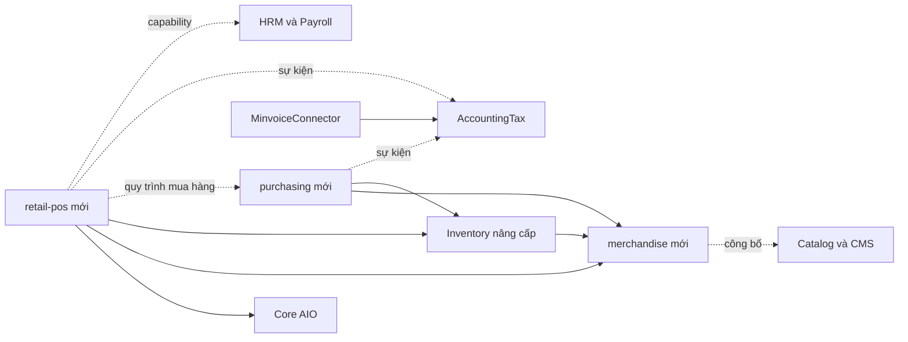
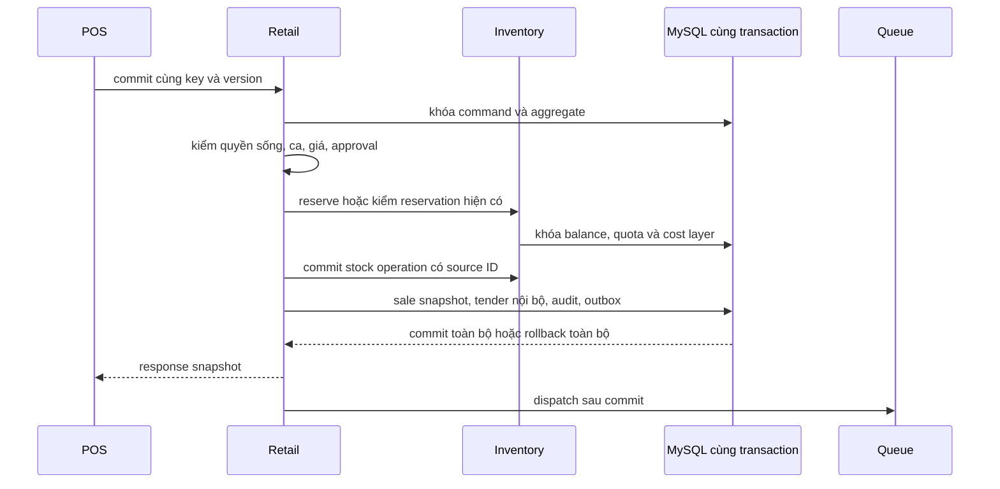

# Kiến trúc và tích hợp Retail POS

> Phiên bản đặc tả: `0.1.0` · Ngày: `2026-10-20`.
> Trạng thái: **Kiến trúc mục tiêu đang triển khai**. Phạm vi đã có ở bản development được ghi trong [tiến độ](retail-pos-implementation-status.md) và [contract runtime](../api/retail-pos-runtime-contract.md).
> Phạm vi: AIO triển khai riêng cho từng khách hàng, vận hành một hoặc nhiều chuỗi và nhiều chi nhánh trong cùng installation.

Retail POS sử dụng nền tảng AIO, một danh mục hàng hóa dùng chung và Inventory làm nguồn tồn chính thức. Bán hàng, thu tiền nội bộ và ghi nhận biến động kho phải nhất quán; tích hợp kế toán, hóa đơn điện tử và các kênh ngoài được xử lý bằng sự kiện có thể đối soát và retry.

Đọc cùng [đặc tả sản phẩm](retail-pos-product-spec.md) và [kế hoạch triển khai](retail-pos-implementation-plan.md). Yêu cầu chức năng nằm trong đặc tả sản phẩm; thứ tự xây dựng và release gate nằm trong kế hoạch. Tài liệu này xác định ranh giới dữ liệu, contract và các bảo đảm kỹ thuật.

## 1. Nền tảng hiện có và khoảng trống

Phần này ghi lại baseline trước khi triển khai Retail. Inventory development hiện đã nâng lên `0.3.0` và các module mới đã có source; đối chiếu tài liệu tiến độ để xác định khoảng trống còn lại.

| Thành phần AIO hiện có | Có thể tận dụng | Khoảng trống phải giải quyết |
| --- | --- | --- |
| Core auth, RBAC, audit và module lifecycle | Hai guard, quyền module, assignment theo scope, audit, coordinator/lease và recovery | Retail cần membership theo chuỗi/vùng/chi nhánh/quầy, approval hạn mức và drain nghiệp vụ |
| Catalog `0.2.1` | Danh mục, thông tin/hình ảnh để công bố lên website | `CatalogProduct` dùng `HasWebsiteScope`; không phải master SKU chung cho chuỗi |
| Inventory `0.2.0` | Kho/vị trí, item, lô, serial, balance, movement và cost layer | Một barcode/unit; transfer tức thời; tạo phiếu là posted; thiếu reservation API và ownership chi nhánh |
| AccountingTax `0.2.0` | Pháp nhân, đối tác, chứng từ, payment/refund, export | Cần adapter Retail và mapping pháp nhân; không thay workflow bán hàng hoặc mua hàng |
| MinvoiceConnector `0.2.0` | Connection policy, outbox và reconcile | Chỉ sử dụng khi contract/provider readiness và gate production hợp lệ |
| F&B POS `0.2.0-dev.2` | Pattern idempotency, version, approval, outbox và recovery | Retail có sale/return riêng; không phụ thuộc order/session/KDS của F&B |
| HRM và Payroll | Hồ sơ nhân sự, khóa tài khoản khi nghỉ việc và quy trình lương | Chỉ tích hợp qua capability; Retail không tự đọc bảng nhân sự/lương |

Các điểm source phải giữ đúng khi nâng cấp:

- [Inventory manifest](../../modules/Inventory/module.json) tại baseline phụ thuộc `cms` và `catalog`; việc tách dependency cần cả đường migration hợp lệ, không chỉ sửa manifest. Bản development mới sử dụng Merchandise và baseline migration riêng.
- [Migration Inventory ban đầu](../../modules/Inventory/database/migrations/2026_07_09_000001_create_inventory_module_tables.php) tạo FK thật từ `inv_items.catalog_product_id` tới `catalog_products`. Fresh install mới và upgrade installation cũ đều cần đường migration hợp lệ.
- [InventoryProductSyncService](../../app/Support/InventoryProductSyncService.php) lấy Catalog làm nguồn và có logic seed tồn ban đầu. Adapter mới phải ngăn seed tồn lần hai khi liên kết lại cùng hàng.
- [InventoryStockService](../../app/Support/InventoryStockService.php) hiện tạo `status=posted` ngay, transfer xuất và nhập cùng transaction; quantity/cost còn dùng `float`. Phương thức `consumeCostLayers` đọc FIFO theo ngày nhận, chưa thực hiện nhánh AVG dù UI có cấu hình.
- [InventoryAvailabilityResolver](../../app/Support/InventoryAvailabilityResolver.php) phục vụ storefront theo số nguyên và có fallback Catalog; Retail không sử dụng reader này cho hàng cân hoặc làm thẩm quyền tồn.
- [ModuleCapabilityChecker](../../app/Core/Modules/ModuleCapabilityChecker.php) kiểm module enabled và lifecycle đang chạy; capability mới phải công bố `introduced_version` để source mới không nhận nhầm installation cũ.

## 2. Ranh giới module và dependency mục tiêu



Mũi tên `A → B` nghĩa là A sử dụng contract của B; nét đứt là tích hợp tùy chọn. Core là nền tảng ứng dụng, không phải một package mới cần cài.

| Package | Vai trò và dependency mục tiêu | Quy tắc khi không sẵn sàng |
| --- | --- | --- |
| `merchandise` mới | Master catalog/SKU, đơn vị, quy cách, barcode, tracking policy; không bắt buộc CMS/Catalog/Accounting | Retail không được tạo giao dịch hàng hóa mới khi capability bắt buộc bị thiếu |
| `inventory` nâng cấp | Tồn duy nhất, reservation, lô, giá vốn, nhận/xuất/chuyển/kiểm kê; master link qua Merchandise | Dừng mutation bán/nhập/xuất; cho phép đọc lịch sử được phân quyền, không fallback tồn Catalog |
| `retail-pos` mới | Hard dependency: Merchandise và Inventory với đủ contract v2 | Enable bị chặn khi dependency/schema/contract chưa đạt; không tự cài/bật module khác |
| `purchasing` mới | Nhà cung cấp, PO, nhận/trả NCC và công nợ vận hành; dùng Merchandise và Inventory | POS vẫn bán hàng đã có tồn; không có workflow mua hàng khi Purchasing chưa enabled |
| Catalog/CMS | Công bố hàng lên website qua mapping; dependency legacy được giữ cho adapter cũ | Không ảnh hưởng POS; kênh website chỉ được mở khi mapping tồn/giá hợp lệ |
| AccountingTax/Minvoice | Adapter kế toán và hóa đơn điện tử theo pháp nhân | Sale đã commit được giữ; yêu cầu tích hợp ở trạng thái chờ/lỗi có thể đối soát |
| HRM/Payroll | Liên kết nhân viên và xuất facts ca/làm việc | Retail vẫn dùng Admin identity; không tự tính lương |

Purchasing là tùy chọn đối với việc cài POS, nhưng bắt buộc trong bộ module của pilot đầy đủ có mua/nhận/trả hàng. Mục tiêu G1 là Merchandise + Inventory cài được trên core trống mà không cần tạo bảng CMS/Catalog giả. Không duy trì hai cách ghi tồn cho Retail tùy theo module bật/tắt.

## 3. Nguồn dữ liệu và ownership

### 3.1. Chuỗi, chi nhánh và pháp nhân

`installation → chain → region tùy chọn → branch → warehouse/location và terminal → shift`. `website_key` tiếp tục phục vụ website context; không thay cho `chain_id` hoặc `branch_id`. Retail có thể gắn chuỗi với một website quản trị để tương thích core assignment, nhưng dữ liệu nghiệp vụ vẫn có khóa chuỗi/chi nhánh rõ ràng.

Retail giữ hồ sơ pháp nhân vận hành tối thiểu và tham chiếu ổn định của chi nhánh. Khi Accounting được cài, mapping tường minh một–một trong phạm vi sử dụng nối hồ sơ này với `AcctOrganization`; các trường pháp lý dùng phát hành hóa đơn do Accounting kiểm và snapshot. Không tự tạo pháp nhân kế toán hoặc tự chọn organization từ website mặc định.

Một kho có đúng một chủ sở hữu vận hành và một pháp nhân chịu trách nhiệm tại một thời điểm. Kho trung tâm có thể cấp hàng cho nhiều chi nhánh được phép nhưng không có nhiều pháp nhân cùng sở hữu một balance. Chuyển hàng khác pháp nhân phải đi workflow giao dịch liên pháp nhân riêng; bản đầu từ chối ordinary transfer giữa hai pháp nhân.

Đổi mapping pháp nhân/kho không được viết lại giao dịch đã posted. Khi còn tồn, hàng đi đường, reservation hoặc quota offline, phải chặn remap hoặc đi quy trình bàn giao có chứng từ và mốc hiệu lực.

### 3.2. Master hàng và các projection

| Miền sở hữu | Dữ liệu canonical | Miền khác được lưu |
| --- | --- | --- |
| Merchandise | Catalog dùng chung; SKU/variant, đơn vị gốc, tỷ lệ quy đổi, barcode, chính sách lô/hạn/serial | ID liên kết, revision và snapshot phục vụ giao dịch |
| Retail | Chuỗi, vùng, chi nhánh, terminal, ca, assortment, bảng giá/khuyến mại, sale/return/payment, khách hàng | Projection đã phân quyền; không có bảng balance độc lập |
| Inventory | Kho/vị trí, stock item, lô, balance/reservation, movement, cost layer và transfer/stocktake | Retail chỉ đọc qua service và giữ stock-operation ID |
| Purchasing | Supplier thương mại, PO, lịch giao, nhận/trả, điều khoản thanh toán và công nợ vận hành | Accounting giữ mapping đối tác và chứng từ tương ứng |
| Accounting | Tài khoản kế toán, chứng từ đã duyệt/posted, dữ liệu thuế và trạng thái pháp lý | Retail giữ trạng thái liên kết; không tự sửa chứng từ kế toán |

Không dùng SKU/barcode làm FK thay cho ID bất biến. Một SKU có nhiều mã theo quy cách, ví dụ lon/lốc/thùng cùng quy về đơn vị gốc. Mã nhà cung cấp hoặc mã website được map về cùng SKU; không tạo thêm stock item chỉ vì có thêm kênh.

### 3.3. Schema khái niệm mục tiêu

Tên sau là đề xuất để lập migration, chưa phải schema hiện hành. Bảng do module sở hữu phải đặt trong package migration của module đó.

| Nhóm | Thực thể/bảng mục tiêu | Ràng buộc quan trọng |
| --- | --- | --- |
| Merchandise | `merch_catalogs`, `merch_skus`, `merch_units`, `merch_packagings`, `merch_barcodes`, `merch_channel_links` | SKU unique trong catalog; barcode resolve duy nhất trong catalog/quy cách; đổi tỷ lệ không làm đổi snapshot cũ |
| Retail tổ chức | `retail_chains`, `retail_regions`, `retail_branches`, `retail_legal_entities`, `retail_terminals`, `retail_branch_warehouse_links` | Mọi terminal thuộc một branch; kho mapping có owner/pháp nhân; branch có timezone và business-day policy |
| Retail quyền | `retail_memberships`, `retail_role_bindings`, `retail_approval_policies`, `retail_approvals` | Assignment theo chuỗi/vùng/branch; approver khác maker khi policy yêu cầu; approval giới hạn một ý định |
| Retail thương mại | `retail_assortments`, `retail_price_books`, `retail_price_revisions`, `retail_promotions`, `retail_policy_publications` | Revision bất biến sau công bố; có effective time, branch targets và ACK |
| Retail giao dịch | `retail_sales`, `retail_sale_lines`, `retail_tenders`, `retail_returns`, `retail_return_lines`, `retail_refunds`, `retail_shifts`, `retail_cash_movements` | UUID public, version, source lineage, currency, pháp nhân và snapshot; không hard delete giao dịch posted |
| Retail nền | `retail_commands`, `retail_outbox`, `retail_inbox`, `retail_integration_links`, `retail_number_sequences` | Unique command/event/source identity; request fingerprint; sequence theo scope, không dùng `max(id)+1` |
| Inventory v2 | Bổ sung owner/link, reservation/fulfillment, transfer dispatch/receipt, stocktake, blocked stock và escrow | Unique balance theo owner/kho/location/item/lô; quantity available trừ reservation và quota được giao |
| Purchasing | `purchase_suppliers`, `purchase_orders`, `purchase_order_lines`, `purchase_receipts`, `purchase_returns`, `purchase_obligations` | PO revision, nhận nhiều lần, remaining quantity, source invoice reference và ledger thanh toán |
| Edge | `retail_gateways`, `retail_authority_epochs`, `retail_offline_grants`, `retail_edge_batches`, `retail_sync_cursors` | Một authority cho mỗi quota; epoch fencing, contiguous sequence, hash và ACK bền vững |

FK trong cùng package được dùng bình thường. Liên kết sang module tùy chọn dùng mapping sở hữu rõ, kiểm existence/capability tại boundary và giữ snapshot; không để uninstall module tùy chọn xóa dây chuyền dữ liệu Retail. Liên kết bắt buộc Merchandise–Inventory–Retail có thể dùng FK khi lifecycle và thứ tự migration đã bảo đảm, luôn `restrict` đối với lịch sử cần giữ.

### 3.4. Số lượng, tiền và thời gian

- API truyền quantity, unit cost và tỷ lệ dưới dạng chuỗi decimal; tính bằng decimal/rational chính xác, không chuyển qua `float` trong controller/service/serializer.
- Đề xuất quantity tối đa 6 chữ số thập phân; Inventory legacy `decimal(14,3)` phải được nâng precision trước khi nhận hàng cân có precision lớn hơn. Unit cost cần precision đủ để phân bổ thùng/lốc và giá vốn; giới hạn cuối cùng chốt bằng migration G1 và test overflow.
- Tổng thanh toán dùng minor unit của currency; VND có minor unit 1 đồng. Tính trung gian precision cao, làm tròn tại boundary đã định nghĩa; không làm tròn mỗi bước rồi cộng lại tùy ý.
- Discount/thuế phân bổ xuống dòng bằng phương pháp xác định, remainder phân phối ổn định theo line identity. Tổng dòng luôn khớp tổng đơn. Return tích lũy không được vượt phân bổ ban đầu.
- Snapshot giao dịch giữ đơn vị, conversion, base quantity, giá, thuế, discount, revision, currency, pháp nhân, branch và costing reference.
- Timestamp lưu UTC, API dùng ISO 8601 có offset; báo cáo theo timezone/business day của branch. Không lấy ngày máy thu ngân làm ngày chứng từ trung tâm.

## 4. Capability và API mục tiêu

### 4.1. Capability registry

Các tên dưới đây là **contract dự kiến**. Chỉ thêm vào manifest khi implementation và test đã có; phải khai báo `introduced_version` khớp bản cài cung cấp contract đó. Không giả định capability chỉ vì schema legacy còn tồn tại.

| Module | Capability mục tiêu | Semantics tối thiểu |
| --- | --- | --- |
| Merchandise | `merchandise.skus.read.v1`, `merchandise.skus.manage.v1` | Resolve SKU/UOM/barcode trong catalog được phép; trả revision và decimal policy |
| Inventory | `inventory.availability.read.v2` | Available theo owner/pháp nhân/kho/lot, quantity decimal; không fallback Catalog |
| Inventory | `inventory.reservations.manage.v2` | Reserve/adjust/release/expire/commit idempotent; transaction-aware; lock trên balance đủ để chống oversell |
| Inventory | `inventory.movements.post.v2` | Ghi stock/cost ledger có source identity; tham gia transaction của caller |
| Inventory | `inventory.transfers.manage.v2`, `inventory.stocktakes.manage.v2` | Dispatch/receive từng phần, hàng đi đường, chênh lệch và mốc kiểm kê |
| Inventory | `inventory.offline.escrow.v1` | Cấp quota/epoch, giữ hàng và nhận consumption theo sequence, không reclaim mù |
| Purchasing | `purchasing.orders.manage.v1`, `purchasing.receipts.manage.v1` | PO/receive/return có version và source identity; nhận hàng gọi Inventory v2 |
| Retail | `retail.sales.read.v1`, `retail.sales.commit.v1`, `retail.returns.manage.v1` | Sale/return snapshot và commit contract dùng chung bởi UI và adapter |

Các contract Accounting/Minvoice hiện hành phải qua adapter kiểm phiên bản thực tế. Nếu thiếu API phù hợp thì bổ sung capability riêng bằng upgrade của module đích; không gọi trực tiếp bảng optional để lách contract.

Readiness là tổng hợp của installed version, schema/precision, capability, lifecycle state và mapping đã kiểm; không chỉ là kết quả đọc manifest. Enable Retail phải chạy preflight các điều kiện này. Worker dài hạn và command trong transaction kiểm lại state cần thiết để nhận biết dependency bị drain giữa hai request.

### 4.2. HTTP và service boundary

Base mục tiêu: `/admin/api/retail`; UI `/admin/modules/retail-pos/*`. Middleware tối thiểu: `auth:admin → admin.active → website compatibility context → module.enabled:retail-pos → retail context/authorization`. Xử lý organization-only account tiếp tục tuân core; assignment Accounting không mặc nhiên mở Retail.

Nhóm endpoint dự kiến:

| Nhóm | Endpoint/command ví dụ | Kiểm soát |
| --- | --- | --- |
| Context | `GET /context`, `GET /branches`, `GET /branches/{id}/assortment` | Chỉ branch được truy cập; response có khả năng bị giới hạn và revision |
| Quầy/ca | `POST /branches/{id}/shifts`, `POST /shifts/{id}/close`, `POST /shifts/{id}/reconcile` | Terminal binding, business day, expected version và unresolved payments |
| Bán hàng | `POST /sales`, `POST /sales/{id}/quote`, `PUT /sales/{id}/lines`, `POST /sales/{id}/commit` | Reprice server-side, stock reservation, approval, command identity |
| Thanh toán | `POST /sales/{id}/payment-intents`, `GET /payment-intents/{id}`, `POST /payments/{id}/reconcile` | Provider/server evidence; không nhận `paid=true` làm bằng chứng |
| Đổi trả | `POST /sales/{id}/returns`, `POST /returns/{id}/commit`, `POST /refunds/{id}/reconcile` | Original line, phần còn được trả, disposition, pháp nhân và giới hạn người duyệt |
| Chính sách | `POST /price-books/{id}/publish`, `GET /publications/{id}/acks` | Effective time, immutable revision và target branches |
| Recovery | `GET /commands/{key}`, `GET /integrations`, `POST /integrations/{id}/retry` | Chỉ identity được phép; retry giữ nguyên operation, không phát sinh sale mới |
| Edge | `/gateways/*`, `/offline-grants/*`, `/sync/batches` | Kênh máy với credentials riêng, fencing và scope thiết bị; không dùng cookie admin làm token máy |

Mutations yêu cầu `Idempotency-Key`; update thêm `expected_version` hoặc version map của các aggregate bị thay đổi. Branch/terminal có thể được chọn qua route/header nhưng server phải đối chiếu membership, terminal binding, entity owner và pháp nhân; body không được quyết định actor/approval/owner đáng tin cậy.

Response thành công theo dạng `{data, meta}`; meta có `request_id`, `version`, `replayed` và trạng thái tích hợp. Lỗi theo `{message, code, request_id, details}`. Dùng `409` cho stale version/command conflict, `422` cho input không hợp lệ, `403/404` theo policy chống lộ tài nguyên, `503` khi dependency bắt buộc đang drain/unavailable. `RETAIL_PAYMENT_UNCERTAIN` và `RETAIL_COMMAND_UNCERTAIN` giữ ý định cũ để đối soát, không hướng dẫn tạo key mới.

Idempotency fingerprint gồm actor, chain, branch, terminal, command type, payload canonical và các revision liên quan. Cùng key khác fingerprint bị từ chối; cùng key của command đã commit trả snapshot kết quả cũ dù sale đã đóng. Status endpoint không trả PII hoặc tender secret cho identity khác.

Ví dụ request **mục tiêu** cho commit tiền mặt; quote và tổng phải được server kiểm lại, actor/branch/pháp nhân lấy từ context đã xác thực:

```http
POST /admin/api/retail/sales/019a0000-0000-7000-8000-000000000001/commit
Idempotency-Key: terminal-01-sale-000042-commit
X-Retail-Terminal: 019a0000-0000-7000-8000-000000000010
Content-Type: application/json

{
  "expected_version": 7,
  "quote_id": "019a0000-0000-7000-8000-000000000020",
  "tenders": [{"method": "cash", "amount_minor": 65000, "tendered_minor": 100000}]
}
```

Server không nhận unit price/tax/discount từ request này làm nguồn đúng. Nếu quote hết hiệu lực hoặc giỏ đã đổi, trả lỗi yêu cầu xác nhận quote mới trước thu tiền; retry ý định cũ sau kết quả uncertain phải tra command trước. Hình thức thanh toán điện tử đi payment intent riêng, không thay `method` bằng `bank` rồi dùng request tương tự làm bằng chứng đã nhận tiền.

## 5. Giao dịch bán hàng online

### 5.1. Commit nội bộ và Inventory



Đây là local transaction trên cùng connection/MySQL. Inventory service không tự commit transaction ngoài, không HTTP gọi lại chính ứng dụng và không phát provider request trong transaction. Lock order ổn định theo owner/kho/item/lô/aggregate ID; có bounded retry deadlock nhưng luôn giữ command identity.

Mất response sau commit được giải bằng replay/status lookup. Không có trạng thái sale completed nhưng stock operation chưa ghi vì worker chưa chạy. Read model có thể trễ, nhưng số tồn dùng để quyết định bán phải kiểm lại trong transaction.

### 5.2. Thanh toán điện tử

Không giữ DB lock khi chờ ngân hàng/provider. Tạo payment intent idempotent và stock hold có hạn trước; gọi provider sau commit, nhận callback đã xác thực hoặc query trạng thái. Payment state chuẩn gồm `created → pending → confirmed|failed|unknown`; API dùng error code `RETAIL_PAYMENT_UNCERTAIN` cho kết quả `unknown`. Sale hoàn tất khi đủ bằng chứng và đủ các điều kiện commit. `funds_received/stock_attention` là tình trạng xử lý ngoại lệ của sale/intent đã có tiền xác nhận, không phải bằng chứng rằng sale đã hoàn tất.

Callback trùng, sai thứ tự hoặc tới muộn được xử lý bằng provider-event identity và version. Nếu tiền đã thu nhưng hold hết hạn/tồn không còn, ghi exception có tiền thật và workflow fulfill/refund có kiểm soát; không ghi sale thành công giả, không làm mất payment vì rollback một transaction mới. Thời hạn hold và tự release không được vượt qua payment còn uncertain mà không có recovery policy.

Thanh toán nhiều phương thức có một allocation snapshot. Cash movement chỉ ghi cho phần tiền mặt; tiền khách đưa và tiền thừa tách khỏi doanh thu. Khi một tender thất bại, trạng thái sale phản ánh phần đã thu; retry không thu lại phần confirmed.

### 5.3. Return và refund

Lock sale line gốc cùng các return allocation liên quan. Kiểm tổng quantity, refund, discount/thuế và điểm/quà đã đảo; tạo return theo phần quyền lợi còn lại. Hàng trả về saleable/quarantine/damaged là quyết định riêng với hoàn tiền. Ghi Inventory receipt/reclassification và return nội bộ trong cùng transaction; external refund đi intent/reconcile như thanh toán.

Cross-branch return chỉ được mở khi policy cho phép, cùng pháp nhân và có kiểm quyền ở chi nhánh nhận; giữ branch bán và branch xử lý để đối soát. Khác pháp nhân hoặc không có đơn gốc đi workflow riêng, bị chặn ở pilot đầu nếu chưa có contract và UAT.

## 6. Mua hàng và vận hành kho

Purchasing sở hữu quy trình `draft → submitted → approved → partially_received → received → closed`; có cancel phần chưa nhận. Inventory sở hữu chứng từ và stock ledger khi nhận. Receipt giữ PO line, quantity thực nhận, quy cách, lô/hạn, hàng tặng, landed cost và phần chênh lệch. Receipt posted + PO received counters + stock/cost movement phải commit cùng transaction; không có worker cộng tồn trễ.

Trả NCC giữ lineage về receipt, giới hạn phần còn trả, loại disposition và giá vốn. Công nợ vận hành dùng ledger nghĩa vụ/thanh toán, không cộng từ các phiếu có thể chỉnh sửa. Khi Accounting được bật, map sang chứng từ/party để đối soát; không ghi nhận lần hai cùng nghĩa vụ chỉ vì replay adapter.

Trong Purchasing, hàng đã nhận nhưng chưa có hóa đơn NCC là khoản nhận-chưa-đối-chiếu, không tự cộng thêm một payable thứ hai khi hóa đơn tới. Nghĩa vụ vận hành, thanh toán và ứng trước có source identity cùng allocation; Accounting giữ bản ghi kế toán tương ứng qua mapping, không trở thành một màn hình khác để tạo lại khoản chi nguồn. Nếu thanh toán được khởi tạo từ Accounting, adapter phải gắn về cùng nghĩa vụ và payment identity hoặc đưa vào hàng chờ đối chiếu trước khi giảm công nợ Purchasing.

Transfer cùng pháp nhân: `draft → requested → approved → dispatched → partially_received → received → reconciled`. Dispatch trừ kho nguồn và tăng hàng đi đường; receive giảm hàng đi đường và tăng kho nhận theo số thực nhận. Thiếu/hỏng/thừa đi chứng từ điều chỉnh có duyệt; không tự tạo hàng hoặc giá vốn để ép khớp. Phần chưa xuất có thể hủy; phần đã xuất phải receive/return-to-origin/claim theo policy, không xóa transfer.

Stocktake giữ phạm vi và snapshot/cursor mốc đếm. Pilot khóa phạm vi đang đếm, drain hoặc loại tường minh reservation/quota; chặn sale/reserve/receive/transfer tại phạm vi đó, các khu vực khác vẫn hoạt động. Tính delta theo cursor để vừa đếm vừa chuyển động trong cùng phạm vi là P1/G5, cần contract và test riêng. Maker khác checker khi vượt ngưỡng. FEFO là chọn lô xuất vật lý; FIFO/AVG là phương pháp giá vốn. Pilot chỉ bật FIFO; AVG bị từ chối cho đến khi thuật toán và fixture G5 được nghiệm thu.

## 7. Tích hợp các module hiện có

### 7.1. Catalog và CMS

Merchandise là master của hàng Retail; Catalog lưu nội dung xuất website và mapping SKU/channel. Thay đổi title/SEO website không tạo SKU hoặc tồn mới. Phải xác định field owner để sync không ghi đè hai chiều: SKU/UOM/barcode/tracking từ Merchandise; nội dung/SEO theo website do Catalog/CMS; giá/tồn public lấy projection được cấp phép.

Website chỉ bán hàng ở assortment/kho đã map; không lấy tổng tồn toàn installation. Checkout phải dùng reservation/commit Inventory v2 nếu cùng chia sẻ hàng Retail; không để checkout legacy đọc projection rồi bán không giữ hàng trong khi POS đang bán. Mở kênh website là release gate riêng, không tự bật sau khi mapping sản phẩm thành công.

### 7.2. AccountingTax và Minvoice

Event sale/return/cash/purchase chứa source ID, event version, branch, legal entity, snapshot và stock/cost references. Adapter tạo internal draft idempotent, kiểm organization mapping, item/tax mapping và quyền đích. Không auto-approve/posted/issue hóa đơn chỉ vì sale completed.

Một source operation có một integration link duy nhất theo `(source_operation_id, destination_module, operation_type)`. Pháp nhân đích là thuộc tính bất biến đã kiểm theo pháp nhân nguồn; contract version là metadata bất biến của payload/attempt, không tạo identity tài chính mới khi nâng contract. Retry giữ link/source; failure sau destination commit được reconcile theo source reference trước khi create lại. Thay thế chứng từ đã tạo phải dùng replacement/reversal lineage tường minh. Mapping mới có hiệu lực cho sự kiện mới hoặc replay có migration policy, không âm thầm đổi pháp nhân của lịch sử.

Minvoice tiếp tục tuân global network/production gates, connection policy, reviewed contract và trạng thái pháp lý. In bill POS và phát hành hóa đơn điện tử là hai trạng thái riêng. Lỗi hóa đơn được hiển thị/đối soát mà không rollback một sale đã thu tiền. Quy trình pháp lý cụ thể được cấu hình theo deployment và contract provider tương ứng.

### 7.3. HRM, Payroll và F&B

Retail dùng `admins` làm identity; membership Retail không tạo tài khoản riêng. Có thể map employee và phát facts ca/làm việc qua adapter; Payroll quyết định tính lương. HRM terminate/khóa tài khoản phải làm invalid online session qua `auth_version`; quyền offline chỉ tồn tại đến thời hạn grant đã ký.

F&B không là dependency. Pattern command runner có thể được trích thành hạ tầng dùng chung sau regression của cả hai miền; không dùng bảng F&B để chứa Retail sale, customer scope, ca hoặc bill, và không refactor F&B rộng chỉ để khởi động Retail.

### 7.4. Outbox, inbox và quyền tự động

Ghi event vào outbox cùng transaction nghiệp vụ; dispatch sau commit. Consumer có inbox/destination uniqueness nên chấp nhận delivery lặp. Mục tiêu là effect đúng một lần về nghiệp vụ dù truyền ít nhất một lần, không hứa transport exactly-once.

Event envelope tối thiểu có `event_id`, `schema_version`, `event_type`, `occurred_at`, `source_module`, `source_operation_id`, `chain_id`, `branch_id`, `legal_entity_ref`, `correlation_id` và payload cần thiết. Consumer hỗ trợ version được công bố; version chưa biết chuyển sang hàng chờ xử lý có cảnh báo thay vì bỏ event. Việc đổi schema phải có upcaster hoặc contract mới và kiểm replay lịch sử.

Automation phải opt-in, có người cấp quyền, scope/destination/action và policy revision. Worker kiểm lại capability, lifecycle, authorization version, mapping và native permission ở thời điểm chạy. Module bị tắt hoặc actor bị thu hồi thì dừng/review; không dùng tài khoản System Owner mặc định để lách quyền.

## 8. Phân quyền và bảo vệ dữ liệu

Core giữ scope `global|website|organization`; organization chỉ dành cho các module Accounting được core cho phép. Retail thêm membership/preset riêng theo HQ/vùng/branch/terminal, không thêm scope `branch` vào core trong baseline này.

Một mutation hợp lệ phải đạt đồng thời permission module, membership phạm vi, terminal/shift binding, ownership entity, trạng thái nghiệp vụ và approval khi cần. Global Retail role không mặc nhiên có permission Inventory/Accounting; thao tác quản trị trực tiếp module đích cần native quyền đích. Dịch vụ bán hàng dùng contract Inventory trong phạm vi warehouse được cho phép bởi chính sách Retail đã công bố, không cấp quyền chỉnh kho tổng quát cho thu ngân.

Khi quản trị mapping/integration, actor cần cả Retail permission và native destination permission. Các quyền xem giá vốn, khách hàng, công nợ, dữ liệu chuỗi và audit tách khỏi quyền bán. Kiểm scope cho list/search/export/import/download, không chỉ API update; báo cáo tổng hợp không được lộ chi nhánh ngoài phạm vi.

Approval gắn command intent hash, branch, amount/quantity limit, maker/approver và expiry; consume một lần trong transaction. Không nhận `approved_by` từ body/header. Thay ý định cần approval mới. Audit append-only/hash-chain theo contract core, mask PII/secret, giữ request/source/device identity; không rewrite chain để hợp thức hóa lịch sử.

Gateway credentials tách Admin credentials, dùng TLS và device identity; revoke/rotate có quy trình. Không log token, raw provider secret hoặc thông tin khách hàng không cần thiết. Backup/artifact có quyền tải và retention; thay chính sách lưu dữ liệu không xóa ledger cần đối soát.

## 9. Offline nhiều quầy và quyền ghi tồn

### 9.1. Phạm vi và authority

G2/G3 là online với recovery chống mất đơn/thu trùng. Full offline pilot thuộc G4 và chỉ được công bố sau test. Bản offline đầu cho sale tiền mặt bằng SKU/giá/quota đã cấp; không dùng điểm/ví/coupon một lần, cross-branch return, nhập/điều chuyển kho hoặc xác nhận thanh toán điện tử khi không có bằng chứng online.

Mỗi cửa hàng dùng một gateway có database bền vững và mọi quầy của phạm vi được giao đi qua cùng authority, kể cả khi WAN còn hoạt động. Gateway giữ subledger của quota được Inventory ủy quyền, không phải một nguồn tồn độc lập thứ hai. Browser cache chỉ giữ projection/giỏ/recovery metadata; không được coi là nơi duy nhất giữ giao dịch tiền đã thu.

Inventory cấp escrow theo owner/kho/item/lô, gateway ID, authority epoch và expiry. Quantity đã cấp bị loại khỏi available dành cho central/website/authority khác. Các quầy của gateway chia sẻ cùng quota, không mỗi quầy nhận bản sao đầy đủ. Reservation ở central không được dùng phần đã cấp cho gateway.

Quy tắc bảo toàn: `central_available = physical_on_hand − central_reservations − outstanding_escrow − blocked_stock`. `outstanding_escrow` tại central bằng lượng đã cấp trừ consumption đã ingest và lượng trả lại đã được xác nhận. Phần gateway đã bán nhưng central chưa ingest vẫn nằm trong escrow central; không dùng số quota còn lại do gateway báo để mở tồn bán ở central trước khi post consumption. Khi nhập edge sale, central giảm physical stock và escrow tương ứng trong cùng transaction; không trừ tồn lần hai vì replay. Tất cả bucket phải không chồng lấn; hàng đang đi đường không nằm trong sellable của kho đích.

### 9.2. Ghi và đồng bộ

1. Online provisioning xác thực gateway, công bố SKU/giá/policy revision và cấp quota/epoch; gateway ACK đã ghi bền trước khi mở bán.
2. Quầy gửi command có device ID/key. Gateway kiểm cash-only, grant, ca, giá, quota và version; commit sale/tender/quota consumption/audit/outbox local atomically rồi mới trả thành công/in bill.
3. Gateway phát event có `(gateway, epoch, sequence)` tăng đơn điệu, source UUID, schema version, payload hash và previous hash. Batch gửi kèm checkpoint; central kiểm scope, signature và gap.
4. Central khóa inbox/quota, nhận sequence hợp lệ, ghi Retail/Inventory ledger và integration outbox một lần. ACK chỉ gửi sau commit; gateway chỉ đánh dấu synchronized sau khi lưu ACK bền.
5. Batch mất ACK được gửi lại cùng IDs. Gap phải nhận lại phần thiếu; duplicate hash khác phải cách ly và cảnh báo. Giao dịch đã thu tiền hợp lệ không được biến mất vì schema/mapping lỗi: lưu exception có bằng chứng và xử lý reconciliation/compensation.
6. Close shift có thể provisional khi offline; chỉ reconciled cuối cùng khi sequence đã được central ACK, cash count và các exception đã xử lý.

Giá vốn/lô được phân bổ khi cấp quota hoặc theo cơ chế layer ownership đã chốt, để central không tiêu thụ cùng cost layer rồi thiếu giá vốn khi ingest. Hàng cần lô/serial/hạn chỉ cấp offline nếu gateway có đủ identity và policy; hết hạn vẫn chặn tại quầy theo business date đáng tin cậy.

### 9.3. Fencing, thu hồi và giới hạn

Chỉ một epoch đang có quyền ghi cho cùng quota. Đổi gateway/authority cần drain, đồng bộ đến checkpoint, trả quota còn lại, fence epoch cũ rồi mới cấp mới. Hết heartbeat không đủ bằng chứng rằng gateway cũ đã ngừng bán; không tự reclaim quota khi chỉ quá timeout hoặc mất kết nối.

Grant offline phải được ký, chứa actor/auth version, quyền được phép, terminal/branch, policy/price revision, hạn thời gian, hạn mức tiền và quota. Khuyến nghị baseline pilot tối đa 4 giờ và không vượt ca; G0 xác nhận giá trị vận hành trước khi cấu hình. Gateway dùng kiểm soát clock rollback/monotonic elapsed time; hết grant thì dừng mutation, không cấp quyền mới offline.

Quyền bị thu hồi ở HQ trong lúc mất WAN không thể cập nhật tức thời tới gateway. Rủi ro được giới hạn bằng thời hạn grant/hạn mức và audit; không tuyên bố khóa nhân viên offline có hiệu lực ngay. Nếu không chấp nhận cửa sổ này thì phải yêu cầu online cho thao tác tương ứng.

Gateway mất ổ đĩa/backup/khóa hoặc nghi bị sao chép đi quy trình sự cố riêng. Central giữ quota bị treo, không phát lại cho writer khác trước khi có fence/recovery được chứng minh. Cửa hàng có thể chuyển online trên phần tồn chưa được ủy quyền; tuyệt đối không mở lại cùng quota bằng thao tác sửa balance thủ công.

## 10. Migration và chuyển đổi an toàn

### 10.1. Cài mới

Core migrate → cài Merchandise → cài Inventory vNext → cài Retail → cài Purchasing nếu vận hành bộ pilot. Accounting/Minvoice/HRM/Catalog cài theo nhu cầu. Core production migrate không aggregate mọi migration module; lifecycle là đường duy nhất cài/nâng package.

Inventory migration mới phải tạo schema không phụ thuộc bảng Catalog. Baseline đề xuất dùng đường package migration đã version hóa, ví dụ `database/migrations/v2`, trong manifest Inventory vNext. Giữ nguyên file legacy và migration ledger đã chạy; runner vNext không chạy lại tập migration legacy trên fresh install và không đánh dấu giả rằng legacy migration đã chạy. Baseline v2 chỉ tạo bảng còn thiếu theo schema tương thích, sau đó forward migration nâng dữ liệu/bảng hiện có và tháo FK Catalog khi đã có mapping. Điều kiện tồn tại bảng/cột/index phải được guard để đi được cả fresh và upgrade. Phát hiện bảng hiện hữu không khớp lineage phải trả recovery-required, không tự coi là fresh rồi nhận dữ liệu không rõ nguồn.

Migration discovery của test, status/recovery và rollback tooling phải nhận diện đường package hiện hành lẫn đường lịch sử; không chỉ quét cố định `modules/*/database/migrations`. G0 kiểm chứng thiết kế này bằng subprocess fresh core và upgrade fixture có dữ liệu; G1 thực hiện trước khi bỏ hard dependency. Không sửa ý nghĩa migration đã chạy, không tạo bảng Catalog giả và không chỉ sửa manifest rồi bỏ qua lỗi FK.

### 10.2. Upgrade có dữ liệu

1. Chụp backup, inventory checksum và baseline module versions; chạy dry-run liệt kê Catalog/InvItem trùng SKU, đơn vị không rõ, balance/cost layer thiếu, mapping pháp nhân mâu thuẫn.
2. Thêm schema Merchandise và mapping mới; nâng precision/constraints bằng forward migration có guard cho partial MySQL DDL failure. Giữ ID/ledger legacy và đường đọc tương thích.
3. Backfill bằng mapping tường minh, báo cáo trường hợp mơ hồ để xử lý. Không tự merge vì trùng tên/SKU xuyên website và không seed opening balance khi item đã có movement.
4. Chuyển Catalog sync thành adapter có direction/field owner. Thêm Inventory API v2, test tương đương ledger và consumer cũ; chưa tháo compatibility v1.
5. Chỉ tháo FK Catalog và hard dependency CMS/Catalog qua forward upgrade sau khi fresh install + legacy upgrade + optional-module absence đã pass. Data/reference lịch sử vẫn giữ.
6. Cutover một tập kho/branch canary sau đối chiếu quantity/value/reservations/cost layers. Có authority flag và checkpoint; chỉ một đường ghi cho từng stock scope.
7. Mở dần chi nhánh sau reconciliation. Các API legacy có thể phá ownership/quota của kho Retail phải bị chặn hoặc đi cùng authorization/contract v2, không để đường vòng ghi stock.

### 10.3. Backout và lifecycle

Backout dừng mở giao dịch mới ở scope canary, drain ca/payment/reservation/outbox, đối soát checkpoint rồi quay lại binary tương thích với schema/ledger hiện tại. Không rollback migration phá dữ liệu, xóa movement, reset stock hoặc sửa installation version bằng tay. Khi có dữ liệu v2 mà binary cũ không hiểu, dùng forward fix hoặc bản tương thích, không chạy bản cũ lên ledger mới.

Retail/Inventory/Merchandise disable phải kiểm dependency và trạng thái vận hành; chặn khi còn payment uncertain, reservation, ca đang mở, transfer đang đi đường hoặc offline epoch/quota chưa thu hồi. Uninstall Retail/Purchasing bị từ chối khi đã có lịch sử cần giữ; disable giữ schema/data/audit. Worker đang chạy phải kiểm drain/capability lần nữa trước mutation.

## 11. Kiểm thử contract và điều kiện phát hành

| Gate | Bằng chứng bắt buộc |
| --- | --- |
| G0 thiết kế | Ownership, scope, rounding, stock authority, provider policy, offline boundary và mapping pháp nhân nhất quán giữa ba tài liệu |
| G1 nền dùng chung | Fresh core → Merchandise/Inventory không CMS/Catalog; upgrade từ Inventory/Catalog hiện tại; không seed tồn trùng; SKU/UOM/barcode và decimal tests |
| G2 online | MySQL competing-process: món cuối, double commit, response lost, partial tender, late callback, reservation expiry và cumulative return; sale/stock atomicity |
| G3 chuỗi | Scope HQ/vùng/branch; transfer nhận thiếu/nhiều lần; kiểm kê khóa phạm vi và vẫn bán phạm vi khác; publish giá/ACK; Purchasing receipt atomic; adapters unavailable không làm mất sale |
| G4 offline và pilot | Split-brain/fencing, một authority cho từng quota, quota hết, clock rollback, mất ACK, sequence gap, disk full/power loss, gateway mất và actor revoke khi offline; đối soát đủ tại 2–3 chi nhánh |
| G5 mở rộng | Benchmark đúng profile chi nhánh/SKU/quầy đã chốt, restore drill, queue lag/recovery, report reconciliation và rollout canary theo nhóm |

SQLite phù hợp unit/fixture nhưng không chứng minh row lock/concurrency của MySQL. Regression phải bao gồm consumer cũ: Catalog-only/storefront, Inventory v1, F&B local adapter, Accounting warehouse bridge, auth/RBAC và lifecycle recovery. Không coi migration đã chạy hoặc file API đã có là bằng chứng contract hoàn tất.

## 12. Quyết định kiến trúc mục tiêu

| ID | Quyết định | Hệ quả triển khai |
| --- | --- | --- |
| ADR-RET-001 | Retail là module riêng; F&B không là dependency | Domain/tables/commands riêng; tái sử dụng hạ tầng sau khi có contract và regression |
| ADR-RET-002 | Merchandise là master hàng dùng chung mới | Catalog thành kênh công bố; không sao chép master theo chi nhánh |
| ADR-RET-003 | Inventory là stock authority bắt buộc | Nâng contract v2 và bỏ fallback Retail; không tạo kho riêng trong Retail |
| ADR-RET-004 | Purchasing tách thành module tái sử dụng | POS cài không bắt buộc Purchasing; pilot mua/nhận/trả dùng cả bộ |
| ADR-RET-005 | Online sale/stock/internal tender cùng local transaction | Adapter Inventory synchronous; provider/accounting ngoài transaction qua outbox |
| ADR-RET-006 | Scope branch thuộc Retail membership | Giữ invariant core RBAC và kiểm quyền module đích riêng |
| ADR-RET-007 | Snapshot và compensation giữ lịch sử | Posted sale/return/movement immutable; không hard delete để sửa sai |
| ADR-RET-008 | Offline dùng gateway/quota/epoch có giới hạn | G4 mới công bố offline; không dựa vào browser journal để hứa liên tục nhiều quầy |
| ADR-RET-009 | Migration tiến tới, có compatibility v1 và canary | Tháo dependency/FK chỉ sau test hai đường fresh/upgrade; không destructive rollback |
| ADR-RET-010 | Hóa đơn điện tử và sale có state riêng | Tuân gate provider hiện có; không auto-issue/approve hoặc rollback sale vì lỗi provider |

Các quyết định trên là baseline để tách work package G0–G5. Thay đổi ảnh hưởng ownership, stock authority, pháp nhân hoặc offline fencing phải cập nhật cả đặc tả sản phẩm, contract và release gate trước khi triển khai consumer mới.
