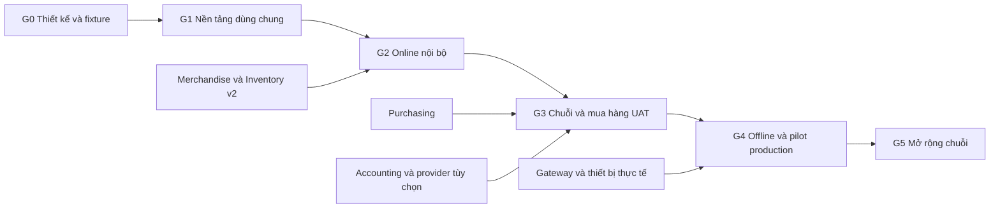

# Kế hoạch triển khai Retail POS theo giai đoạn

> Phiên bản: `0.1.0` · Cập nhật: `2026-10-20`.
> Trạng thái: **Kế hoạch mục tiêu đang triển khai**. Xem [tiến độ thực tế](retail-pos-implementation-status.md) và [contract runtime](../api/retail-pos-runtime-contract.md); các gate dưới đây vẫn cần nghiệm thu độc lập.
> Phạm vi: vận hành chuỗi siêu thị mini và cửa hàng tạp hóa trên AIO.

Retail POS được triển khai theo các lát cắt có thể kiểm chứng, từ nền tảng hàng hóa và tồn kho đến pilot nhiều chi nhánh. Mỗi giai đoạn chỉ kết thúc khi có bằng chứng về giao dịch, dữ liệu, phân quyền và vận hành; sự hiện diện của màn hình hoặc module manifest không thay thế nghiệm thu.

Đọc cùng [đặc tả sản phẩm](retail-pos-product-spec.md) và [kiến trúc cùng contract tích hợp](retail-pos-architecture-and-integration.md). Đặc tả xác định hành vi cần có; tài liệu kiến trúc xác định nguồn dữ liệu và ranh giới giao dịch; kế hoạch này xác định thứ tự, đầu ra và điều kiện chuyển giai đoạn.

## 1. Nguyên tắc triển khai

1. Retail POS là module mới `retail-pos`; không sử dụng mô hình order, session hay bill của F&B làm dữ liệu bán lẻ.
2. Một nguồn tồn chính thức thuộc Inventory. Retail không duy trì một ledger tồn có quyền ghi độc lập và không fallback về `catalog_products.stock` khi Inventory không sẵn sàng.
3. Online: chốt sale, commit tồn, ghi nhận tender nội bộ và outbox nằm trong cùng transaction MySQL qua contract Inventory đồng bộ. Gọi provider bên ngoài transaction; trạng thái chưa chắc chắn phải được reconcile bằng identity gốc.
4. Merchandise là module dùng chung mới cho catalog hàng hóa, SKU, đơn vị/quy đổi và barcode. Catalog hiện tại tiếp tục là kênh nội dung website qua adapter.
5. Purchasing là module dùng chung mới. POS có thể cài khi chưa có Purchasing, nhưng Purchasing phải đạt contract mua/nhận/trả hàng trước pilot vận hành đầy đủ.
6. Những capability `v2`, module mới, API và test suite được nhắc trong kế hoạch là đầu ra cần phát triển. Bản development đã có một phần; contract được hỗ trợ thực tế và bằng chứng nằm trong tài liệu tiến độ/runtime.
7. Mọi thay đổi schema dùng forward migration qua đúng module lifecycle. Không sửa migration đã chạy, xóa ledger, chạy `migrate:fresh` trên dữ liệu cần giữ hoặc chỉnh DB để bỏ qua gate.
8. Production pilot nhiều chi nhánh bắt đầu ở **G4**. G2 và G3 là môi trường nội bộ/UAT cô lập.

## 2. Baseline AIO và phần phải nâng cấp

Baseline source trước khi bắt đầu triển khai Retail; các phiên bản và khoảng trống trong bảng này là mốc so sánh, không mô tả toàn bộ source development hiện tại. Installation thực tế phải được kiểm tra lại ở mỗi deployment.

| Thành phần | Phần sử dụng lại | Khoảng thiếu ảnh hưởng thứ tự triển khai |
| --- | --- | --- |
| Core AIO | Auth đa guard, RBAC, audit, ModuleManager, lifecycle recovery, capability, queue | Cần Retail membership theo chain/branch/terminal và grant cho adapter; không mở rộng scope core tùy tiện |
| Catalog `0.2.1` | Nội dung hàng hóa, media, publication website | `CatalogProduct` đang website-scoped; chưa là master SKU dùng chung toàn chuỗi |
| Inventory `0.2.0` | Kho, vị trí, lô, serial, movement và cost layer | Một barcode/unit; tính toán còn `float`; phiếu được post ngay; chuyển kho xuất/nhập tức thời; reservation và branch authorization cần hoàn thiện |
| Inventory dependency | Lifecycle và schema module sẵn có | Hiện phụ thuộc `cms`/`catalog`, có FK `inv_items.catalog_product_id`; không thể chỉ sửa manifest để tách phụ thuộc |
| AccountingTax `0.2.0` | Pháp nhân, đối tác, chứng từ, payment/refund, export, audit | Adapter Retail phải tạo chứng từ có lineage và classification; không tự approve/post hay biến sale thành hóa đơn thuế |
| MinvoiceConnector `0.2.0` | Readiness, outbox, reconcile và provider safety gate | Cần contract, sandbox và UAT riêng cho deployment; module enabled không đồng nghĩa có thể phát hành |
| F&B POS | Pattern idempotency, expected version, approval, outbox, ca/quầy | Chỉ tham khảo cơ chế; Retail không phụ thuộc module F&B hoặc quyền F&B |
| HRM/Payroll | Tài khoản nhân viên, hồ sơ và dữ liệu lao động | Mapping tùy chọn; tắt module không được làm mất cashier identity hoặc lịch sử sale |

File neo để kiểm chứng trước khi thực hiện:

- `app/Models/CatalogProduct.php`, `app/Models/InvItem.php`, `app/Models/InvWarehouse.php`.
- `app/Support/InventoryStockService.php`, `InventoryProductSyncService.php`, `InventoryAvailabilityResolver.php`.
- `modules/Inventory/module.json` và các migration của Inventory.
- `app/Core/Modules/ModuleCapabilityChecker.php`, `ModuleManager.php`, `ModuleLifecycleCoordinator.php`.
- `app/Support/AccountingTax/AccountingDocumentService.php` và `Providers/ProviderExecutionGuard.php`.
- `modules/FnbPos/Services/FnbCommandRunner.php` và các security provider của F&B.

## 3. Trách nhiệm và phụ thuộc

Các vai trò dưới đây là trách nhiệm cần phân công, không phải nhân sự đã được bố trí. Một người có thể kiêm nhiệm nhiều vai trò, nhưng người duyệt ngoại lệ tiền/kho phải đáp ứng chính sách phân tách nhiệm vụ.

| Vai trò | Trách nhiệm và bằng chứng phải bàn giao |
| --- | --- |
| Product Owner | Chính sách bán/đổi trả/giá, phạm vi pilot, tiêu chí nghiệp vụ và UAT |
| Tech Lead | ADR, contract module, migration/cutover, transaction và phương án phục hồi |
| Backend | Domain service, Inventory/Merchandise/Purchasing, authorization, API và worker |
| Frontend | POS bàn phím/máy quét, Admin drawer, trạng thái pending/conflict và khả năng tiếp cận |
| QA | Dataset, scenario matrix, HTTP/E2E, competing-process, fault injection và traceability |
| Operations | Thiết bị, hạ tầng, backup/restore, giám sát, hỗ trợ và đào tạo |
| Finance/Stock Control | Đối soát tiền, giá vốn, tồn, công nợ và chứng từ mẫu |
| Security reviewer | Phạm vi dữ liệu, approval, session/device, offline lease và adapter grant |

Được làm song song: UX và fixture ở G0; Merchandise với thiết kế Inventory ở G1; Purchasing và các adapter khi contract G1 đã ổn định. Không được vượt phụ thuộc correctness: không xây POS bằng một ledger tồn tạm rồi chuyển sang Inventory sau pilot.

## 4. G0 Chốt mô hình và bộ dữ liệu nghiệm thu

**Đầu vào:** đặc tả, source AIO hiện hành, danh sách mô hình cửa hàng và thiết bị dự kiến.

**Công việc:**

- [ ] `G0-01` Chốt Retail chain/region/branch, pháp nhân tác nghiệp, warehouse ownership và channel mapping; chi nhánh không tương đương website.
- [ ] `G0-02` Chốt ownership giữa Merchandise, Inventory, Purchasing và Retail; danh sách hard/optional dependency và target capability version.
- [ ] `G0-03` Chốt decimal/rounding, thuế theo dòng/đơn, phân bổ discount và cumulative return; định nghĩa doanh thu thuần, giá vốn và lãi gộp.
- [ ] `G0-04` Chốt tập quyền, preset, hạn mức, approval, chain/branch/terminal context và native permission cho adapter.
- [ ] `G0-05` Chốt state machine của sale, payment, return, shift, transfer, PO, receiving, stocktake và stock reservation.
- [ ] `G0-06` Thiết kế offline gateway, authority epoch, quota, lease, journal và giới hạn thao tác; xác định chính sách khi WAN/LAN/thiết bị hỏng.
- [ ] `G0-07` Chuẩn bị fixture ba chi nhánh, kho trung tâm, ít nhất hai quầy cùng cửa hàng, hai pháp nhân, hai website và F&B cùng installation.
- [ ] `G0-08` Chuẩn bị hàng lon/lốc/thùng, hàng cân, barcode cân, hàng theo lô/hạn, thuế/discount khác nhau, hàng quarantined và tài khoản có quyền chồng lấn.
- [ ] `G0-09` Chốt candidate load, thiết bị, phạm vi offline, cửa hàng pilot và bộ dữ liệu import; tạo decision log có owner và gate giải quyết.

**Đầu ra:** ADR, data dictionary, contract draft, ma trận quyền, bộ mẫu tính tiền, fixture và test scenario có expected result.

**Owner:** Product Owner + Tech Lead; Finance, Stock Control và Security reviewer tham gia phần tương ứng.

**Điều kiện kết thúc:** mọi thao tác ghi có nguồn dữ liệu/actor/transaction boundary; ví dụ đổi trả/điều chuyển/offline có kết quả tính được; không còn quyết định mở làm thay đổi ownership của stock, SKU hay tiền.

## 5. G1 Merchandise và Inventory dùng chung

**Điều kiện vào:** G0 hoàn tất; có baseline regression AIO và bản sao dữ liệu cô lập phục vụ migration rehearsal.

**Công việc:**

- [ ] `G1-01` Xây package Merchandise: catalog dùng chung, SKU, unit/conversion version, barcode theo quy cách, trạng thái và import preview/commit có báo cáo lỗi.
- [ ] `G1-02` Xây mapping Merchandise ↔ Inventory ↔ Catalog theo identity; conflict report bắt buộc cho trùng SKU/barcode, không tự gộp bằng tên hàng.
- [ ] `G1-03` Nâng Inventory bằng forward migration: decimal end-to-end, precision policy, số chứng từ an toàn đồng thời, immutable movement và reversal có lineage.
- [ ] `G1-04` Xây reserve/commit/release/expire và khóa theo stock scope; công thức tồn khả dụng loại reservation, quota offline, quarantine và hàng chưa nhận.
- [ ] `G1-05` Bổ sung warehouse ownership, quyền truy cập chi nhánh và pháp nhân tác nghiệp; chặn mọi lookup/mutation xuyên phạm vi, kể cả endpoint Inventory cũ.
- [ ] `G1-06` Xây transfer hai bước có in-transit, partial receipt, short/damage handling; tách FEFO vật lý khỏi FIFO giá vốn. AVG/bình quân chỉ bật ở G5 khi thuật toán và dữ liệu đã được nghiệm thu.
- [ ] `G1-07` Bổ sung draft/approval/post/reversal cho nghiệp vụ kho và stocktake; giữ tương thích chứng từ đã posted trong lịch sử.
- [ ] `G1-08` Tách hard dependency CMS/Catalog của Inventory bằng schema và adapter tương thích; xử lý FK `catalog_product_id` và legacy sync. Thiết kế đường migration theo phiên bản để fresh Inventory không chạy DDL giả định có Catalog, còn upgrade lịch sử vẫn bảo toàn dữ liệu. Discovery của migrate/rollback/refresh phải tìm đúng cả path hiện hành và lịch sử; không giả bảng Catalog hay đánh dấu migration chưa thực thi là đã chạy.
- [ ] `G1-09` Đăng ký target capability theo version/schema thực cài; module chưa upgraded, disabled hoặc đang lifecycle không được báo ready cho Retail.
- [ ] `G1-10` Diễn tập upgrade tiếp tục sau MySQL DDL partial failure, refresh trên DB cô lập, disable/drain và recovery; giữ dữ liệu khi rollback application.

**Đầu ra:** Merchandise package, Inventory target contracts, migration scripts, mapping report, permission policy và bộ regression dùng chung.

**Owner:** Tech Lead + Backend; QA kiểm migration/concurrency; Security kiểm scope.

**Điều kiện kết thúc:** `AT-01…AT-08`, `AT-20…AT-23`, `AT-29…AT-31`, `AT-43` pass ở mức service/contract với fixture và context được authorize trên MySQL production-like; phương án fresh/upgrade đều giữ ledger và consumer cũ. G1 dùng command/payment giả lập để kiểm contract, không phụ thuộc UI Retail hoặc sale/ca chưa xây ở G2. Các scenario có hành trình Retail/provider/thiết bị phải chạy lại ở gate E2E tương ứng sau này. Chỉ capability đã nghiệm thu mới được quảng bá trong manifest.

## 6. G2 Lát cắt bán hàng online nội bộ

**Điều kiện vào:** G1 đạt gate; Merchandise và Inventory được cài qua lifecycle ở môi trường nội bộ.

**Công việc:**

- [ ] `G2-01` Xây Retail package, onboarding chain/branch/terminal, membership/preset, binding warehouse và pháp nhân; dùng Admin identity hiện có.
- [ ] `G2-02` Xây assortment, bảng giá/version/schedule, snapshot giỏ hàng, tính tiền, discount cơ bản và chính sách hiệu lực khi giữ đơn lâu.
- [ ] `G2-03` Xây POS: scan, search, unit/quantity, hold/resume cart, cashier context, receipt snapshot và trạng thái command pending/conflict.
- [ ] `G2-04` Xây sale finalization, Inventory reservation/commit và tender nội bộ trong một transaction; mã idempotency sống qua mất response/reload.
- [ ] `G2-05` Xây mở ca, tiền đầu ca, cash movement, mixed tender, đóng/đối soát ca; phân biệt sale/tender/receipt/ca.
- [ ] `G2-06` Xây return có sale-line lineage, cumulative amount/quantity cap, phân bổ discount và trạng thái hàng trả; cùng branch trước.
- [ ] `G2-07` Xây payment intent/reconciliation cho thanh toán điện tử; manual confirmation có quyền riêng và lịch sử, QR pending không thành paid.
- [ ] `G2-08` Bổ sung dashboard vận hành và outbox monitor; xử lý external provider failure không sửa sale đã commit.
- [ ] `G2-09` Kiểm thử keyboard/scanner, client retry, hai tab/hai thu ngân, đóng browser, worker crash và permission revoke.

**Đầu ra:** hành trình online từ nhập tồn mở đầu → mở ca → bán → thu → in → trả → đối soát, chạy trên fixture một chi nhánh với nhiều quầy.

**Owner:** Backend + Frontend; Finance/QA đối chiếu số; Operations thử thiết bị ban đầu.

**Điều kiện kết thúc:** `AT-09…AT-16`, `AT-24…AT-25`, `AT-42` pass; mỗi sale truy được stock/tender/audit; không cần sửa DB tay. Đây là bản nội bộ, chưa đủ điều kiện production pilot.

## 7. G3 Vận hành nhiều chi nhánh và mua hàng

**Điều kiện vào:** lát cắt G2 ổn định; có dataset đầy đủ và owner nghiệp vụ cho nhận hàng, kiểm kê, giá vốn/công nợ.

**Công việc:**

- [ ] `G3-01` Hoàn thiện HQ/vùng/branch, publication giá/assortment, theo dõi quầy nhận chính sách và delegation trong ceiling.
- [ ] `G3-02` Xây Purchasing package: NCC, đơn vị nhập, bảng giá/điều kiện, đề nghị/đơn mua, approval, nhận từng phần và trả NCC.
- [ ] `G3-03` Kết nối receipt Purchasing với Inventory đồng bộ; receipt identity chỉ post một lần, ghi thiếu/thừa/hỏng, đơn giá nhập và nghĩa vụ phải trả. Phân bổ chi phí mua/điều chỉnh cost nâng cao thuộc G5.
- [ ] `G3-04` Hoàn thiện bổ sung hàng theo từng kho/branch: available, inbound PO, in-transit, min/max và hàng gần hết hạn.
- [ ] `G3-05` Kiểm kê có snapshot, cut-off, blind count, recount và approval chênh lệch. Pilot drain reservation/quota rồi khóa sale, reserve, receive, transfer và edge consumption trong phạm vi khi chốt; các phạm vi khác vẫn hoạt động. Kiểm kê liên tục có bù movement thuộc G5.
- [ ] `G3-06` Lô/hạn: chặn expired, FEFO, quarantine/release, waste, truy xuất và thu hồi; kiểm chứng cân/tem cân nếu pilot có hàng cân.
- [ ] `G3-07` Khóa return theo branch policy của pilot; thử từ chối return xuyên chi nhánh/pháp nhân khi chưa được hỗ trợ. Return khác chi nhánh cùng pháp nhân thuộc G5, khác pháp nhân tiếp tục bị chặn đến khi có workflow riêng được nghiệm thu.
- [ ] `G3-08` Hoàn thiện khuyến mại cơ bản, chiết khấu có duyệt, quy tắc phân bổ khi trả; chưa bật loyalty redemption phân tán.
- [ ] `G3-09` Bổ sung adapter Accounting draft/reversal và supplier mapping; module off/mapping thiếu hiện pending actionable, không sửa tồn hoặc chặn sale đã commit.
- [ ] `G3-10` Kết nối hóa đơn điện tử nếu thuộc phạm vi pilot; chỉ bật sau sandbox/UAT/readiness và native permissions. Mọi legal operation nằm trong contract provider đã xác minh.
- [ ] `G3-11` Báo cáo branch/chuỗi, lãi gộp có provenance giá vốn, cash/return/discount, tồn/hao hụt, NCC và công nợ; quyền xem cost tách quyền bán.
- [ ] `G3-12` Chạy UAT ba chi nhánh, hai pháp nhân, mua trung tâm/nhận thẳng, điều chuyển thiếu, trả hàng và đối soát tiền–kho–chứng từ.

**Đầu ra:** chuỗi giao dịch mua–nhập–chuyển–bán–trả–kiểm kê–đóng ca và báo cáo đối chiếu trên UAT; Purchasing đầy đủ cho pilot.

**Owner:** Product Owner + Backend/Frontend; Finance, Stock Control và QA ký kết quả theo scenario.

**Điều kiện kết thúc:** `AT-17…AT-26`, `AT-28`, `AT-32…AT-34` pass; `AT-27` là gate P1 ở G5. Có báo cáo đối soát từng branch và chain; sai lệch còn lại được phân loại có owner. G3 chưa cho phép tuyên bố offline hoặc vận hành production.

## 8. G4 Offline có giới hạn và production pilot

**Điều kiện vào:** G3 đạt gate; thiết bị/hạ tầng pilot đã được chọn; có backup, restore drill, observability, người hỗ trợ và cửa hàng canary.

**Công việc trước khi mở pilot:**

- [ ] `G4-01` Triển khai store gateway với durable DB/journal, device identity và một authority epoch cho stock scope; kiểm crash/fsync/restart/replay.
- [ ] `G4-02` Inventory cấp escrow/quota theo item/lot/branch và epoch; phần cấp cho gateway được trừ khỏi phần central được bán. Không có central/gateway cùng quyền tiêu cùng đơn vị tồn.
- [ ] `G4-03` Offline đầu tiên chỉ bán tiền mặt trong quota, price snapshot, shift và quyền còn hiệu lực; giới hạn thời gian/giá trị theo policy. Cấm thao tác cần xác nhận trung tâm trong phạm vi chưa hỗ trợ.
- [ ] `G4-04` Đồng bộ journal theo sequence, idempotency và checkpoint; detect gap/hash mismatch; ack chỉ sau central commit. Xử lý từng sale giữ nguyên snapshot và identity.
- [ ] `G4-05` Fencing gateway cũ trước khi chuyển authority/reclaim quota. Lease timeout không tự chứng minh gateway đã dừng; cấm ép thu hồi quota khi chưa fence/reconcile được.
- [ ] `G4-06` Thử WAN mất, LAN mất, thiết bị restart, disk full, clock lệch, cashier lease hết hạn, grant bị revoke lúc offline, gateway hỏng và key bị replay.
- [ ] `G4-07` Chạy MySQL competing-process, load/soak, backup/restore, provider uncertain result và regression AIO trên đúng release candidate.
- [ ] `G4-08` Kiểm thiết bị thật: scan liên tục, tem cân, máy in, cash drawer, receipt reprint, mất điện và cấu hình mạng; công bố danh sách thiết bị đã kiểm.
- [ ] `G4-09` Diễn tập cutover dữ liệu và backout, đào tạo thu ngân/kho/manager, cấp account thực theo least privilege, chuẩn bị support rota.

**Pilot production đề xuất:** 2–3 chi nhánh, gồm một nơi nhiều quầy, kho trung tâm và một chu kỳ điều chuyển; dùng đúng phương thức thanh toán/nhóm hàng dự định bán thật. Cửa hàng có hàng cân/lô/hạn phải đưa các loại này vào pilot.

**Điều kiện mở pilot:** tất cả critical gate của G0–G4 pass; `AT-35…AT-44` pass; module version, feature flag, backup ID và mapping được ghi lại; Operations/Finance có quy trình xử lý lỗi. Nếu offline chưa đạt, release chỉ được dùng theo phạm vi online đã công bố, chưa đạt gate chuỗi liên tục của kế hoạch này.

**Điều kiện kết thúc pilot:** tối thiểu 10 ngày kinh doanh và hai chu kỳ bàn giao/đối soát đầy đủ tại mỗi chi nhánh; các chỉ tiêu ở mục 12 đạt; không còn sự cố chưa giải thích làm ảnh hưởng tiền, tồn, quyền hoặc khả năng phục hồi.

**Owner:** Operations điều phối; Product Owner nghiệm thu vận hành; QA/Tech Lead ký bằng chứng correctness; Finance/Stock Control ký đối soát.

## 9. G5 Mở rộng chuỗi và tính năng tăng trưởng

**Điều kiện vào:** G4 hoàn tất; có số liệu pilot và capacity report trên release dự định mở rộng.

- [ ] `G5-01` Triển khai theo nhóm chi nhánh có flag; kiểm lại dữ liệu, thiết bị, quyền và stock ownership trước khi bật từng nơi.
- [ ] `G5-02` Loyalty ledger, điểm/hạng/voucher, ngân sách khuyến mại, combo/mua X tặng Y và phân bổ discount/refund tương ứng.
- [ ] `G5-03` Đối soát payment provider tự động theo contract; phát hiện stale intent, settlement missing và refund uncertain.
- [ ] `G5-04` Đồng bộ Catalog/CMS như kênh publication; đơn online dùng cùng reservation authority, xác định kho cấp hàng và nhận tại cửa hàng.
- [ ] `G5-05` HQ nâng cao: forecast/replenishment, price/promotion effectiveness, supplier lead time, fill rate và tồn chậm luân chuyển.
- [ ] `G5-06` Workforce qua HRM/Payroll capability, nhiều thương hiệu/pháp nhân và các mô hình mở rộng chỉ khi có nhu cầu cụ thể.
- [ ] `G5-07` Tối ưu query/index/read model/archive theo kết quả đo; export lớn chạy queue với quyền/cost masking và artifact private.
- [ ] `G5-08` Return khác chi nhánh cùng pháp nhân, AVG, phân bổ chi phí mua và kiểm kê liên tục: phát hành từng contract sau khi scenario riêng pass; không tự mở do P0 đã hoàn tất.

**Đầu ra:** từng increment có contract, migration, test, release note và rollout gate riêng. Không gộp toàn bộ G5 thành một release bắt buộc trước khi bán hàng.

**Owner:** Product Owner ưu tiên theo dữ liệu; Tech Lead giữ invariant; Operations quản lý rollout.

## 10. Backlog và truy xuất yêu cầu

Tất cả dòng dưới đây là backlog chưa thực hiện. Các family ID liên kết tới nhóm yêu cầu cùng tên trong đặc tả; test scenario cụ thể ở mục 11 là bằng chứng bắt buộc khi nghiệm thu.

| Work package | Yêu cầu | Pha chính | Ưu tiên | Phụ thuộc | Bằng chứng |
| --- | --- | --- | --- | --- | --- |
| Chain/branch/legal entity | `RET-ORG-*` | G0–G2 | P0 | Core identity | Membership và ownership matrix |
| Shared SKU/UOM/barcode | `RET-MDM-*` | G1 | P0 | Merchandise mới | Import/conversion/barcode fixtures |
| Stock correctness | `RET-INV-*` | G1 | P0 | Inventory upgrade | Ledger/reservation concurrency |
| Transfer hai bước | `RET-TRF-*` | G1/G3 | P0 | Ownership, decimal | Dispatch/receive/shortage |
| Kiểm kê | `RET-COUNT-*` | G1/G3 | P0 | Movement/approval | Count với concurrent sale |
| Lô/hạn/chất lượng | `RET-EXP-*` | G1/G3 | P0 theo hàng | Lot allocation | Expiry/recall/quarantine |
| POS và receipt | `RET-POS-*` | G2 | P0 | MDM, giá, ca | Scanner/E2E/retry |
| Giá/khuyến mại | `RET-PRICE-*` | G2/G3/G5 | P0 cơ bản | Publication/snapshot | Schedule/return allocation |
| Payment/reconcile | `RET-PAY-*` | G2/G4/G5 | P0 | Intent/idempotency | Lost response/uncertain capture |
| Ca/quầy/tiền | `RET-SHIFT-*` | G2/G3 | P0 | Tender ledger | Blind cash count/variance |
| Đổi trả | `RET-RET-*` | G2/G3 | P0 | Sale immutable | Cumulative cap/stock condition |
| Mua/nhận/trả NCC | `RET-PUR-*` | G3 | P0 pilot | Purchasing mới, Inventory | Partial receipt/AP report |
| Hồ sơ khách | `RET-CRM-*` | G2/G3 | P0 tối thiểu | Consent/PII quyền | Masking/history |
| Loyalty nâng cao | `RET-CRM-*`, `RET-PRICE-*` | G5 | P1 | Ledger/version | Double redemption/refund |
| Báo cáo | `RET-RPT-*` | G2/G3/G5 | P0 cơ bản | Immutable facts | Reconcile theo source |
| Security/lifecycle | `RET-SEC-*` | G0–G5 | P0 | Core + module contracts | Cross-scope/revoke/drain |
| Offline | `RET-OFF-*` | G0/G4 | P0 chuỗi liên tục | Escrow/epoch/gateway | Split authority/restart/replay |
| Module adapters | `RET-INT-*` | G1/G3/G5 | P0 contract | Native capability/grant | Optional-off/backcompat |
| Hiệu năng/vận hành | `RET-NFR-*` | G0/G4/G5 | P0 | Telemetry/infra | Load/soak/restore/support drill |

P0 theo nhóm hàng nghĩa là phải có trước khi bán nhóm hàng đó. Không bỏ quản lý hạn dùng cho cửa hàng thực tế bán hàng có hạn, hoặc bỏ decimal/cân trong khi pilot bán kg/lít.

## 11. Ma trận kiểm thử và nghiệm thu

Test phải chỉ rõ revision, module version, engine DB, dataset, máy/thiết bị, workload và kết quả. SQLite hữu ích cho logic, nhưng khóa/đồng thời/DDL/cutover phải kiểm trên MySQL production-like. Bảng này đặt tên scenario mục tiêu, không tuyên bố các file test đã tồn tại.

| ID | Tình huống | Kết quả bắt buộc | Gate |
| --- | --- | --- | --- |
| AT-01 | Nhập 1 thùng 24 lon, bán lốc 6 lon | Còn đúng 18 lon; tiền và cost theo snapshot | G1/G2 |
| AT-02 | Hàng 0,375 kg; quy đổi nhiều lần | Decimal không trôi; rounding đúng mẫu Finance | G1 |
| AT-03 | Hai barcode trùng trong cùng catalog | Import/mutation báo conflict; không gán nhầm SKU | G1 |
| AT-04 | Hai quầy reserve món cuối cùng lúc | Chỉ cấp lượng còn hợp lệ; không trừ âm ngoài policy | G1/G2 |
| AT-05 | Reserve hết hạn trong khi payment pending | Có policy gia hạn/reconcile; không tự giải phóng gây sale không có hàng | G1/G2 |
| AT-06 | Hai worker post cùng stock source | Một movement; replay trả identity gốc | G1 |
| AT-07 | Transfer 10, nhận 7 tốt + 1 hỏng | In-transit/shortage và tồn đích phản ánh đúng từng phần | G1/G3 |
| AT-08 | FIFO và FEFO khác nhau, AVG chưa được bật | Xuất lô/giá vốn theo policy riêng; AVG bị chặn trước nghiệm thu | G1/G3 |
| AT-09 | Finalize thành công nhưng client mất response | Retry cùng key trả sale/tender/stock gốc | G2 |
| AT-10 | Cùng key, đổi tiền/actor/terminal | Conflict; không thực hiện mutation thứ hai | G2 |
| AT-11 | Commit stock thất bại giữa finalize | Sale/tender/outbox rollback đồng bộ | G2 |
| AT-12 | Thẻ/QR timeout sau provider capture | Intent uncertain; reconcile trước khi thu lại | G2/G4 |
| AT-13 | Hai phương thức thanh toán, tiền thừa | Tổng thu/tiền thừa/tender/receipt/ca khớp | G2 |
| AT-14 | Hai lần return đồng thời cùng sale line | Tổng quantity/amount không vượt phần còn được trả | G2/G3 |
| AT-15 | Return hàng từng có discount/combo | Hoàn đúng allocation gốc; điểm/quà đảo đúng policy | G2/G5 |
| AT-16 | Đóng ca thiếu tiền, còn tender unresolved | Chặn/đánh dấu đúng trạng thái; không sửa số hệ thống | G2/G3 |
| AT-17 | PO nhận nhiều đợt rồi trả NCC | Không nhận/hoàn dư; tồn và công nợ có lineage | G3 |
| AT-18 | Nhận PO retry cùng key | Không post receipt, payable hoặc outbox hai lần | G3 |
| AT-19 | Sale/reserve/receive/transfer/edge phát sinh trong phạm vi đang chốt blind stocktake | Drain reservation/quota và chặn chuyển động trong scope đã khóa; phạm vi khác vẫn bán; không ghi đè tồn sống | G3 |
| AT-20 | Cashier branch A đoán public ID branch B | Read/mutation/export bị chặn; không lộ PII/cost | G1/G3 |
| AT-21 | HQ Retail chưa có quyền Inventory/Accounting | Adapter bị từ chối; không được bypass nhờ HQ | G1/G3 |
| AT-22 | Role/branch grant bị thu hồi trong worker | Recheck đúng auth/grant version; không chạy automation stale | G1/G3 |
| AT-23 | Disable/upgrade Inventory giữa ca | Drain chặn hợp lý; không fallback Catalog hoặc ghi dở | G1/G4 |
| AT-24 | Giữ giỏ qua thời điểm đổi giá | Reprice/confirm đúng policy, giữ lịch sử thông báo | G2/G3 |
| AT-25 | In lỗi hoặc in lại receipt | Sale không thu lại; reprint có marker/lịch sử | G2/G4 |
| AT-26 | Lô hết hạn/quarantine/recall | Không bán; truy được vị trí/receipt/sale liên quan | G3 |
| AT-27 | Return tại branch B cùng pháp nhân khi mở P1 | Đối soát sale/tender/tồn theo đúng nơi; quantity cap toàn chuỗi | G5 |
| AT-28 | Return qua pháp nhân khác | Chặn khi chưa có workflow được phép | G3 |
| AT-29 | Fresh core rồi cài module qua lifecycle | Đúng schema latest qua versioned install path, không tạo bảng Catalog giả/ledger migration giả; core production không aggregate module migrations | G1/G4 |
| AT-30 | Upgrade legacy Catalog/Inventory có FK, rồi discovery rollback/refresh trên DB cô lập | Giữ ID/ledger/cost/mapping; restart migration không mất dữ liệu; tìm đúng migration path hiện hành/lịch sử | G1/G4 |
| AT-31 | Catalog/CMS absent hoặc disabled | Retail không gọi bảng optional; Inventory v2 vẫn hoạt động | G1/G4 |
| AT-32 | Accounting off rồi bật lại/replay outbox | Không ảnh hưởng sale; chỉ một draft theo source identity | G3/G4 |
| AT-33 | F&B/CMS/Accounting chạy cùng Retail | Permission, stock mapping và lifecycle không bị đổi ngoài phạm vi | G3/G4 |
| AT-34 | Giá vốn thiếu hoặc provider invoice pending | Báo cáo hiện đúng trạng thái; không ghi cost 0/lợi nhuận giả | G3 |
| AT-35 | WAN mất, hai quầy bán cùng gateway | Tổng tiêu trong quota; receipt/journal durable, không double writer | G4 |
| AT-36 | WAN mất, central vẫn bán online | Central không sử dụng phần escrow đã cấp gateway | G4 |
| AT-37 | Gateway restart sau ack local trước sync | Khôi phục đúng sale; replay central một lần | G4 |
| AT-38 | Lease hết hạn/clock sai/quota cạn | Chặn bán theo policy; không tự mở thêm quyền hoặc tồn | G4 |
| AT-39 | Gateway mất liên lạc, yêu cầu reclaim quota | Không reclaim chỉ vì timeout; phải fence/reconcile có bằng chứng | G4 |
| AT-40 | Restore DB + journal/checkpoint/outbox | Đối soát được ledger; không replay tiền/kho đã xử lý | G4 |
| AT-41 | Load/soak và thiết bị thực | Đạt mục 12, không mất/thu trùng và có trace truy nguyên | G4/G5 |
| AT-42 | Provider capture thành công, local finalize/stock commit thất bại | Hồ sơ giữ funds_received/stock_attention; retry finalize hoặc hoàn bù bằng identity gốc, không báo sale completed hay thu lại | G2/G4 |
| AT-43 | Mã cân sai checksum/prefix/độ dài, lượng vượt scale hoặc trùng mapping | Báo lỗi rõ; không tự suy giá/lượng hoặc gán SKU gần giống | G1/G4 |
| AT-44 | Catalog/price epoch offline cũ hoặc quá validity | Áp đúng thời hạn và policy đã công bố; chặn khi quá hạn, không âm thầm chuyển epoch | G4 |
| AT-45 | P1 kiểm kê liên tục có sale/receipt giữa các mốc đếm | Bù movement theo cut-off có thể tái dựng; không trộn số đếm tại các thời điểm tùy ý | G5 |
| AT-46 | Bật AVG hoặc phân bổ chi phí mua sau nhận | Giá vốn đúng mẫu Finance, có revision/lineage; movement lịch sử không bị viết lại | G5 |

## 12. Hiệu năng và điều kiện go hoặc no go

### 12.1. Bộ tải ứng viên

Mốc thiết kế ban đầu: **50 chi nhánh × 5 terminal = 250 phiên POS**, 50.000 SKU dùng chung và 5 triệu sale line lịch sử. Mô phỏng 300 sale/giờ/chi nhánh ở giờ cao điểm, tức 15.000 sale/giờ toàn chuỗi, sau đó chạy 2× peak. Đây là workload để benchmark, không phải capacity đã được chứng minh hoặc cam kết hạ tầng.

Load bao gồm scan/search, giữ đơn, stock reservation, payment, return, receipt, publication giá, nhập/chuyển hàng, HQ report, queue và đồng bộ gateway. Không thay workload HTTP/thiết bị bằng một vòng lặp gọi service.

| Chỉ tiêu mục tiêu | Cách đo và điều kiện |
| --- | --- |
| Local scan P95 dưới 200 ms | Từ scan input đến dòng hàng hiển thị trên thiết bị đã cache; ghi riêng cold start |
| Search API P95 dưới 500 ms | Dataset 50.000 SKU, pagination và scope branch đầy đủ |
| Online finalize P95 dưới 2 giây | Từ command được server nhận đến transaction commit; loại thời gian chờ provider, nhưng đo riêng end-to-end |
| HTTP 5xx dưới 0,1% | Tại declared peak; tách validation/conflict hợp lệ, không loại lỗi DB/lifecycle |
| Double sale/tender/movement | Bằng 0 trong replay, fault injection, concurrency và pilot |
| Data repair trực tiếp DB | Bằng 0 cho quy trình vận hành được hỗ trợ |
| Soak | Ít nhất 8 giờ mixed workload với đổi ca, report, queue và nhiều lần WAN drop trong giới hạn policy |
| Outbox bình thường | P95 dispatch trong 60 giây khi dependency healthy; ghi và cảnh báo backlog theo tuổi, không chỉ số lượng |

Nếu không đạt, giảm cohort/giới hạn công bố hoặc sửa bottleneck rồi chạy lại đúng workload. Không gắn nhãn hỗ trợ 50 chi nhánh bằng phép suy rộng từ fixture nhỏ.

### 12.2. Pilot và độ bền dữ liệu

- 100% ca pilot có đối soát tiền và danh sách tender pending rõ ràng trước ngày kinh doanh kế tiếp; mọi chênh lệch phải có lý do và người xử lý.
- 100% transfer/receipt/return trong pilot truy được source và ledger; không có sai lệch tiền/tồn chưa giải thích khi đóng gate.
- Không còn blocker critical về tiền, tồn, cross-branch/cross-organization, mất dữ liệu hoặc khôi phục; các defect khác có owner và phạm vi ảnh hưởng được chấp nhận cho release cụ thể.
- Central đã commit: không mất acknowledged transaction trong phạm vi durability của primary được cấu hình và kiểm chứng. Điều này không tuyên bố RPO bằng 0 khi mất toàn bộ primary và bản sao.
- DR mục tiêu đề xuất: RPO không quá 15 phút, RTO không quá 4 giờ; đo bằng restore drill từ backup/binlog thực tế trước pilot. Nhu cầu RPO thấp hơn phải kéo theo kiến trúc replication/backup tương ứng.
- Offline đã ack local: không mất giao dịch khi process/OS restart trong phạm vi disk đã fsync. Mất/hỏng toàn bộ disk gateway là failure mode riêng; cần mirror/backup local hoặc công bố giới hạn và quy trình phục hồi, không tuyên bố journal trên một disk bảo vệ được disk-loss.
- Thời gian offline, lease, quota và hạn mức tiền phải có giá trị cấu hình cụ thể từ G0 và được kiểm đúng boundary ở G4.

## 13. Di chuyển dữ liệu và giữ tương thích

Di chuyển thử trên bản sao cô lập trước khi thao tác deployment có dữ liệu. Thao tác production phải có change record gồm phạm vi, revision, backup ID, owner và phương án dừng.

1. **Inventory:** thống kê item/warehouse/location/batch/cost layer, Catalog link/FK và consumer đang ghi. Chụp tổng lượng/giá trị và checksum theo kho/item/lô.
2. **Chuẩn hóa:** lập báo cáo trùng SKU/barcode, quy cách, âm tồn/cost thiếu, sai website/warehouse ownership; đưa xung đột vào hàng chờ xử lý, không tự gộp.
3. **Expand schema:** thêm identity và mapping mới, precision/constraints/version cần thiết; migration có guard và có thể tiếp tục sau DDL partial failure.
4. **Backfill:** map Catalog/Inventory sang Merchandise bằng identity được xác nhận, giữ ID/source lineage. Không seed opening stock lần hai từ `catalog_products.stock`.
5. **Shadow read:** so sánh reader mới/cũ và cost result trên cùng dữ liệu; đây chỉ là đối chiếu, không chạy hai stock writer độc lập.
6. **Cutover:** drain writer liên quan, chốt watermark, áp delta, đối chiếu tổng rồi bật contract mới theo feature flag và scope. Cấm writer cũ bỏ qua reservation/quota sau cutover.
7. **Legacy adapter:** Catalog sync chỉ publish/map; luồng cũ phải đi qua policy stock v2 hoặc bị từ chối cho kho Retail quản lý. F&B/Accounting giữ source identity và native permissions.
8. **Reconcile:** số dòng đã map + conflict có giải thích = số dòng trong phạm vi; tồn vật lý, reservation, in-transit, cost value và payable đều có báo cáo trước/sau.
9. **Contract:** chỉ bỏ cơ chế tương thích sau một chu kỳ vận hành ổn định và inventory consumer audit; không xóa bảng/ledger nguồn để hoàn tất một milestone.

Backout ứng dụng chỉ về phiên bản hiểu schema và lịch sử đã sinh. Khi đã có reservation/escrow/posted event mới, dùng forward fix, disable writer hoặc compensation đã thiết kế; không rollback migration/xóa event để làm số liệu giống trước cutover.

## 14. Triển khai, giám sát và hỗ trợ

### 14.1. Bật theo chi nhánh

Tách flag cho sale writer, purchase receiving, transfer v2, optional accounting, payment provider, gateway và từng capability tăng trưởng. Flag nằm server-side theo chain/branch; client không tự mở tính năng.

Sau pilot, cohort đề xuất: 10% → 25% → 50% → 100% chi nhánh đã sẵn sàng, mỗi bước có ít nhất ba ngày kinh doanh đủ quan sát hoặc cửa sổ khác được ghi trong change record. Mở cohort tiếp theo chỉ khi đối soát/observability không phát hiện sai lệch chưa giải thích.

Kill switch chặn command mới theo phạm vi, giữ truy vấn/receipt/reconcile cần thiết. Dừng POS phải xử lý giỏ và tender pending; tắt optional provider không được đảo sale đã commit. Không chuyển authority từ gateway sang central nếu chưa đạt fencing gate.

### 14.2. Dashboard và cảnh báo bắt buộc

| Tín hiệu | Hành động vận hành |
| --- | --- |
| Payment uncertain hoặc tender quá hạn | Reconcile bằng operation identity; không bấm thu lại bằng key mới |
| Stock invariant/ledger reconciliation lỗi | Chặn scope bị ảnh hưởng, giữ bằng chứng, xử lý qua correction workflow |
| Gateway sequence gap/hash mismatch | Dừng checkpoint/authority handover, điều tra journal gốc |
| Lease sắp hết, quota gần cạn, disk gần đầy | Báo cửa hàng và HQ; chặn trước khi không còn bảo đảm durable write |
| Outbox dead-letter/tuổi tăng | Xác minh capability, mapping, grant, provider rồi retry identity cũ |
| Giá chưa được quầy nhận | Xác định phiên bản đang dùng; áp chính sách stale price đã công bố |
| Đối soát ca/transfer/PO quá hạn | Giao owner, theo dõi tuổi và mức tiền/lượng liên quan |
| Backup trễ/restore chưa đạt | Chặn mở rộng rollout, sửa và chạy lại drill |

### 14.3. Hồ sơ mỗi release

- [ ] Revision/code/module versions, migration đã áp dụng và flags theo chi nhánh.
- [ ] Release note, thay đổi contract, consumer compatibility và bảng thiết bị đã kiểm.
- [ ] Test run IDs/logs không chứa PII/secret; kết quả MySQL, HTTP/E2E, concurrency, load/soak và restore.
- [ ] Data reconciliation report và danh sách conflict có owner; backup/binlog/gateway checkpoint.
- [ ] SOP thu ngân, mở/đóng ca, payment pending, return, nhận/chuyển/kiểm kê và mất mạng.
- [ ] Quy trình sự cố, escalation, kill switch, backout và người trực từng ca pilot.
- [ ] Finance/Stock Control đối chiếu số mẫu; Product/Operations xác nhận phạm vi đủ dùng.

## 15. Quyết định mở và rủi ro có owner

Những quyết định dưới đây được giải quyết trong gate tương ứng; không yêu cầu người dùng xác nhận lại trước khi tiếp tục biên soạn hoặc chuẩn bị công việc độc lập.

| Quyết định hoặc rủi ro | Hướng mặc định đề xuất | Owner và gate |
| --- | --- | --- |
| Quy mô và nhóm hàng pilot | 2–3 branch, nhiều quầy, có đủ loại hàng thực tế định bán | Product/Operations, G0 |
| Chuẩn đơn vị, precision và cách làm tròn | Decimal có scale/rounding rõ; Finance duyệt ví dụ tiền/cost | Finance/Tech Lead, G0/G1 |
| Pháp nhân và stock ownership | Mỗi kho có một chủ sở hữu hiệu lực; cross-legal transfer/return chưa hỗ trợ thì chặn | Product/Finance, G0/G3 |
| Catalog/Inventory legacy coupling | Forward upgrade, adapter giữ consumer cũ; không chỉ đổi manifest | Tech Lead, G1 |
| Offline gateway và disk-loss | Durable local authority, quota/epoch; chọn persistence/backup theo yêu cầu cửa hàng | Tech Lead/Operations, G0/G4 |
| Thu hồi quyền khi WAN mất | Lease có hạn, policy hạn mức; hết lease chặn, không hứa revoke tức thì offline | Security/Operations, G0/G4 |
| Nhà cung cấp thanh toán/in và cân | Chọn model/contract có thể test; provider off thì hiển thị đúng phạm vi manual | Product/Operations, G0/G4 |
| Hóa đơn điện tử | Adapter optional, readiness/sandbox/UAT đúng pháp nhân; không thay thế bằng receipt | Finance/Integration owner, G3/G4 |
| Baseline test AIO chưa xanh | Phân loại từng lỗi, sửa blocker hoặc chứng minh scope; không miễn toàn suite vì có lỗi lịch sử | Tech Lead/QA, trước G1 và G4 |
| Lịch và nhân lực | Lập lịch sau G0 theo work package, staffing và thiết bị; không suy thời lượng từ số màn hình | Product/Tech Lead, G0 |

## 16. Cập nhật tiến độ khi bắt đầu phát triển

Mỗi lần hoàn tất một work package, ghi riêng: revision, module/capability version, requirement/scenario liên quan, test engine, kết quả, giới hạn và bước tiếp theo. Tạo báo cáo implementation status khi bắt đầu code; giữ tài liệu kế hoạch này là baseline mục tiêu.

Không đánh dấu một giai đoạn hoàn tất vì đã có PR hoặc test unit pass. Mốc hoàn tất phải có đủ đầu ra, exit criteria, migration/rollback evidence và người chịu trách nhiệm nghiệm thu theo phạm vi của giai đoạn.
