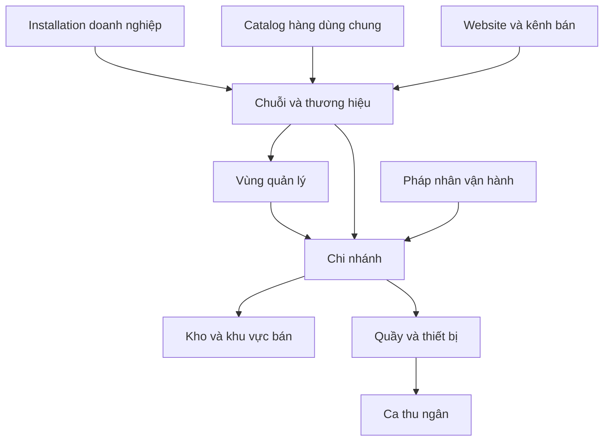

# Đặc tả sản phẩm Retail POS cho chuỗi siêu thị và cửa hàng tạp hóa

> Phiên bản đặc tả: `0.1.0` · Cập nhật: `2026-10-20`.
> Trạng thái: **Đặc tả mục tiêu**. Đã bắt đầu triển khai bản development; xem [tiến độ và bằng chứng kiểm thử](retail-pos-implementation-status.md) để biết phạm vi thực tế.
> App: **Quản lý siêu thị và cửa hàng tạp hóa** · Module key: `retail-pos`.

Retail POS phục vụ bán hàng tại quầy và điều hành chuỗi: hàng hóa, giá, mua hàng, tồn kho, tiền quầy, đổi trả và báo cáo. Một installation AIO phục vụ một doanh nghiệp triển khai riêng, có thể gồm nhiều chuỗi và chi nhánh. Hàng hóa được chuẩn hóa dùng chung; quyền, tồn kho và tiền được kiểm soát theo đúng đơn vị vận hành.

Đọc cùng [kiến trúc và contract tích hợp](retail-pos-architecture-and-integration.md), [kế hoạch triển khai](retail-pos-implementation-plan.md) và [contract runtime](../api/retail-pos-runtime-contract.md). Đặc tả này xác định hành vi sản phẩm; tài liệu kiến trúc xác định quyền sở hữu dữ liệu và giao dịch; kế hoạch xác định thứ tự công việc và bằng chứng cần có trước phát hành. Sự hiện diện của một yêu cầu trong tài liệu không đồng nghĩa đã nghiệm thu.

## 1. Mục tiêu và phạm vi phát hành

### 1.1. Mục tiêu vận hành

- Thu ngân quét hàng và thu tiền nhanh, xử lý được giỏ lớn và thao tác bằng bàn phím.
- Nhập thùng, bán lốc/lẻ hoặc cân ký nhưng sử dụng cùng một lượng tồn cơ sở chính xác.
- HQ quản lý chính sách toàn chuỗi; từng cửa hàng nhận đúng hàng, giá và quyền.
- Truy được mọi chênh lệch hàng, tiền, điều chuyển, trả hàng và khuyến mại tới giao dịch nguồn.
- Tận dụng Core AIO và Inventory; kết nối các module khác theo capability, không tạo thêm một sổ tồn cạnh tranh.
- Hoạt động nhiều quầy và phục hồi sau lỗi mạng mà không bán, thu hoặc xuất kho trùng.

### 1.2. Các mức phạm vi

| Mức | Nội dung | Điều kiện phát hành |
| --- | --- | --- |
| P0 | Hàng hóa, POS, thanh toán, ca, mua/nhận hàng cơ bản, kho, điều chuyển, kiểm kê, đổi trả, quyền, báo cáo cốt lõi | Hoàn thành trước pilot vận hành thật G4 |
| P0 theo loại hàng | Quy đổi đóng gói; hàng cân; lô/hạn; tem cân; truy xuất lô | Bắt buộc nếu chi nhánh pilot bán nhóm hàng tương ứng |
| P0 về vận hành | Khôi phục giao dịch, chống thu trùng, offline tiền mặt có giới hạn, sao lưu/khôi phục và giám sát | G4 kiểm chứng trên thiết bị và nhiều quầy thực tế |
| P1 | HQ/vùng nâng cao, loyalty, khuyến mại phức tạp, bổ sung hàng, đổi trả khác chi nhánh cùng pháp nhân | G5 theo từng increment |
| P2 | Đa kênh đầy đủ, dự báo, nhượng quyền, tự thanh toán, nhiều provider/thiết bị nâng cao | Workstream riêng sau baseline ổn định |

G0 là thiết kế; G1 là nền tảng dùng chung; G2 là luồng online nội bộ; G3 là nghiệp vụ chuỗi và UAT nội bộ; G4 là offline có giới hạn và pilot 2–3 chi nhánh; G5 là mở rộng. G2/G3 không phải cam kết đã đủ điều kiện chạy production.

### 1.3. Những phần không nằm trong baseline

Không xây lại tiền lương, kế toán tổng hợp hay nền tảng phát hành hóa đơn điện tử trong Retail. Franchise có đối soát thương mại riêng, bán ký gửi, sản xuất/chế biến, self-checkout và thu thẻ offline chưa nằm trong pilot. Quầy có thể bán hàng đóng gói hoặc hàng cân; đóng gói/chia tách có biến đổi nguyên liệu cần chứng từ chuyển đổi riêng ở giai đoạn sau.

## 2. Căn cứ từ AIO và quyết định sử dụng lại

Baseline source ngày 2026-10-20:

| Thành phần | Nền tảng đang có | Khoảng thiếu cần giải quyết |
| --- | --- | --- |
| Core AIO | Auth, RBAC, audit, module lifecycle, capability, queue | Membership chi nhánh, quyền Retail, kiểm tra scope cho tác vụ nền |
| Catalog `0.2.1` | Danh mục và sản phẩm website | Product master đang theo `website_key`; chưa là master hàng toàn chuỗi |
| Inventory `0.2.0` | Kho/vị trí, lô, ledger, cost layer | Một barcode/unit; tính toán có `float`; chuyển kho tức thời; phiếu tạo là posted; reservation và workflow cần hoàn thiện |
| AccountingTax `0.2.0` | Pháp nhân, chứng từ, thu/hoàn, xuất báo cáo | Cần adapter Retail; chứng từ kế toán không thay thế đơn mua/nhận hàng |
| MinvoiceConnector `0.2.0` | Connection, outbox, safety gate, reconcile | Kết nối thực tế phải qua readiness và kiểm chứng provider |
| HRM/Payroll | Hồ sơ nhân sự và lương | Liên kết nhân sự tùy chọn, không quyết định quyền bán hàng thay RBAC |
| F&B POS | Pattern command, idempotency, version, approval, ca, outbox | Tham khảo cơ chế; không dùng session/KDS/check F&B làm mô hình Retail |

Các file neo: [CatalogProduct](../../app/Models/CatalogProduct.php), [InvItem](../../app/Models/InvItem.php), [InventoryStockService](../../app/Support/InventoryStockService.php), [InventoryAvailabilityResolver](../../app/Support/InventoryAvailabilityResolver.php), [InventoryProductSyncService](../../app/Support/InventoryProductSyncService.php), [ModuleCapabilityChecker](../../app/Core/Modules/ModuleCapabilityChecker.php). Nhãn `avg` và cột `quantity_reserved` hiện có không chứng minh đã có đầy đủ thuật toán giá vốn bình quân hay reservation.

Quyết định mục tiêu:

1. Tạo `retail-pos` cho nghiệp vụ bán lẻ và `merchandise` cho master hàng dùng chung. `merchandise` là module mới, không coi là thành phần đã có.
2. Nâng cấp Inventory để cung cấp contract v2 và là nguồn tồn chính thức. Retail yêu cầu Merchandise và Inventory v2; không phụ thuộc F&B.
3. Tạo `purchasing` dùng chung cho nhà cung cấp/đơn mua/nhận và trả hàng. POS có thể cài không có Purchasing, nhưng pilot đầy đủ phải có module này.
4. CMS/Catalog là kênh xuất bản tùy chọn. AccountingTax, Minvoice, HRM và Payroll là tích hợp tùy chọn.
5. Tháo dependency/FK lịch sử Inventory → CMS/Catalog bằng migration tiến tới và adapter tương thích; chỉ bỏ dependency sau khi fresh-install và regression cũ đạt gate G1.

## 3. Tổ chức chuỗi và quyền sở hữu dữ liệu

### 3.1. Mô hình tổ chức

Vùng là tùy chọn. Kho trung tâm có đơn vị sở hữu rõ ràng dù không có quầy. Mỗi chi nhánh có một pháp nhân vận hành hiệu lực tại một thời điểm; giao dịch giữ snapshot pháp nhân, không thay đổi theo việc tái cấu trúc sau này. Catalog hàng có thể dùng cho nhiều chuỗi khi được gắn tường minh; hàng tồn luôn có chủ sở hữu pháp lý.

Retail lưu định danh pháp nhân tối thiểu phục vụ vận hành. Khi AccountingTax được kết nối, mapping pháp nhân phải rõ một–một trong phạm vi sử dụng và đối chiếu thông tin trước khi đồng bộ. Không cần cài Accounting để cấu hình cửa hàng. Một website có thể phục vụ nhiều chi nhánh; một chi nhánh có thể nhận đơn từ nhiều kênh theo mapping được duyệt.

### 3.2. Yêu cầu tổ chức

| ID | Yêu cầu | Mức |
| --- | --- | --- |
| RET-ORG-01 | CRUD chuỗi, vùng, chi nhánh, kho được gắn, quầy, thiết bị; mã nghiệp vụ unique trong phạm vi và public ID UUID | P0 |
| RET-ORG-02 | Chi nhánh có timezone, business day, giờ chốt, pháp nhân, kho xuất mặc định và trạng thái hoạt động | P0 |
| RET-ORG-03 | Đổi kho/pháp nhân/quầy dùng hiệu lực và audit; không đổi ownership của chứng từ đã chốt | P0 |
| RET-ORG-04 | HQ công bố assortment, giá và chương trình theo nhóm cửa hàng; thấy phiên bản từng quầy đã nhận | P0 cơ bản, P1 nâng cao |
| RET-ORG-05 | Đóng chi nhánh có bước drain: đơn chưa kết thúc, tiền chưa đối soát, hàng đi đường và offline chưa đồng bộ phải được giải quyết | P0 |

### 3.3. Vai trò và giới hạn

| Vai trò | Quyền nghiệp vụ | Giới hạn mặc định |
| --- | --- | --- |
| HQ | Danh mục, giá, mua hàng, điều phối, báo cáo chuỗi | Trong chuỗi được giao; không tự cấp quyền platform |
| Quản lý vùng | Xem và duyệt trong vùng | Không tự thêm chi nhánh vào phạm vi mình |
| Quản lý cửa hàng | Ca/quầy, nhận hàng, ngoại lệ, kiểm kê | Chi nhánh được gán, hạn mức được duyệt |
| Thu ngân | POS, thu tiền, tra đơn | Không xem giá vốn, tự sửa giá hoặc tự duyệt hoàn vượt hạn mức |
| Kho/mua hàng | PO, nhận/xuất, kiểm kê, lô | Chỉ kho và loại chứng từ được phân công |
| Kế toán/kiểm soát | Đối soát, công nợ, kiểm tra | Quyền chứng từ và pháp nhân của module đích vẫn được kiểm riêng |

Core RBAC giữ `global|website|organization` hiện hành. Retail thêm membership/preset cho chuỗi/vùng/chi nhánh/quầy ở lớp domain, không thêm scope `branch` vào core. Cần đồng thời có permission module và membership hợp lệ. `organization` của core tiếp tục chỉ dành cho AccountingTax/Minvoice theo contract hiện tại.

## 4. Hàng hóa và quy cách

| ID | Yêu cầu và quy tắc | Mức |
| --- | --- | --- |
| RET-MDM-01 | Merchandise là master catalog, sản phẩm/biến thể/SKU, nhóm/nhãn hiệu, đơn vị gốc, tracking policy. SKU unique theo catalog; không tự merge theo tên | P0 |
| RET-MDM-02 | Nhiều barcode cho một biến thể/quy cách; giữ số 0 đầu, checksum theo loại mã, unique theo namespace đã chọn, cảnh báo xung đột khi import | P0 |
| RET-MDM-03 | Thùng/lốc/cái quy đổi bằng tỷ lệ chính xác, chỉ cùng chiều đo; thay tỷ lệ tạo phiên bản mới, chứng từ cũ giữ tỷ lệ cũ | P0 |
| RET-MDM-04 | Kg/lít hỗ trợ số lượng lẻ, PLU, tem cân chứa trọng lượng hoặc giá; cấu hình parser và độ chính xác theo thiết bị | P0 có điều kiện |
| RET-MDM-05 | Import có preview, lỗi từng dòng, phát hiện trùng, dry-run và mapping được duyệt; không ghi đè ledger từ file hàng hóa | P0 |
| RET-MDM-06 | Assortment và min/max theo chi nhánh; ngừng bán khác với xóa master. Hàng đã phát sinh giao dịch chỉ archive | P0 |
| RET-MDM-07 | Đồng bộ sang Catalog theo mapping ID và phiên bản; không để sửa giá/tồn website làm thay dữ liệu Retail ngoài quy trình | P1 |

Ví dụ nghiệm thu: một thùng 24 lon, một lốc 6 lon; nhận 2 thùng và bán 1 lốc + 3 lon phải còn 39 lon. Nhận 10 kg, bán 0,375 kg và trả 0,125 kg hợp lệ phải còn 9,750 kg. Giá vốn và thuế được tính theo các snapshot quy đổi của từng giao dịch.

Barcode EAN/UPC thông thường nhận diện hàng; dữ liệu cân/lô/hạn chỉ có khi loại mã hoặc tem hỗ trợ. Không suy ra được lô vật lý từ một mã chỉ có GTIN. Với nhiều lô trên cùng kệ, FEFO là đề xuất phân bổ; truy xuất chính xác từng món yêu cầu quét tem lô hoặc quy trình tách kệ/đếm được thực hiện. Không tuyên bố chặn mọi món hết hạn nếu quầy không thu nhận được lô thực tế.

## 5. Bán hàng tại quầy

| ID | Yêu cầu và hành vi | Mức |
| --- | --- | --- |
| RET-POS-01 | Quét liên tiếp, tìm theo SKU/barcode/tên, phím tắt, sửa số lượng có quyền, hiển thị đơn vị/quy cách và tổng tiền tức thời | P0 |
| RET-POS-02 | Giữ/khôi phục giỏ, chuyển người xử lý có audit; giữ giỏ không mặc nhiên giữ tồn vô thời hạn | P0 |
| RET-POS-03 | Trước thu tiền phải xác nhận giá/khuyến mại, tồn bán được, ca, quầy và quyền; chênh lệch so với giỏ cũ phải hiển thị | P0 |
| RET-POS-04 | Đơn hoàn tất có số đơn, pháp nhân/chi nhánh/quầy/ca, hàng, quy đổi, giá, thuế, khuyến mại, payment allocation và cost status bất biến | P0 |
| RET-POS-05 | In bill, in lại đánh dấu, gửi bill theo lựa chọn khách; lỗi máy in không làm thu tiền lại. Bill bán lẻ và hóa đơn điện tử có trạng thái riêng | P0 |
| RET-POS-06 | Đơn nhiều dòng có phân trang/lazy render hợp lý; giỏ chưa thanh toán không bị mất do lỗi render hoặc reload có thể phục hồi | P0 |

Trạng thái sale mục tiêu: `draft → priced → awaiting_payment → completed`. `cancelled` chỉ hợp lệ khi không còn tiền đã thu/không rõ kết quả và đã giải phóng reservation đúng quy tắc. `exception` biểu diễn trường hợp đã có tiền xác nhận nhưng chưa hoàn tất hàng/chứng từ; trạng thái này phải được đối soát, không đổi thành thất bại thông thường để thu lại.

Một đơn đang chờ thanh toán khóa snapshot giá và giữ tồn có thời hạn. Nếu cần sửa giỏ, phải giải quyết payment intent cũ rồi tạo revision mới. Không tự đổi số tiền khi provider đang xử lý.

## 6. Giá và khuyến mại

| ID | Yêu cầu và quy tắc | Mức |
| --- | --- | --- |
| RET-PRICE-01 | Bảng giá theo chi nhánh/nhóm/đơn vị bán, tiền tệ, thời gian; thứ tự ưu tiên và xử lý trùng hiệu lực xác định rõ | P0 |
| RET-PRICE-02 | Giảm tiền/% theo dòng hoặc đơn có hạn mức; không cho tổng âm; sửa giá thủ công cần lý do, quyền và người duyệt khi vượt ngưỡng | P0 |
| RET-PRICE-03 | Mua X tặng Y, combo, giá hội viên, coupon: ưu tiên/cộng dồn/loại trừ, ngân sách và giới hạn dùng có quy tắc nhất quán | P1 |
| RET-PRICE-04 | Phân bổ giảm giá/quà/thuế về từng dòng bằng thuật toán xác định; tổng dòng bằng tổng đơn; snapshot phục vụ đổi trả | P0 |
| RET-PRICE-05 | HQ công bố và thu hồi phiên bản; quầy báo trạng thái nhận; tem kệ có ngày/giá/quy cách, danh sách cần in lại khi giá đổi | P0 cơ bản |

Mỗi publication là bất biến, có thời điểm hiệu lực server và timezone rõ ràng. Không áp cùng lúc hai chương trình có semantics chưa xác định. Đổi trả dùng allocation gốc, không chạy lại promotion hiện tại. Với chương trình có quà, quyền lợi hoàn được xác định trên toàn nhóm khuyến mại và các lần trả trước; không cho giữ quà và hoàn vượt số tiền còn được hưởng.

## 7. Mua hàng và công nợ nhà cung cấp

| ID | Yêu cầu và quy tắc | Mức |
| --- | --- | --- |
| RET-PUR-01 | Purchasing quản lý nhà cung cấp, mã hàng NCC, đơn vị mua, giá nhập, lead time, hạn trả và tài liệu đính kèm; không bắt buộc Accounting | P0 |
| RET-PUR-02 | Đề nghị mua → PO draft → submitted → approved → partially_received/received → closed; người duyệt độc lập theo hạn mức | P0 |
| RET-PUR-03 | Nhận từng phần theo thực tế; số lượng thiếu/thừa/hỏng, lô/hạn, hàng tặng; over-receipt ngoài dung sai cần duyệt | P0 |
| RET-PUR-04 | Đối chiếu đơn mua, phiếu nhận và hóa đơn NCC; theo dõi khoản phải trả, ngày đến hạn, thanh toán/ứng trước/phân bổ và số dư | P0 cơ bản, P1 đối chiếu nâng cao |
| RET-PUR-05 | Trả NCC có lineage tới receipt; không xuất vượt tồn phù hợp; giảm công nợ hoặc theo dõi tiền phải nhận lại bằng chứng từ | P0 |
| RET-PUR-06 | Phân bổ chi phí mua và điều chỉnh giá vốn sau nhận bằng sự kiện có revision; không viết lại movement lịch sử | P1 |

Purchasing sở hữu cam kết mua và công nợ vận hành; Inventory sở hữu phiếu và ledger hàng thực nhận/xuất trả. Việc ghi nhận hàng và cập nhật lượng đã nhận trên PO là một giao dịch có idempotency. Accounting nhận bản ánh xạ có kiểm soát, không tự sinh một nghĩa vụ phải trả hoặc payment thứ hai cho cùng nguồn. Chi tiết ownership và chống nhân đôi ở contract tích hợp.

## 8. Tồn kho và điều chuyển

### 8.1. Nguồn tồn và giữ hàng

| ID | Yêu cầu và quy tắc | Mức |
| --- | --- | --- |
| RET-INV-01 | Inventory là ledger tồn duy nhất; phân tách kho/vị trí/biến thể/lô/tình trạng và pháp nhân. Retail không có cột tồn để tự sửa | P0 |
| RET-INV-02 | Reserve/commit/release/expire có identity, deadline và lock; kiểm tra tồn và trừ tồn atomically khi nhiều quầy bán | P0 |
| RET-INV-03 | Phân biệt sellable, reserved, quarantined, damaged, in_transit và lượng đã giao quyền cho gateway; tránh trừ hai lần cùng một lượng | P0 |
| RET-INV-04 | Default không bán âm. Kho sai pháp nhân, mapping thiếu, module/capability không sẵn sàng phải chặn giao dịch cần kho | P0 |
| RET-INV-05 | FIFO triển khai thực; AVG chỉ được bật khi có thuật toán/test và migration dữ liệu tương ứng. FEFO không thay thế phương pháp giá vốn | P0 FIFO, P1 AVG |
| RET-INV-06 | Mọi điều chỉnh có chứng từ, lý do, quyền, duyệt theo hạn mức và lineage; số dư được tái dựng/đối chiếu từ ledger | P0 |

Tồn khả dụng được tính từ các bucket không chồng lấn. Hàng đang vận chuyển không thuộc sellable của kho đích; hàng cách ly/hết hạn không được cấp cho quầy; quota offline đã cấp không được website/central dùng đồng thời. Phương trình và trạng thái bucket do Inventory contract v2 quy định thống nhất.

### 8.2. Điều chuyển chi nhánh

| ID | Yêu cầu và quy tắc | Mức |
| --- | --- | --- |
| RET-TRF-01 | Request → approved → dispatched → partially_received/received → reconciled; có cancelled trước xuất và xử lý bù sau xuất | P0 |
| RET-TRF-02 | Xuất tạo hàng đi đường, chưa tăng tồn bán được ở đích; nhận xác nhận số thực nhận, có thể nhiều lần | P0 |
| RET-TRF-03 | Thiếu/thừa/hỏng, hoàn về nguồn và mất hàng có chứng từ độc lập; người giao không tự xác nhận thay người nhận | P0 |
| RET-TRF-04 | Pilot chỉ chuyển nội bộ cùng pháp nhân; khác pháp nhân cần quy trình mua–bán và chứng từ tương ứng, không giả thành chuyển kho | P0 giới hạn |

## 9. Kiểm kê và hạn sử dụng

| ID | Yêu cầu và quy tắc | Mức |
| --- | --- | --- |
| RET-COUNT-01 | Tạo đợt kiểm kê theo kho/kệ/nhóm; chốt mốc ledger, giao người đếm, nhập/quét số thực tế và đếm lại | P0 |
| RET-COUNT-02 | Pilot khóa chuyển động trong phạm vi kiểm kê khi chốt; giao dịch đã giữ tồn/edge quota phải drain hoặc được loại rõ khỏi phạm vi | P0 |
| RET-COUNT-03 | Chênh lệch có giải trình và người khác duyệt; post một lần bằng chứng từ adjustment, không ghi thẳng số dư | P0 |
| RET-COUNT-04 | Kiểm kê luân phiên khi vẫn bán cần bù movement từ mốc đếm và test riêng; không trộn số đếm ở các thời điểm tùy ý | P1 |
| RET-EXP-01 | Tracking lô/hạn bật theo SKU; nhận hàng kiểm hạn còn lại tối thiểu; định nghĩa expiry/best-before rõ trong cấu hình | P0 theo loại hàng |
| RET-EXP-02 | Cảnh báo theo mốc cấu hình, đề xuất FEFO; chặn lô expired/quarantined khi đã nhận diện được lô; nêu rõ giới hạn quét GTIN | P0 theo loại hàng |
| RET-EXP-03 | Thu hồi lô: khóa bán/cấp quota, tìm receipt/transfer/sale liên quan, theo dõi hàng thu hồi/cách ly/hủy và bằng chứng | P0 cơ bản |
| RET-EXP-04 | Giảm giá cận hạn có publication và quyền riêng, không tự đổi hạn/nhãn để bán hàng hết hạn | P1 |

Thời điểm hết hạn dựa trên quy tắc sản phẩm và timezone chi nhánh. Gateway offline áp dụng thời gian tin cậy và lịch recall đã nhận; recall mới từ HQ không thể được nhận tức thời khi mất WAN. Với nhóm hàng yêu cầu kiểm tra recall trực tuyến, tắt quyền bán offline; gateway khác chỉ được bán trong thời hạn ủy quyền hữu hạn và phải dừng khi hết hạn.

## 10. Đổi trả và hoàn tiền

| ID | Yêu cầu và quy tắc | Mức |
| --- | --- | --- |
| RET-RET-01 | Trả gắn sale line gốc, số lượng quy đổi gốc, giá/thuế/discount allocation gốc; tổng đã trả không vượt lượng/tiền còn được trả | P0 |
| RET-RET-02 | Phân loại restock/quarantine/damaged; hàng trả và refund là hai ledger có lineage, không phải refund nào cũng tăng tồn bán được | P0 |
| RET-RET-03 | Refund nhiều lần và nhiều phương thức phải kiểm cumulative limit, provider status và refund intent đang unresolved | P0 |
| RET-RET-04 | Exchange là return và sale mới liên kết, thu thêm/hoàn chênh lệch rõ ràng. Không sửa sale nguồn | P0 |
| RET-RET-05 | Trả khác chi nhánh chỉ khi cùng pháp nhân và policy cho phép, có đối soát tiền/hàng hai bên; trả không có đơn cần workflow ngoại lệ riêng | P1 |

Return: `draft → approved → posted → completed`; có `rejected/cancelled` trước post. `posted` ghi nhận nghĩa vụ và tình trạng hàng; `completed` chỉ khi các dòng nhận/trả và refund cần thiết đã kết thúc. Refund `pending/unknown/failed` giữ nghĩa vụ còn lại, không làm mất quyền lợi khách hoặc tạo yêu cầu thu/hoàn mới ngoài kiểm soát.

Với bill có thuế/chiết khấu và làm tròn, các lần trả một phần phải phân bổ phần dư có thứ tự xác định, để khi trả toàn bộ thì tổng tiền và thuế đảo đúng số gốc. Chứng từ hoàn giữ revision tính toán, mã lý do và người duyệt.

## 11. Thanh toán và quản lý ca

### 11.1. Thanh toán

| ID | Yêu cầu và quy tắc | Mức |
| --- | --- | --- |
| RET-PAY-01 | Cash, chuyển khoản, thẻ và mixed tender; phân biệt tiền khách đưa, applied amount và tiền thừa; tổng applied bằng amount due khi completed | P0 |
| RET-PAY-02 | Payment intent có pending/confirmed/failed/unknown; chỉ server/provider evidence hoặc thao tác operator được cấp quyền mới xác nhận | P0 |
| RET-PAY-03 | Trước yêu cầu thu ngoài hệ thống phải có reservation; kết quả uncertain phải reconcile theo operation key trước khi retry | P0 |
| RET-PAY-04 | Sale completed + commit tồn + ledger thu nội bộ + outbox cùng transaction online. Provider/cash vật lý không thể rollback bằng DB, cần xử lý ngoại lệ riêng | P0 |
| RET-PAY-05 | Phí provider, hoàn tiền và đối soát ngân hàng riêng với doanh thu. QR tạo ra/in ra không tự chuyển payment thành confirmed | P0 |
| RET-PAY-06 | Bill và yêu cầu hóa đơn điện tử tách trạng thái; provider lỗi giữ hàng đợi xử lý và cảnh báo, không thu lại đơn | P0 khi tích hợp |

Nếu provider đã xác nhận tiền nhưng commit nội bộ thất bại, chuyển hồ sơ sang đối soát `funds_received/stock_attention`; giữ reservation hoặc khóa xử lý có ownership, không expire mù. Operator được hướng dẫn hoàn tất một lần hoặc hoàn tiền có kiểm soát. Với mixed tender, tiền đã thu ở phương thức trước được giữ trong hồ sơ thanh toán; phương thức sau thất bại không được đánh dấu cả đơn là chưa thu.

### 11.2. Ca và tiền quầy

| ID | Yêu cầu và quy tắc | Mức |
| --- | --- | --- |
| RET-SHIFT-01 | Mở ca theo quầy/thu ngân và business day, tiền đầu ca, bàn giao có người nhận; một drawer chỉ có một ca tài chính active theo policy | P0 |
| RET-SHIFT-02 | Thu/chi, rút/nộp két có loại giao dịch và bằng chứng; không dùng sửa sale để điều chỉnh quỹ | P0 |
| RET-SHIFT-03 | Cuối ca kiểm đếm theo phương thức/mệnh giá; giữ số hệ thống và số thực đếm riêng, ghi chênh lệch và người duyệt | P0 |
| RET-SHIFT-04 | Chặn khóa ca khi có payment/refund uncertain, command chưa rõ kết quả hoặc gateway chưa đồng bộ; đóng quầy tạm khác với khóa sổ ca | P0 |
| RET-SHIFT-05 | Giao dịch đến muộn giữ business day nguồn và thời điểm đồng bộ; điều chỉnh ca đã khóa bằng chứng từ kỳ sau có lineage | P0 |

## 12. Khách hàng và báo cáo

| ID | Yêu cầu và quy tắc | Mức |
| --- | --- | --- |
| RET-CRM-01 | Khách lẻ không bắt buộc thông tin cá nhân; hồ sơ thành viên có quyền, masking, lịch sử và lựa chọn nhận liên hệ | P0 |
| RET-CRM-02 | Điểm có ledger earn/redeem/expire/reverse; chỉ ghi điểm từ sale hoàn tất, trả hàng đảo theo quyền lợi gốc | P1 |
| RET-CRM-03 | Bán chịu có hạn mức, người duyệt, kỳ hạn, sổ phải thu và payment allocation; không xem khoản nợ là tiền quầy đã thu | P1 bật theo cửa hàng |
| RET-CRM-04 | Gift card/ví/coupon một lần có ledger riêng và bảo vệ double spend; pilot offline không cho đổi điểm/ví/voucher dùng một lần | P1 |
| RET-RPT-01 | Doanh thu thuần, giảm giá, trả hàng, thuế, tender, doanh thu theo ngày/quầy/chi nhánh/nhân viên; dictionary chỉ tiêu thống nhất | P0 |
| RET-RPT-02 | Tồn và tuổi tồn, hàng bán chậm, gần hết hạn, chênh lệch kiểm kê, hàng đi đường và tỷ lệ hao hụt | P0 |
| RET-RPT-03 | Giá vốn/lãi gộp có trạng thái provisional/final; chỉ báo lợi nhuận khi đã có phạm vi chi phí tương ứng | P0 |
| RET-RPT-04 | Báo cáo công nợ NCC/khách, ca lệch, ngoại lệ payment và đồng bộ; hỗ trợ drill-down về chứng từ | P0 theo capability |
| RET-RPT-05 | HQ so sánh cửa hàng, bổ sung hàng theo min/max và lead time; export lớn chạy job, có quyền/scope và lịch sử | P1 |

Dictionary tối thiểu: gross sales theo giá trước giảm; net sales sau giảm và trả, với cách trình bày thuế được ghi rõ; gross margin = net sales không gồm thuế đầu ra tương ứng − COGS cùng phạm vi; cash variance = thực kiểm đếm − hệ thống. Không cộng chuyển kho vào doanh thu chuỗi. Báo cáo có `as_of`, business timezone và thời điểm dữ liệu offline đã nhận; không gắn nhãn thời gian thực khi còn chi nhánh chưa đồng bộ.

## 13. Bảo mật và kiểm soát nghiệp vụ

| ID | Yêu cầu và quy tắc | Mức |
| --- | --- | --- |
| RET-SEC-01 | Mọi read/write/export kiểm permission và chain/branch/warehouse/legal owner server-side; không tin branch/actor từ body hoặc localStorage | P0 |
| RET-SEC-02 | Role preset HQ/vùng/manager/cashier/stock/finance; giảm giá, hoàn, hủy, xem giá vốn/PII là quyền riêng | P0 |
| RET-SEC-03 | Approval độc lập, có expiry, hạn mức, ràng buộc command/payload/version; không dùng approval cho giao dịch khác | P0 |
| RET-SEC-04 | Audit append-only và chain theo convention core; chứa request/command ID và dữ liệu đã che, không lưu PAN/CVV, token hoặc PII thừa | P0 |
| RET-SEC-05 | Worker kiểm capability, quyền hiện hành/standing grant, auth_version và mapping trước tác dụng; quyền Retail không tự cấp quyền Inventory/Accounting | P0 |
| RET-SEC-06 | Disable/drain chặn ca/command/payment/quota còn hoạt động; giữ ledger/schema. Không uninstall dữ liệu giao dịch đã post | P0 |

Thao tác đã hoàn tất không sửa/xóa để che lịch sử. System Owner vẫn đi qua invariant nghiệp vụ, trạng thái module và kiểm scope như contract capability; quyền quản trị không là đường tắt bỏ qua kiểm tồn hoặc tổng tiền.

## 14. Offline và thiết bị

### 14.1. Hai chế độ phải hiển thị rõ

| Chế độ | Hành vi | Giới hạn |
| --- | --- | --- |
| Online có khôi phục | Trung tâm là authority, command có idempotency, giỏ phục hồi, hiển thị kết quả uncertain | Mất WAN hoàn toàn chỉ tra cache/giữ giỏ; không quảng bá là bán offline |
| Cửa hàng bán offline | Gateway cửa hàng lưu bền vững và điều phối các quầy bằng quyền/quota đã cấp | Cash trong giới hạn; giá/quyền có hạn; central không tiêu cùng quota |

Gateway là workstream mới, không phải thành phần đang có của AIO. Chuyển authority cần epoch/fencing và bàn giao có đối soát. Hết thời gian ủy quyền thì gateway dừng cấp giao dịch mới; trung tâm vẫn không tự lấy lại quota chỉ vì timeout. Cần chứng minh gateway đã bị fence và đã reconcile trước khi tái cấp lượng đó.

### 14.2. Yêu cầu offline

| ID | Yêu cầu và quy tắc | Mức |
| --- | --- | --- |
| RET-OFF-01 | Gateway giữ catalog/price publication, membership grant hữu hạn, quota và command journal bền vững; chỉ ACK sau durable commit | P0 G4 |
| RET-OFF-02 | Cash offline có giới hạn thời gian/giá trị/quota/thiết bị/nhân viên; không bán âm hoặc tự cấp thêm tồn từ browser | P0 G4 |
| RET-OFF-03 | Tất cả quầy cùng cửa hàng đi qua một authority; epoch chặn writer cũ; không vừa central vừa edge tự trừ cùng hàng | P0 G4 |
| RET-OFF-04 | Sync theo identity và thứ tự phụ thuộc, replay giữ kết quả, phát hiện gap/duplicate/conflict; không tự last-write-wins cho tiền/tồn | P0 G4 |
| RET-OFF-05 | Mất điện/restart gateway không mất giao dịch đã ACK trong phạm vi đĩa bền vững; mất/hỏng đĩa có quy trình sự cố riêng và đối chiếu bill/tiền | P0 G4 |
| RET-OFF-06 | Không redeem điểm/ví, đổi trả liên chi nhánh, sửa policy HQ hoặc thu thẻ offline trong pilot; manual transfer không giả thành provider-confirmed | P0 giới hạn |
| RET-OFF-07 | Grant offline có thời hạn tối đa một ca và hard cap thời gian cấu hình; thiết bị đồng hồ sai hoặc journal/quota lỗi phải chặn bán | P0 G4 |

Khóa tài khoản/recall mới tại HQ có thể chưa tới gateway mất WAN; giới hạn grant và nhóm hàng được bán offline là biện pháp ràng buộc bắt buộc. Không cho phép tự kéo dài grant cũ tại cửa hàng. G0 chốt giá trị cap theo rủi ro pilot; G4 phải chứng minh thực thi bằng test thay đổi giờ, restart và revocation.

### 14.3. Thiết bị

Pilot có danh sách model đã kiểm chứng cho máy quét, in bill 80 mm, ngăn kéo tiền và máy in tem. Cân điện tử/tem cân là bắt buộc nếu pilot bán hàng cân; công bố parser, chuẩn kết nối và quy tắc tare/độ chính xác. Adapter local và quyền hệ điều hành được quản lý riêng; một browser chạy được UI không chứng minh mọi máy in/cân đều tương thích. Mobile dùng cho nhận hàng/kiểm kê; native app và self-checkout là phạm vi sau.

## 15. Tích hợp và tính liên tục

| ID | Yêu cầu và quy tắc | Mức |
| --- | --- | --- |
| RET-INT-01 | Enable Retail yêu cầu Merchandise và Inventory đúng capability/version; mất Inventory chặn finalization, không fallback sang Catalog.stock | P0 |
| RET-INT-02 | Purchasing nhận/post đồng bộ với Inventory trong cùng DB transaction; Accounting/Minvoice và notification qua outbox có retry/reconcile | P0 |
| RET-INT-03 | Accounting nhận internal draft theo source ID duy nhất; luật approve/post/tax của module đích giữ nguyên; Retail không tự phát hành tax invoice | P0 khi tích hợp |
| RET-INT-04 | CMS/Catalog là projection kênh; đơn đa kênh dùng cùng Inventory reservation và warehouse mapping có quyền | P1/P2 |
| RET-INT-05 | HRM liên kết admin/employee tùy chọn; disable không làm mất identity Retail; Payroll tự xử lý kỳ lương từ facts có contract | P1 |
| RET-INT-06 | Optional module disabled làm adapter unavailable, giữ hàng đợi có trạng thái; bật lại phải revalidate, không tự cấp quyền hoặc gửi mạng | P0 |

Các action pháp lý của hóa đơn, provider và tỷ lệ thuế dùng cấu hình/hợp đồng đã được xác minh cho deployment. Không hardcode tỷ lệ, threshold hay suy diễn một bill Retail là hóa đơn hợp lệ. Profile cần hóa đơn trước khi bàn giao phải có connector readiness trong gate pilot của profile đó.

## 16. Yêu cầu phi chức năng và UI

| ID | Yêu cầu | Mốc kiểm chứng |
| --- | --- | --- |
| RET-NFR-01 | Target benchmark: 50 chi nhánh × 5 terminal, 50.000 SKU active/catalog, 5 triệu sale line lịch sử; phân bố/tải ghi ghi rõ trong kịch bản | G1 thiết kế, G4 đo; chưa phải năng lực đã chứng minh |
| RET-NFR-02 | Target P95 scan lookup local <200 ms, search server <500 ms, finalize online <2 s không gồm chờ provider; theo bộ tải và phần cứng ghi nhận | G4 |
| RET-NFR-03 | Idempotency/version/lock theo aggregate; 0 thu trùng, xuất trùng, hoàn vượt hoặc giao dịch committed bị mất trong bài test lỗi | G2–G4 |
| RET-NFR-04 | VND ở pilot; amount minor unit là số nguyên chính xác, quantity decimal string tối đa 6 số lẻ; unit cost/price độ chính xác cao trước khi làm tròn | G1–G4 |
| RET-NFR-05 | RPO giao dịch central đã ACK là 0 trong phạm vi primary commit bền vững; DR đề xuất RPO ≤15 phút, RTO ≤4 giờ theo topology đã thử restore | G4; hai phạm vi sự cố khác nhau |
| RET-NFR-06 | Metric và alert về pending/unknown payment, outbox lag, edge lag/quota, inventory mismatch, ca lệch, thiết bị lỗi, backup thất bại | G3–G4 |
| RET-NFR-07 | UI tiếng Việt, tối ưu bàn phím/touch, trạng thái mất mạng/đồng bộ rõ; POS riêng với workspace backoffice, drawer cho form phù hợp pattern AIO | G2–G4 |
| RET-NFR-08 | Import/export/print có scope, chống formula injection, URL/artifact có kiểm quyền; report lớn dùng queue và pagination | G3–G5 |

Tiền trong API vận chuyển bằng chuỗi integer minor unit khi có nguy cơ vượt giới hạn số chính xác JavaScript. Số lượng/quy đổi/unit price/tax dùng decimal/rational xác định, không dùng `float` trong domain. G0 chốt rounding mode, điểm làm tròn theo dòng/đơn và phân bổ remainder; ghi phiên bản vào snapshot. Điều chỉnh unit cost có precision cao không làm mất giá trị khi nhân số lượng lẻ.

UI backoffice gồm Tổng quan, Chi nhánh/quầy, Hàng hóa, Giá/khuyến mại, Mua hàng, Kho/điều chuyển, Kiểm kê, Lô/hạn, Khách hàng, Đổi trả, Ca/tiền, Báo cáo, Tích hợp và Cấu hình. Menu phụ thuộc capability và quyền; thiếu quyền phải bị chặn ở API ngay cả khi UI đã ẩn nút. Màn POS ưu tiên giỏ, ô quét luôn sẵn sàng, tổng tiền dễ đọc và kết quả thu tiền không mơ hồ.

## 17. Tình huống nghiệm thu sản phẩm

Các test chi tiết và phase owner nằm trong kế hoạch. Những tình huống sau bắt buộc có fixture và bằng chứng:

1. Quy đổi thùng/lốc/lẻ và kg như ví dụ mục 4 cho đúng tồn, giá, thuế và tiền hoàn.
2. Hai quầy cùng mua món cuối: chỉ lượng hợp lệ được commit; request còn lại nhận conflict có thể xử lý.
3. Server commit rồi mất response: retry cùng key trả cùng sale/payment/stock identity.
4. Provider nhận tiền rồi timeout: reconcile không thu lại; thiếu hàng tạo exception và phương án xử lý.
5. Mixed tender thu cash xong card thất bại: tiền cash và nghĩa vụ còn lại được giữ đúng.
6. Chuyển 10, nhận 8, hỏng 1, còn đi đường 1: đối soát được cả 10, không tự cộng đủ vào đích.
7. Trả một phần bill đã giảm giá và có quà nhiều lần: không hoàn quá lượng/tiền/thuế còn được phép.
8. Nhân viên chi nhánh A không đọc/sửa/export dữ liệu B bằng đổi URL/header/body; worker quyền cũ bị thu hồi không tiếp tục post.
9. Hàng hết hạn/cách ly không được cấp cho sale theo thông tin lô thực thu nhận; mã chỉ GTIN phải có policy hạn chế truy xuất rõ ràng.
10. Kiểm kê khi có reservation hoặc edge quota: drain hoặc loại phạm vi rõ, không post số dư sai.
11. Mất WAN, hai quầy cash dùng cùng gateway; website không tiêu quota; hết quota/grant dừng đúng; reconnect replay không nhân đôi.
12. Restart gateway sau ACK và central sau commit phục hồi được; restore backup theo target RPO/RTO đo được.
13. Disable Inventory/Retail trong lúc có ca/quota/payment pending bị chặn hoặc drain đúng; không rơi sang nguồn tồn khác.
14. Đóng ca giữ số hệ thống, số đếm và chênh lệch; command chưa rõ kết quả không bị bỏ quên.
15. Fresh production chỉ core → lifecycle cài các module cần thiết → hoàn tất nhiều chi nhánh mà không cần migrate trực tiếp schema module khác.

## 18. Quyết định cần chốt trong giai đoạn G0

| Quyết định | Mặc định thiết kế | Bằng chứng/kết quả cần có trước khi phát triển phụ thuộc |
| --- | --- | --- |
| Nhóm cửa hàng pilot | 2–3 chi nhánh cùng pháp nhân, kho trung tâm, nhiều quầy | Danh mục hàng đóng gói/cân/lô và quy mô dữ liệu mẫu |
| Catalog dùng chung | Merchandise mới, SKU/biến thể canonical; Catalog là kênh | Sơ đồ mapping legacy, báo cáo trùng SKU/barcode và kế hoạch cutover |
| Giá vốn | FIFO ở pilot; giá nhập có provisional/final rõ | Fixture bán/trả/chi phí mua, quy trình sửa chênh lệch bằng sự kiện |
| Offline | Gateway, cash, quota và grant hữu hạn; không đồng thời hai authority | Chọn stack/gateway, chính sách bảo mật, thử split-brain và thu hồi quota |
| Thiết bị | Danh sách model cụ thể | Thử scanner/printer/cân trên OS/browser mục tiêu |
| Thuế và hóa đơn | Cấu hình theo pháp nhân, connector tùy chọn | Contract provider và quy trình vận hành deployment có nhu cầu |
| Khuyến mại pilot | Giảm giá cơ bản, allocation ổn định | Chính sách return và ví dụ làm tròn được thống nhất |
| Quy mô và khả dụng | Bộ target mục 16 để thiết kế và benchmark | Load profile, topology, backup/restore và tiêu chí go/no-go |

Các quyết định được giải quyết trong G0 theo công việc đã lập kế hoạch; không suy từ việc có đặc tả rằng các lựa chọn hạ tầng, thiết bị hay provider đã hoàn tất.

## 19. Tài liệu và tiêu chuẩn tham chiếu

- [AIO bootstrap](../ai-session-bootstrap-prompt.md), [RBAC](admin-access-control.md), [AccountingTax](accounting-tax-module.md), [F&B runtime contract](../api/fnb-pos-runtime-contract.md).
- [GS1 về hàng có lượng biến đổi](https://support.gs1.org/support/solutions/articles/43000734396-what-is-a-variable-measure-trade-item-): mã bán lẻ của nhóm này cần biểu diễn định danh và dữ liệu lượng/giá phù hợp.
- [GS1 về mã 2D tại POS](https://ref.gs1.org/guidelines/2d-in-retail/): lựa chọn mã, dữ liệu bổ sung và tương thích máy quét cần được kiểm chứng theo use case.
- [Shopify về phạm vi offline](https://help.shopify.com/en/manual/sell-in-person/shopify-pos/selling-offline/offline-features): tham chiếu việc xác định ma trận chức năng khi mất mạng; không dùng để suy ra AIO đã có chức năng tương ứng.

Nguồn ngoài được dùng để tham khảo barcode và giới hạn thiết kế offline; yêu cầu Retail/AIO, phase và target hiệu năng trong bộ tài liệu này là thiết kế sản phẩm của AIO.
